# Code Patterns: the Gang of Four

The 22 classic object-oriented design patterns, written for engineers who have to maintain the result and for the people who review the pull request.

All 22 pages are live. Each one comes with runnable code in Java, Python, and TypeScript in [../examples/](../examples/).

## Contents

- [The three families](#the-three-families)
- [How to pick one](#how-to-pick-one)
- [Creational patterns](#creational-patterns)
- [Structural patterns](#structural-patterns)
- [Behavioral patterns](#behavioral-patterns)
- [The pairs people mix up](#the-pairs-people-mix-up)
- [A sensible learning order](#a-sensible-learning-order)
- [Go deeper](#go-deeper)

## The three families

Twenty-two names is a lot to hold. Three families is not. The family tells you which shelf to look on before you remember the pattern's name.

| Family | The question it answers | Count |
|---|---|---|
| **Creational** | How does this object get made, and who decides which concrete type? | 5 |
| **Structural** | How are these objects composed into a bigger thing? | 7 |
| **Behavioral** | How do these objects divide work and talk to each other? | 10 |

Almost every real design problem lands in one family within a sentence. "I keep changing this constructor" is creational. "These two class hierarchies multiply against each other" is structural. "This switch statement grows every sprint" is behavioral.

## How to pick one

```mermaid
flowchart TD
    A[What is hurting?] --> B[Creating objects]
    A --> C[Composing objects]
    A --> D[Behavior between objects]
    B --> B1[One instance, one owner: Singleton]
    B --> B2[Subclass picks the type: Factory Method]
    B --> B3[Families that must match: Abstract Factory]
    B --> B4[Too many constructor arguments: Builder]
    B --> B5[Copy a configured object: Prototype]
    C --> C1[Interfaces do not match: Adapter]
    C --> C2[Two dimensions multiplying: Bridge]
    C --> C3[Trees of things: Composite]
    C --> C4[Add behavior at runtime: Decorator]
    C --> C5[Subsystem is too noisy: Facade]
    C --> C6[Too many objects in memory: Flyweight]
    C --> C7[Control access or cost: Proxy]
    D --> D1[Algorithm should be swappable: Strategy]
    D --> D2[Behavior depends on state: State]
    D --> D3[One change, many listeners: Observer]
    D --> D4[Request as an object: Command]
    D --> D5[Steps fixed, details vary: Template Method]
```

A caution before you use it: the fastest way to write worse code is to reach for a pattern before you have the problem. If you have one implementation and no second one on the roadmap, write the plain version.

## Creational patterns

| Pattern | What it solves | Reach for it when |
|---|---|---|
| [Singleton](creational/singleton.md) | One shared instance, with one place that owns its lifecycle | A resource is genuinely single, like a connection pool. Rarely as often as people use it |
| [Factory Method](creational/factory-method.md) | Let a subclass decide which concrete type to create | A base class must create something, but only the subclass knows which |
| [Abstract Factory](creational/abstract-factory.md) | Create whole families of related objects that must match | Swapping one implementation means swapping five related ones together |
| [Builder](creational/builder.md) | Assemble a complex object step by step | The constructor has grown past four or five arguments, several of them optional |
| [Prototype](creational/prototype.md) | Create a new object by copying a configured one | Setting up a fresh instance is expensive, and you already have a good one |

## Structural patterns

| Pattern | What it solves | Reach for it when |
|---|---|---|
| [Adapter](structural/adapter.md) | Make an incompatible interface fit the one your code expects | You are wrapping a third-party library or a legacy service |
| [Bridge](structural/bridge.md) | Vary an abstraction and its implementation independently | Two dimensions are multiplying into a class explosion |
| [Composite](structural/composite.md) | Treat a single object and a tree of objects the same way | You keep writing "if this is a leaf, else recurse" |
| [Decorator](structural/decorator.md) | Add behavior to one object without touching its class | Behavior stacks: logging, then retry, then metrics, in different combinations |
| [Facade](structural/facade.md) | Hide a complicated subsystem behind one simple entry point | Callers need three lines, not thirty, and you cannot change the subsystem |
| [Flyweight](structural/flyweight.md) | Share the common part of state so many objects fit in memory | You hold millions of near-identical objects |
| [Proxy](structural/proxy.md) | Stand in for another object to control access, cost, or timing | You need lazy loading, access control, caching, or a remote call to look local |

## Behavioral patterns

| Pattern | What it solves | Reach for it when |
|---|---|---|
| [Chain of Responsibility](behavioral/chain-of-responsibility.md) | Pass a request down a line of handlers until one takes it | Middleware, validation stages, or an approval flow |
| [Command](behavioral/command.md) | Turn a request into an object you can queue, log, retry, or undo | You need undo, an audit trail, or deferred execution |
| [Iterator](behavioral/iterator.md) | Walk a collection without exposing how it stores things | You are writing a custom collection. Your language probably gives you this already |
| [Mediator](behavioral/mediator.md) | Route object-to-object talk through one coordinator | Every component knows every other component |
| [Memento](behavioral/memento.md) | Capture and restore state without breaking encapsulation | Undo, checkpoints, or a wizard the user can back out of |
| [Observer](behavioral/observer.md) | Notify many dependents when one object changes | One change, several unrelated reactions, and the source should not know them |
| [State](behavioral/state.md) | Change behavior when internal state changes | A switch on a status field appears in five different methods |
| [Strategy](behavioral/strategy.md) | Swap an algorithm at runtime behind one interface | Pricing rules, sorting, routing, anything with real alternatives |
| [Template Method](behavioral/template-method.md) | Fix the steps of an algorithm, let subclasses fill them in | Every implementation follows the same five steps with two of them different |
| [Visitor](behavioral/visitor.md) | Add a new operation to a class hierarchy without editing it | The hierarchy is stable but the operations keep multiplying |

## The pairs people mix up

Most pattern confusion is not about structure. Two patterns often draw the same diagram and differ only in intent. These are the pairs worth learning as pairs.

| Pair | The difference in one sentence |
|---|---|
| Strategy vs State | Strategy is chosen by the caller, State changes itself as the object moves through a lifecycle |
| Factory Method vs Abstract Factory | Factory Method makes one product through inheritance, Abstract Factory makes a family through composition |
| Decorator vs Proxy | Decorator adds behavior you asked for, Proxy controls access to something you would otherwise call directly |
| Decorator vs Adapter | Decorator keeps the same interface and adds to it, Adapter changes one interface into another |
| Facade vs Adapter | Facade simplifies a subsystem you chose to hide, Adapter reconciles an interface you did not choose |
| Bridge vs Strategy | Bridge is a structural split made once at design time, Strategy is a behavioral swap made at runtime |
| Observer vs Mediator | Observer broadcasts one-to-many, Mediator coordinates many-to-many through a hub |
| Template Method vs Strategy | Template Method varies steps through inheritance, Strategy varies the whole algorithm through composition |
| Composite vs Decorator | Composite gives you a tree of many, Decorator gives you one object wrapped in layers |
| Builder vs Abstract Factory | Builder constructs one complex object in stages, Abstract Factory returns finished related objects |

Each pair gets its own side-by-side page in `decision-guides/`.

## A sensible learning order

Not alphabetical, and not the order the book uses. This is the order the patterns actually show up in working code.

1. **Strategy**, **Factory Method**, **Builder**, **Adapter**, **Observer**. These five cover most of what you will write and read in a normal codebase.
2. **Decorator**, **Facade**, **Proxy**, **Template Method**, **Command**, **State**. The next tier, common in frameworks and infrastructure code.
3. **Composite**, **Chain of Responsibility**, **Abstract Factory**, **Singleton**, **Iterator**, **Mediator**. Situational, and Singleton is here because it is the most overused pattern in the set.
4. **Bridge**, **Flyweight**, **Prototype**, **Memento**, **Visitor**. Specialized. Worth recognizing when you meet them, rarely worth reaching for.

## Go deeper

Every pattern here has a full lesson, with diagrams and worked examples, in [Grokking Design Patterns for Engineers and Managers](https://www.designgurus.io/course/grokking-design-patterns-for-engineers-and-managers?utm_source=github&utm_medium=repo&utm_campaign=design-patterns).

For how patterns are tested in a low-level design round, see [Grokking the Object-Oriented Design Interview](https://www.designgurus.io/course/grokking-the-object-oriented-design-interview?utm_source=github&utm_medium=repo&utm_campaign=design-patterns). For the principles underneath the patterns, see [Grokking SOLID Design Principles](https://www.designgurus.io/course/grokking-solid-design-principles?utm_source=github&utm_medium=repo&utm_campaign=design-patterns).

To add a page, copy [_template.md](_template.md) and follow [CONTRIBUTING.md](../CONTRIBUTING.md).
