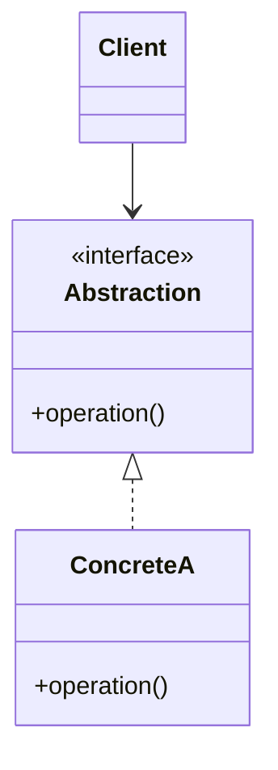

# [Pattern name]

> One line: what this pattern lets you change without breaking everything else.

**Family:** Creational | Structural | Behavioral
**Also called:** [other names, if any]

Note for authors: placeholder paths below are shown as plain text so this template does not fail the link check. In a real page, write them as relative markdown links, for example a link to `../behavioral/strategy.md`.

## The problem

Two or three sentences describing the code you would write *without* this pattern, and what goes wrong as it grows. Be concrete. Name the smell: a switch statement that grows with every new type, a constructor with twelve arguments, a class you cannot test because it builds its own dependencies.

## The idea in one picture

A plain-language analogy in one or two sentences, then the structure.



## How it works

Three or four sentences on the mechanism. Who owns what, what the client sees, and what stays hidden.

## Code

Minimal and runnable. Show the shape, not a framework.

```java
// Java
```

```python
# Python
```

```typescript
// TypeScript
```

Full runnable versions live in `examples/`, one file per language, named the way that language names things: `java/PatternDemo.java`, `python/pattern.py`, `typescript/pattern.ts`. Link to all three from the real page.

## When to use it

- A concrete situation, not a restatement of the pattern.
- Another one. Two or three is enough.

## When not to use it

The section readers come back for. Be direct.

- The case where a plain function, a map, or a language feature is simply better.
- The case where the pattern adds indirection you will never use.
- The threshold: how many variants you need before this earns its cost. Usually the honest answer is three.

## What it costs

| You gain | You pay |
|---|---|
| Benefit | The extra file, indirection, or runtime cost |
| Benefit | The thing a new team member has to learn first |

Name the cost in reader time: how many files someone must open to follow one request end to end.

## Mistakes that show up in code review

- The common wrong implementation, and what it breaks.
- The version that looks like the pattern but is not, for example a Singleton that is really a global variable.
- The thread-safety, mutability, or lifecycle trap specific to this pattern.

## Often confused with

| Looks like | Actual difference |
|---|---|
| Pattern name, linked to `../<family>/<pattern>.md` | The one sentence that separates them, usually intent rather than structure |

## In modern languages

One short note per language where the pattern is partly or fully built in. First-class functions replace Strategy. Decorators are syntax in Python. Interfaces are structural in Go and TypeScript.

## Related

- The pattern that pairs with this one, linked as `../<family>/<pattern>.md`.
- The system-level pattern that solves the same problem one altitude up, if there is one, linked as `../../system-patterns/<group>/<pattern>.md`.

## Go deeper

This pattern is covered lesson by lesson, with diagrams and worked examples, in [Grokking Design Patterns for Engineers and Managers](https://www.designgurus.io/course/grokking-design-patterns-for-engineers-and-managers?utm_source=github&utm_medium=repo&utm_campaign=design-patterns). For how patterns get tested in an object-oriented design round, see [Grokking the Object-Oriented Design Interview](https://www.designgurus.io/course/grokking-the-object-oriented-design-interview?utm_source=github&utm_medium=repo&utm_campaign=design-patterns).
