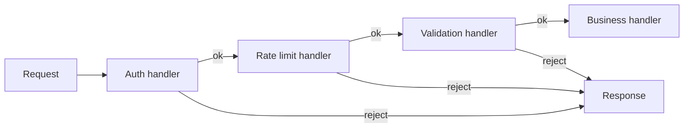

# Chain of Responsibility

> Pass a request along a line of handlers until one of them deals with it.

**Family:** Behavioral
**Also called:** Chain of Command

## The problem

A request has to pass several checks before the real work happens. Authenticate the caller. Check the rate limit. Validate the payload. Check permissions. Then handle it.

Written directly, one method does all five, and it grows every time a rule is added. Worse, the order is buried in the method body, and some callers need only three of the five. You end up with flags, or with four near-identical methods.

## The idea in one picture

An expense claim goes to your manager. Under one thousand, they approve it. Over that, it goes to the director. Over ten thousand, to finance. Each level either handles it or passes it up.



## How it works

Each handler holds a reference to the next one. On receiving a request, a handler either deals with it and stops, or does its part and calls the next. Callers hold only the first handler and know nothing about the rest.

Two variants exist, and mixing them up causes confusion:

- **Pure chain:** exactly one handler deals with the request, and the rest never see it. Approval workflows work this way.
- **Pipeline:** every handler processes the request in turn, and any of them may stop the chain. Web middleware works this way.

Both are this pattern. Say which one you mean.

## Code

```java
abstract class Handler {
    private Handler next;

    Handler setNext(Handler next) { this.next = next; return next; }

    public final void handle(Request r) {
        if (process(r)) {                 // returns false to stop the chain
            if (next != null) next.handle(r);
        }
    }

    protected abstract boolean process(Request r);
}

final class RateLimitHandler extends Handler {
    protected boolean process(Request r) {
        if (limiter.exceeded(r.clientId())) { r.reject(429, "slow down"); return false; }
        return true;
    }
}

// Wiring is explicit, and the order is visible in one place.
Handler chain = new AuthHandler();
chain.setNext(new RateLimitHandler()).setNext(new ValidationHandler()).setNext(new BusinessHandler());
```

```python
class Handler:
    def __init__(self):
        self._next = None

    def set_next(self, handler: "Handler") -> "Handler":
        self._next = handler
        return handler

    def handle(self, request) -> None:
        if self.process(request) and self._next:
            self._next.handle(request)
```

```typescript
type Middleware = (req: Request, next: () => void) => void;

function runChain(req: Request, chain: Middleware[], i = 0): void {
  if (i >= chain.length) return;
  chain[i](req, () => runChain(req, chain, i + 1));   // a handler that never calls next stops here
}
```

Full runnable versions: [`ChainOfResponsibilityDemo.java`](../../examples/java/ChainOfResponsibilityDemo.java), [`chain_of_responsibility.py`](../../examples/python/chain_of_responsibility.py), [`chain-of-responsibility.ts`](../../examples/typescript/chain-of-responsibility.ts).

## When to use it

- Several checks or stages apply in a known order, and each is independent.
- Different callers need different subsets, assembled at startup or per route.
- Any stage may legitimately stop the request, and the rest should not run.
- New rules arrive regularly and should not require editing the existing ones.

## When not to use it

- **Every request goes through every handler, always, in a fixed order.** Then a sequence of calls in one method is clearer and easier to debug.
- **Nobody handles the request.** A chain where the end can be reached with nothing done needs an explicit default at the tail, or the failure is silent.
- **Handlers depend on each other's results.** Then they are not independent stages, and threading state through the chain gets ugly fast.
- **Performance is tight.** A long chain adds a call and a branch per stage. Rarely significant, occasionally measurable.

## What it costs

| You gain | You pay |
|---|---|
| Adding a stage is a new class plus one wiring line | The path a request takes is spread across many files |
| Each stage tested alone, with a fake next | Debugging means stepping through handlers to find which one stopped it |
| Different chains assembled per route or per environment | Nothing checks that the wiring is complete or correctly ordered |

## Mistakes that show up in code review

- **A handler that forgets to call next.** The request silently disappears. This is the single most common bug, and the reason middleware frameworks make `next` an explicit argument.
- **No terminal handler.** Reaching the end with nothing done should be an error, not a shrug. Put a handler at the tail that says so.
- **Order dependencies that are not written down.** Authentication before rate limiting, or after? The wiring should say why.
- **Handlers that know about each other.** Then the chain is not reorderable and you have coupling the pattern was meant to prevent.
- **Losing the reason a request stopped.** Each rejecting handler should record what it rejected and why, or debugging is guesswork.

## Often confused with

| Looks like | Actual difference |
|---|---|
| [Decorator](../structural/decorator.md) | A decorator stack always continues inward and enhances a result. A chain lets a handler stop the request entirely, and that early exit is the point |
| [Observer](observer.md) | Observer notifies everyone, in no meaningful order, and no one can stop delivery. A chain is ordered and can terminate |
| [Composite](../structural/composite.md) | A chain is linear. A composite is a tree, and it fans out to all children |
| A `switch` | A switch picks one branch by value. A chain lets each handler decide for itself, and the set of handlers is not fixed at compile time |

## In modern languages

This is the shape of nearly every web framework's middleware: Express, Koa, ASP.NET Core, Django, and the Java servlet filter chain are all this pattern. In those, handlers are usually functions taking `(request, next)` rather than classes. The function version is easier to compose and to reorder. Use classes when handlers need injected dependencies and their own state.

## Related

- [Command](command.md), which is often the request that travels along the chain.
- [Decorator](../structural/decorator.md), the version where every layer always runs.
- The API and edge group in [system-patterns](../../system-patterns/README.md), where the same idea appears as gateway filters across services.

## Go deeper

Full lesson with diagrams and worked examples in [Grokking Design Patterns for Engineers and Managers](https://www.designgurus.io/course/grokking-design-patterns-for-engineers-and-managers?utm_source=github&utm_medium=repo&utm_campaign=design-patterns). For how patterns are tested in a low-level design round, see [Grokking the Object-Oriented Design Interview](https://www.designgurus.io/course/grokking-the-object-oriented-design-interview?utm_source=github&utm_medium=repo&utm_campaign=design-patterns).
