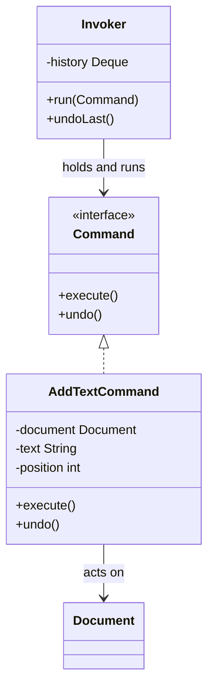

# Command

> Turn a request into an object, so it can be queued, logged, retried, or undone.

**Family:** Behavioral
**Also called:** Action, Transaction

## The problem

A method call happens once, right now, and leaves no trace. That is usually fine. It stops being fine when you need any of these:

- **Undo.** The user wants the last three edits reversed.
- **A queue.** The work should run later, on a worker, not in the request thread.
- **A log of intent.** An auditor wants to know what was asked for, not just what the data looks like now.
- **Retry.** The call failed and should be attempted again, with the same arguments.

None of that is possible with a plain call, because the call is not a thing you can hold.

## The idea in one picture

A restaurant order ticket. It records what was asked for, it can be passed to whoever is free, it can sit in a queue, and it can be cancelled before it is cooked.



## How it works

Wrap the call in an object. The object stores the receiver (what to act on) and the arguments (what to do with it), and exposes an `execute` method. The invoker holds commands and runs them, without knowing what any of them does.

Undo works by having each command also record what it needs to reverse itself. The invoker keeps a history stack, and undo pops the last one and calls `undo`.

The separation is the point: the thing that decides *when* to run something no longer knows *what* it does.

## Code

```java
interface Command {
    void execute();
    void undo();
}

final class AddText implements Command {
    private final Document doc;
    private final String text;
    private int position;                 // recorded during execute, needed by undo

    AddText(Document doc, String text) { this.doc = doc; this.text = text; }

    @Override public void execute() { position = doc.length(); doc.append(text); }
    @Override public void undo()    { doc.deleteFrom(position, text.length()); }
}

final class Editor {
    private final Deque<Command> history = new ArrayDeque<>();

    void run(Command c) { c.execute(); history.push(c); }
    void undoLast()     { if (!history.isEmpty()) history.pop().undo(); }
}
```

```python
class AddText:
    def __init__(self, doc, text):
        self.doc, self.text, self.position = doc, text, None

    def execute(self):
        self.position = len(self.doc)
        self.doc.append(self.text)

    def undo(self):
        self.doc.delete_from(self.position, len(self.text))
```

```typescript
interface Command { execute(): void; undo(): void }

class Editor {
  private history: Command[] = [];
  run(c: Command) { c.execute(); this.history.push(c); }
  undoLast() { this.history.pop()?.undo(); }
}
```

Full runnable versions: [`CommandDemo.java`](../../examples/java/CommandDemo.java), [`command.py`](../../examples/python/command.py), [`command.ts`](../../examples/typescript/command.ts).

## When to use it

- Undo and redo are requirements. This is the pattern that makes them tractable.
- Work should be queued, scheduled, or run on a different thread or machine.
- You need an audit trail of requested actions, not just resulting state.
- The same action is triggered from several places: a menu item, a keyboard shortcut, and a script. One command object serves all three.
- Requests need to be retried, and retry needs the original arguments.

## When not to use it

- **The call is simple and immediate.** Wrapping `save()` in a `SaveCommand` with no undo, no queue, and no log is ceremony.
- **Undo is not really possible.** Sending an email cannot be undone. A command object suggests reversibility that does not exist, which is worse than not offering it.
- **Your language has closures and you only need deferral.** A lambda is a command object with less typing. Use the class when you need `undo` as well as `execute`, or a name for serialization.
- **The commands must survive a restart.** Then they need serializing, which pulls in versioning and schema questions. Consider a queue or an event log instead. See the communication group in [system-patterns](../../system-patterns/README.md).

## What it costs

| You gain | You pay |
|---|---|
| Undo, queueing, logging, and retry all become possible | One class per action, so the class count tracks the action count |
| The invoker is decoupled from what it invokes | Each command must capture enough state to run later, and to reverse |
| The same action reused across triggers | Reading the code means finding which command a button actually creates |

## Mistakes that show up in code review

- **Undo that recomputes instead of restoring.** If `undo` guesses the previous state rather than recording it, it is wrong the moment anything else changed. Capture what you need during `execute`.
- **Commands holding live references to mutable objects.** A queued command runs an hour later against an object that has changed underneath it. Capture values, not references, if there is any delay.
- **A command that does several unrelated things.** Then partial failure leaves the system half done, and undo cannot reverse it cleanly. One command, one reversible unit.
- **An unbounded history stack.** Every edit is retained forever. Cap it.

## Often confused with

| Looks like | Actual difference |
|---|---|
| [Strategy](strategy.md) | Strategy says how to do something and runs now, chosen by the caller. Command says what to do, with arguments captured, and can run later or be reversed |
| [Memento](memento.md) | Both support undo. Command stores the operation and reverses it. Memento stores a snapshot of state and restores it. Command undo is cheap per step, Memento is simpler when reversal logic is hard |
| [Chain of Responsibility](chain-of-responsibility.md) | The two combine: a command is often the request passed along a chain |
| A message or event | A command says do this and names a receiver. An event says this happened and names nobody. The difference matters once they cross a network |

## In modern languages

A closure captures arguments and defers execution, which is most of this pattern in one expression. `() => doc.append(text)` is a command. The class version earns its place when you need a pair of operations (`execute` and `undo`), when commands must be serialized to a queue or a log, or when they need identity for deduplication. Task queues, job frameworks, and command bus libraries are all this pattern with infrastructure attached.

## Related

- [Memento](memento.md), the other route to undo.
- [Chain of Responsibility](chain-of-responsibility.md), often used to route a command through handlers.
- The communication group in [system-patterns](../../system-patterns/README.md), for commands that cross process boundaries as queued messages.

## Go deeper

Full lesson with diagrams and worked examples in [Grokking Design Patterns for Engineers and Managers](https://www.designgurus.io/course/grokking-design-patterns-for-engineers-and-managers?utm_source=github&utm_medium=repo&utm_campaign=design-patterns). For how patterns are tested in a low-level design round, see [Grokking the Object-Oriented Design Interview](https://www.designgurus.io/course/grokking-the-object-oriented-design-interview?utm_source=github&utm_medium=repo&utm_campaign=design-patterns).
