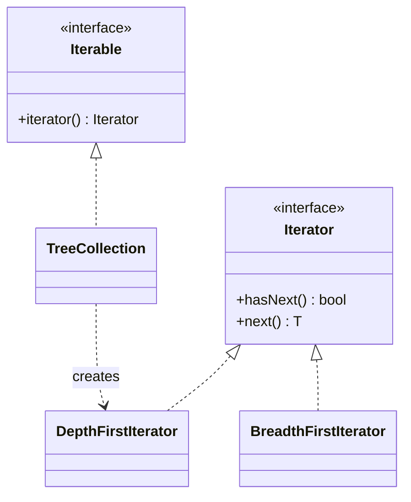

# Iterator

> Walk a collection without exposing how it stores its items.

**Family:** Behavioral
**Also called:** Cursor

## The problem

Client code needs to visit every element. If it walks the collection by index, it now depends on the collection being an array. Change to a linked list, a tree, or a paged remote source, and every loop breaks.

There is a second problem. Some structures have no natural index at all. A tree can be walked depth first or breadth first. A graph needs a visited set. If the caller writes the traversal, every caller writes it again, and some of them get it wrong.

## The idea in one picture

A television remote's channel-up button. You do not need to know how channels are stored to move through them one at a time.



## How it works

The iterator holds the position and the traversal logic. It exposes two operations: is there another element, and give me the next one. The collection exposes a method that creates one.

Because the position lives in the iterator and not the collection, several traversals can run at once over the same data. Because traversal lives in the iterator, one collection can offer several: depth first, breadth first, filtered, reversed.

## Code

Almost every language has this built in. Write it by hand only for a custom structure or a custom order.

```java
final class TreeCollection implements Iterable<Node> {
    private final Node root;

    @Override
    public Iterator<Node> iterator() {          // depth first
        return new Iterator<>() {
            private final Deque<Node> stack = new ArrayDeque<>(List.of(root));
            public boolean hasNext() { return !stack.isEmpty(); }
            public Node next() {
                Node n = stack.pop();
                n.children().forEach(stack::push);
                return n;
            }
        };
    }
}

for (Node n : tree) { /* the caller knows nothing about the shape */ }
```

```python
class TreeCollection:
    def __init__(self, root): self.root = root

    def __iter__(self):                 # a generator IS an iterator
        stack = [self.root]
        while stack:
            node = stack.pop()
            stack.extend(node.children)
            yield node

    def breadth_first(self):            # a second traversal, same data
        queue = deque([self.root])
        while queue:
            node = queue.popleft()
            queue.extend(node.children)
            yield node
```

```typescript
class TreeCollection {
  constructor(private root: Node) {}

  *[Symbol.iterator](): Generator<Node> {    // generator function
    const stack = [this.root];
    while (stack.length) {
      const node = stack.pop()!;
      stack.push(...node.children);
      yield node;
    }
  }
}

for (const node of tree) { /* ... */ }
```

Full runnable versions: [`IteratorDemo.java`](../../examples/java/IteratorDemo.java), [`iterator.py`](../../examples/python/iterator.py), [`iterator.ts`](../../examples/typescript/iterator.ts).

## When to use it

- You are writing a custom collection, and callers should not see its internals.
- One structure needs several traversal orders, each named and reusable.
- The sequence is large or infinite, and producing it lazily matters.
- The source is remote or paged, and you want paging hidden behind a normal loop.

## When not to use it

- **You are wrapping a plain list.** Return the list, or its built-in iterator. A hand-written iterator over an array is pure ceremony.
- **Callers need random access.** An iterator gives you sequential access only. If callers want element 4,000, expose indexing.
- **The traversal has side effects callers must control.** Hiding "this call fetches the next page over the network" behind `next()` produces loops that make a thousand requests. Make the cost visible, or expose a batch API.

## What it costs

| You gain | You pay |
|---|---|
| Callers stop depending on the storage shape | An extra object per traversal, which matters only in very hot loops |
| Several traversal orders over one structure | Modifying the collection during iteration is undefined unless you handle it |
| Lazy evaluation, including infinite sequences | Lazy sequences that hold resources need closing, and callers forget |

## Mistakes that show up in code review

- **Modifying the collection while iterating.** Java throws `ConcurrentModificationException`. Python may skip elements silently, which is worse. Collect changes and apply them after the loop.
- **A lazy iterator holding an open file or connection.** If the loop exits early, the resource leaks. Use a context manager, `try-with-resources`, or an explicit close.
- **Consuming a one-shot iterator twice.** A Python generator is empty the second time. Nothing warns you, and the bug looks like missing data.
- **Hiding network calls in `next()`.** Every step becomes a round trip and the loop looks innocent.

## Often confused with

| Looks like | Actual difference |
|---|---|
| [Visitor](visitor.md) | Iterator decides the order of traversal and gives you elements. Visitor decides what to do at each element. They pair naturally |
| [Composite](../structural/composite.md) | Composite is the structure. Iterator is how you walk it |
| A stream or pipeline | Streams add mapping, filtering, and laziness on top. Underneath, the traversal is still this pattern |

## In modern languages

This is the most thoroughly absorbed pattern in the set. Java has `Iterable` and enhanced `for`. Python has the iterator protocol and generators. JavaScript has `Symbol.iterator` and `for...of`. C# has `IEnumerable` and `yield return`. Go has `range` and, since 1.23, range-over-function iterators. In practice you almost never write the classic class: you write a generator function, which is the same pattern with the state machine generated for you.

## Related

- [Composite](../structural/composite.md), the structure most often iterated.
- [Visitor](visitor.md), for the operations performed during the walk.
- [Factory Method](../creational/factory-method.md), since `iterator()` is one.

## Go deeper

Full lesson with diagrams and worked examples in [Grokking Design Patterns for Engineers and Managers](https://www.designgurus.io/course/grokking-design-patterns-for-engineers-and-managers?utm_source=github&utm_medium=repo&utm_campaign=design-patterns). For how patterns are tested in a low-level design round, see [Grokking the Object-Oriented Design Interview](https://www.designgurus.io/course/grokking-the-object-oriented-design-interview?utm_source=github&utm_medium=repo&utm_campaign=design-patterns).
