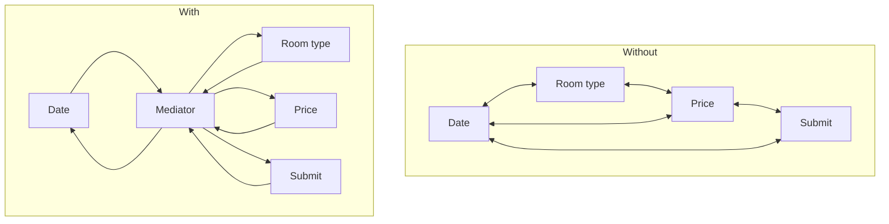

# Mediator

> Route object-to-object communication through one coordinator, so components stop knowing each other.

**Family:** Behavioral
**Also called:** Controller (in some user interface literature, which adds to the confusion)

## The problem

A booking form has a date picker, a room-type dropdown, a guest counter, a price label, and a submit button. Changing the date reloads room types. Changing the room type updates the price and may disable submit. Changing the guest count filters room types.

If each widget talks to the others directly, every widget holds references to three others. Adding a promotion-code field means editing five existing widgets. None of them can be reused elsewhere, because each one drags the others along.

## The idea in one picture

Aircraft near an airport do not negotiate with each other. They all talk to the tower, and the tower knows the rules.



## How it works

Each component knows only the mediator. When something happens, it tells the mediator: "I changed". The mediator holds the interaction rules and decides what to update.

The number of connections drops from roughly n squared to n. More importantly, the rules that used to be scattered across every component now live in one readable place.

## Code

```java
interface FormMediator {
    void changed(Component source);
}

final class BookingForm implements FormMediator {
    private final DatePicker date = new DatePicker(this);
    private final Dropdown roomType = new Dropdown(this);
    private final Label price = new Label(this);
    private final Button submit = new Button(this);

    @Override
    public void changed(Component source) {          // every rule, in one place
        if (source == date) {
            roomType.setOptions(catalog.availableOn(date.value()));
        }
        if (source == date || source == roomType) {
            price.setText(pricing.quote(date.value(), roomType.value()));
        }
        submit.setEnabled(date.value() != null && roomType.value() != null);
    }
}
```

```python
class BookingForm:
    def changed(self, source) -> None:
        if source is self.date:
            self.room_type.set_options(catalog.available_on(self.date.value))
        if source in (self.date, self.room_type):
            self.price.text = pricing.quote(self.date.value, self.room_type.value)
        self.submit.enabled = bool(self.date.value and self.room_type.value)
```

```typescript
class BookingForm implements FormMediator {
  changed(source: Component): void {
    if (source === this.date) this.roomType.setOptions(catalog.availableOn(this.date.value));
    if (source === this.date || source === this.roomType) {
      this.price.text = pricing.quote(this.date.value, this.roomType.value);
    }
    this.submit.enabled = Boolean(this.date.value && this.roomType.value);
  }
}
```

Full runnable versions: [`MediatorDemo.java`](../../examples/java/MediatorDemo.java), [`mediator.py`](../../examples/python/mediator.py), [`mediator.ts`](../../examples/typescript/mediator.ts).

## When to use it

- Components are tangled: several objects each hold references to several others.
- The interaction rules are real logic that deserves one home and its own tests.
- You want components reusable in other screens, which means they cannot know their neighbors.
- A workflow coordinates several services, and the sequence is the thing that keeps changing.

## When not to use it

- **Two components talk, and that is all.** Let them. A mediator for one relationship adds a layer for nothing.
- **The interactions are simple and unlikely to grow.** The pattern trades scattered simplicity for centralized complexity, and that trade is only good past a certain size.
- **The rules are genuinely independent.** If nothing needs coordinating and components just react to a change, [Observer](observer.md) is lighter.
- **You already have a god object problem.** A mediator can become one. If it already has four hundred lines, adding more is not the fix.

## What it costs

| You gain | You pay |
|---|---|
| Components with one dependency instead of many | The mediator accumulates every rule, and it grows |
| Interaction rules in one readable, testable place | It becomes a single point of change: everyone edits the same file |
| Components reusable in other contexts | Tracing "why did this update?" means reading the mediator, not the component |

## Mistakes that show up in code review

- **The mediator becoming a god object.** The known failure mode. When it passes a few hundred lines, split it by area: one mediator per section of the screen or per workflow.
- **Components reaching around it.** One direct reference between two components and the guarantee is gone. Enforce it in review.
- **Business logic in the mediator that is not about coordination.** Pricing rules belong in a pricing service the mediator calls, not inside the mediator.
- **Notification loops.** The mediator updates a component, which reports that it changed, which triggers the mediator again. Guard with a flag or by updating without emitting.

## Often confused with

| Looks like | Actual difference |
|---|---|
| [Observer](observer.md) | Observer is one-to-many broadcast from a source, and the source holds no rules. Mediator is many-to-many, and it holds the rules. Mediators are often implemented using observers underneath |
| [Facade](../structural/facade.md) | Facade is one-directional: callers use it, the subsystem does not know it exists. In a mediator, the components know the mediator and report to it |
| An event bus | An event bus is a mediator with no rules: it only routes. Once routing decisions carry logic, it is a mediator |

## In modern languages

The mediator is usually a function, a reducer, or a controller rather than a class implementing an interface. Redux and similar state containers are exactly this pattern: components dispatch, one reducer holds the rules, everything re-reads the result. In backend code, an orchestrator service coordinating several domain services is the same shape. The saga pattern, in the consistency group of [system-patterns](../../system-patterns/README.md), is a mediator that survives across processes.

## Related

- [Observer](observer.md), commonly the delivery mechanism a mediator uses.
- [Facade](../structural/facade.md), for the one-directional version.
- [Command](command.md), often what components send to the mediator.

## Go deeper

Full lesson with diagrams and worked examples in [Grokking Design Patterns for Engineers and Managers](https://www.designgurus.io/course/grokking-design-patterns-for-engineers-and-managers?utm_source=github&utm_medium=repo&utm_campaign=design-patterns). For how patterns are tested in a low-level design round, see [Grokking the Object-Oriented Design Interview](https://www.designgurus.io/course/grokking-the-object-oriented-design-interview?utm_source=github&utm_medium=repo&utm_campaign=design-patterns).
