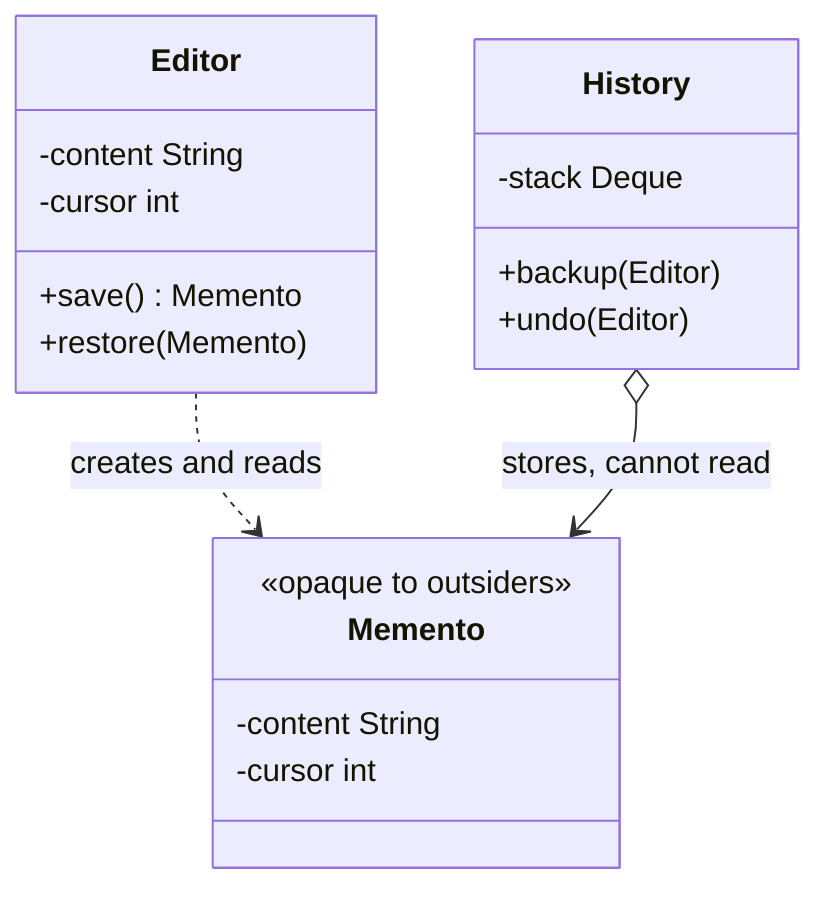

# Memento

> Capture an object's state so it can be restored later, without exposing what is inside it.

**Family:** Behavioral
**Also called:** Snapshot, Token

## The problem

The user wants undo. The obvious approach is to save a copy of the editor's state before each change, then put it back on request.

To do that, something outside the editor has to read every field. Now the history manager knows about cursor positions, selection ranges, and the undo stack itself. Adding a field to the editor means updating the history manager. Every private detail has become public, and the encapsulation you had is gone.

## The idea in one picture

A save point in a game. It holds everything needed to return to that moment. You cannot open it and edit your health value.



## How it works

Three roles. The **originator** is the object with state, and it is the only thing that can create a memento or restore from one. The **memento** holds the state and exposes nothing useful to anyone else. The **caretaker** keeps mementos in a list or stack, and hands them back when asked, without ever looking inside.

The caretaker holding something it cannot read is the entire point. History management and state structure stay independent.

## Code

```java
final class Editor {
    private String content = "";
    private int cursor = 0;

    public Memento save() { return new Memento(content, cursor); }

    public void restore(Memento m) {
        this.content = m.content;      // only the Editor can read these
        this.cursor = m.cursor;
    }

    // Private nested class: the fields are invisible outside Editor.
    public static final class Memento {
        private final String content;
        private final int cursor;
        private Memento(String content, int cursor) {
            this.content = content;
            this.cursor = cursor;
        }
    }
}

final class History {
    private final Deque<Editor.Memento> stack = new ArrayDeque<>();
    void backup(Editor e) { stack.push(e.save()); }
    void undo(Editor e)   { if (!stack.isEmpty()) e.restore(stack.pop()); }
}
```

```python
class Editor:
    def __init__(self):
        self._content, self._cursor = "", 0

    def save(self) -> "Memento":
        return Memento(self._content, self._cursor)

    def restore(self, m: "Memento") -> None:
        self._content, self._cursor = m._content, m._cursor
```

```typescript
class Editor {
  #content = "";
  #cursor = 0;
  save(): Memento { return new Memento(this.#content, this.#cursor); }
  restore(m: Memento): void { [this.#content, this.#cursor] = m.read(); }
}
```

Full runnable versions: [`MementoDemo.java`](../../examples/java/MementoDemo.java), [`memento.py`](../../examples/python/memento.py), [`memento.ts`](../../examples/typescript/memento.ts).

## When to use it

- Undo and redo over an object whose state is awkward to reverse step by step.
- Checkpoints: a wizard the user can back out of, a transaction that may roll back, a game save.
- The state must be captured without publishing the object's internals.
- Reversing an operation is harder than restoring what came before it.

## When not to use it

- **The state is large and changes often.** Snapshotting a big document on every keystroke exhausts memory quickly. Use [Command](command.md) undo, or snapshot occasionally and replay commands from the last snapshot.
- **The state includes things you cannot snapshot.** Open sockets, file handles, and external system state do not restore.
- **The object is immutable.** Then the old value is the memento. Keep a reference and skip the pattern.
- **Reversal is easy.** If every operation has a clean inverse, Command undo is cheaper per step.

## What it costs

| You gain | You pay |
|---|---|
| Undo without exposing internals | Memory grows with history depth, and it grows fast for large state |
| History management independent of state structure | Deep copies are needed, or the "snapshot" shares mutable objects with the live one |
| Restore that is simple and always correct | Some languages cannot express real opacity, so the encapsulation is by convention |

## Mistakes that show up in code review

- **A shallow snapshot.** The memento holds a reference to the same list the editor is still mutating. Restoring then puts back the current state. This is the classic bug, and it is silent.
- **Unbounded history.** Every snapshot is retained forever. Cap the depth and drop the oldest.
- **Public getters on the memento.** Then it is a data transfer object, not a memento, and the caretaker will start reading it.
- **Snapshotting external state.** A memento holding a database connection restores an object that looks right and does not work.

## Often confused with

| Looks like | Actual difference |
|---|---|
| [Command](command.md) | Both give you undo. Command stores the operation and reverses it, which is cheap per step and needs reversal logic. Memento stores the state and restores it, which needs no reversal logic and costs memory. Real editors use both: commands for steps, snapshots every so often |
| [Prototype](../creational/prototype.md) | Prototype produces a second live object to use. Memento produces an inert record to restore the same object later |
| A serialized copy | Serialization is one way to implement a memento. The pattern is about who may read it, not the format |

## In modern languages

Immutable data makes this almost free: if state is a persistent structure, every previous version already exists, and history is a list of references with structural sharing. This is how undo works in most functional-style state containers. Python's `copy.deepcopy` gives a memento in one line, at the cost of no opacity. JavaScript's `structuredClone` does the same. Java records and Kotlin data classes with `copy` are a natural fit for the memento type itself.

## Related

- [Command](command.md), the other route to undo, and the one that usually pairs with this.
- [Prototype](../creational/prototype.md), for copying with a different purpose.
- [State](state.md), when what you are capturing is a position in a state machine.

## Go deeper

Full lesson with diagrams and worked examples in [Grokking Design Patterns for Engineers and Managers](https://www.designgurus.io/course/grokking-design-patterns-for-engineers-and-managers?utm_source=github&utm_medium=repo&utm_campaign=design-patterns). For how patterns are tested in a low-level design round, see [Grokking the Object-Oriented Design Interview](https://www.designgurus.io/course/grokking-the-object-oriented-design-interview?utm_source=github&utm_medium=repo&utm_campaign=design-patterns).
