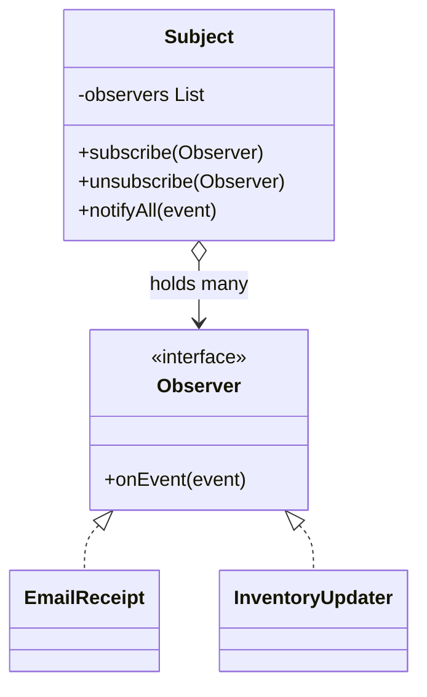

# Observer

> Notify many dependents when one object changes, without the source knowing who they are.

**Family:** Behavioral
**Also called:** Publish-Subscribe (loosely, and the two are not the same thing)

## The problem

When an order is paid, four things must happen: send a receipt, update inventory, notify the warehouse, and record analytics. Written directly, the payment code calls all four:

```java
void markPaid() {
    this.status = PAID;
    emailService.sendReceipt(this);
    inventory.reserve(this);
    warehouse.notify(this);
    analytics.track("order_paid", this);
}
```

Payment now depends on email, inventory, warehousing, and analytics. Testing payment means providing all four. Adding a fifth reaction means editing payment again. Payment knows about things that have nothing to do with payment.

## The idea in one picture

A newspaper does not phone each reader. Readers subscribe, and every issue goes to whoever is on the list that day.



## How it works

The subject keeps a list of observers and exposes methods to add and remove them. When something happens, it walks the list and calls the same method on each. The subject knows the observer interface and nothing else. Observers register themselves, so the dependency points from observer to subject rather than the other way round.

## Code

```java
interface OrderObserver {
    void onPaid(Order order);
}

final class Order {
    private final List<OrderObserver> observers = new CopyOnWriteArrayList<>();

    public void subscribe(OrderObserver o) { observers.add(o); }
    public void unsubscribe(OrderObserver o) { observers.remove(o); }

    public void markPaid() {
        this.status = PAID;
        for (OrderObserver o : observers) {
            try {
                o.onPaid(this);
            } catch (RuntimeException e) {
                log.warn("observer failed", e);  // one bad observer must not stop the rest
            }
        }
    }
}
```

```python
class Order:
    def __init__(self):
        self._observers: list[Callable[["Order"], None]] = []

    def subscribe(self, fn): self._observers.append(fn)

    def mark_paid(self):
        self.status = "paid"
        for fn in list(self._observers):   # copy, in case a handler unsubscribes
            try:
                fn(self)
            except Exception:
                logging.exception("observer failed")
```

```typescript
type OrderListener = (order: Order) => void;

class Order {
  private listeners: OrderListener[] = [];
  subscribe(fn: OrderListener): () => void {
    this.listeners.push(fn);
    return () => { this.listeners = this.listeners.filter((l) => l !== fn); };
  }
}
```

Returning an unsubscribe function, as the TypeScript version does, is the shape that prevents most leaks. The caller who subscribed holds the only thing needed to stop.

Full runnable versions: [`ObserverDemo.java`](../../examples/java/ObserverDemo.java), [`observer.py`](../../examples/python/observer.py), [`observer.ts`](../../examples/typescript/observer.ts).

## When to use it

- One change should trigger several unrelated reactions.
- The set of reactions differs by environment, or changes at runtime.
- The source genuinely should not know its listeners, for example a domain object that must not depend on infrastructure.
- You are building anything event driven: user interface widgets, model-view separation, reactive state.

## When not to use it

- **There is one listener and there always will be.** Call it directly. Indirection with one subscriber is harder to read for no benefit.
- **You need ordering or guaranteed delivery.** In-process observers run in list order, which is an accident, and a crash loses everything not yet called. If order or durability matters, use a queue. See the communication group in [system-patterns](../../system-patterns/README.md).
- **The reactions are slow.** Synchronous notification makes the subject as slow as the sum of its listeners.
- **The flow must be traceable.** Observers make control flow hard to follow. In code where an auditor needs to see the whole path, explicit calls are kinder.

## What it costs

| You gain | You pay |
|---|---|
| The source stops depending on its reactions | Control flow becomes hard to follow: nothing at the call site says what will run |
| Reactions added and removed at runtime | Memory leaks when observers never unsubscribe, which is the classic failure |
| Each reaction testable on its own | Debugging is harder, because the stack trace starts inside a loop over a list |

## Mistakes that show up in code review

- **No unsubscribe.** The subject holds a strong reference forever, so the observer is never collected. In long-lived applications this is the leading cause of slow memory growth.
- **An observer that throws, killing the loop.** The third listener fails and the fourth and fifth never run. Catch per observer and log.
- **Mutating the observer list during notification.** A handler that unsubscribes itself while the subject is iterating throws a concurrent modification error. Iterate over a copy, or use a concurrent list.
- **Observers that call back into the subject.** Now you have a cycle, and sometimes infinite recursion. Notify after the state change is complete, and never let a notification trigger another notification synchronously.
- **Long work inside a handler.** Hand it to a queue or an executor rather than blocking the source.

## Often confused with

| Looks like | Actual difference |
|---|---|
| Publish-subscribe with a broker | The important difference. Observer is in-process, synchronous by default, and the subject holds direct references to its observers. Pub-sub puts a broker in the middle, so publisher and subscriber never meet, and delivery can be asynchronous, durable, and across machines |
| [Mediator](mediator.md) | Observer broadcasts one-to-many from a source. Mediator coordinates many-to-many, and it contains the interaction rules |
| [Chain of Responsibility](chain-of-responsibility.md) | A chain passes a request until one handler takes it. Observer delivers to everyone |

## In modern languages

Most languages ship this. JavaScript has `EventTarget` and `EventEmitter`. Java has `PropertyChangeListener` and, more usefully, reactive libraries. Python has no built-in, and a list of callables is the normal implementation. Reactive extension libraries such as RxJS generalize the pattern with composition, backpressure, and error channels, which is what you want once the streams get complicated. In user interface frameworks, this pattern is the whole update model, usually hidden behind hooks or signals.

## Related

- [Mediator](mediator.md), when the reactions must coordinate rather than run independently.
- [State](state.md), which commonly notifies observers when a transition occurs.
- The communication group in [system-patterns](../../system-patterns/README.md), for the cross-process version with queues and brokers.

## Go deeper

Full lesson with diagrams and worked examples in [Grokking Design Patterns for Engineers and Managers](https://www.designgurus.io/course/grokking-design-patterns-for-engineers-and-managers?utm_source=github&utm_medium=repo&utm_campaign=design-patterns). For how patterns are tested in a low-level design round, see [Grokking the Object-Oriented Design Interview](https://www.designgurus.io/course/grokking-the-object-oriented-design-interview?utm_source=github&utm_medium=repo&utm_campaign=design-patterns).
