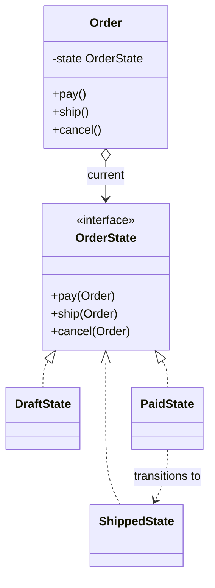

# State

> Let an object change its behavior when its internal state changes, instead of checking a status field everywhere.

**Family:** Behavioral
**Also called:** Objects for States

## The problem

An order moves through draft, paid, shipped, delivered, and cancelled. Every method starts the same way:

```java
public void cancel() {
    if (status == DRAFT) { /* just delete */ }
    else if (status == PAID) { /* refund, then cancel */ }
    else if (status == SHIPPED) { throw new IllegalStateException("too late"); }
    else if (status == DELIVERED) { throw new IllegalStateException("too late"); }
}
```

That switch is repeated in `pay`, `ship`, `refund`, and `addItem`. The rules for one state are scattered across five methods, and the rules for one method cover five states. Adding a state means finding every switch. Nothing tells you when you missed one.

## The idea in one picture

A vending machine behaves differently before and after you put money in. The buttons are the same. What they do is not.



## How it works

Each state becomes a class implementing the same interface, with one method per action. The context holds a reference to its current state object and forwards every call to it. A state handles the actions that are legal for it, and rejects the rest. Transitions happen by the state telling the context to switch to a different state object.

Now the rules for "what can happen while paid" live in one file. Adding a state adds a class. The compiler tells you if it does not implement every action.

## Code

```java
interface OrderState {
    default void pay(Order o)    { throw new IllegalStateException("cannot pay now"); }
    default void ship(Order o)   { throw new IllegalStateException("cannot ship now"); }
    default void cancel(Order o) { throw new IllegalStateException("cannot cancel now"); }
}

final class DraftState implements OrderState {
    @Override public void pay(Order o)    { o.setState(new PaidState()); }
    @Override public void cancel(Order o) { o.setState(new CancelledState()); }
}

final class PaidState implements OrderState {
    @Override public void ship(Order o)   { o.setState(new ShippedState()); }
    @Override public void cancel(Order o) { o.refund(); o.setState(new CancelledState()); }
}

final class Order {
    private OrderState state = new DraftState();
    void setState(OrderState s) { this.state = s; }
    public void pay()    { state.pay(this); }    // no switch anywhere
    public void ship()   { state.ship(this); }
    public void cancel() { state.cancel(this); }
}
```

```python
class PaidState:
    def ship(self, order): order.state = ShippedState()
    def cancel(self, order):
        order.refund()
        order.state = CancelledState()
    def pay(self, order): raise RuntimeError("already paid")
```

```typescript
class PaidState implements OrderState {
  ship(o: Order) { o.state = new ShippedState(); }
  cancel(o: Order) { o.refund(); o.state = new CancelledState(); }
  pay(_: Order) { throw new Error("already paid"); }
}
```

Full runnable versions: [`StateDemo.java`](../../examples/java/StateDemo.java), [`state.py`](../../examples/python/state.py), [`state.ts`](../../examples/typescript/state.ts).

## When to use it

- The same conditional on a status field appears in three or more methods.
- The number of states is growing, and which transitions are legal is real business logic.
- You want the rules for one state readable in one place, which is what a reviewer or an auditor asks for.
- Illegal transitions should fail loudly and in one predictable way.

## When not to use it

- **There are two states and three methods.** A boolean and an `if` are clearer.
- **Behavior does not change, only data does.** If every state does the same thing with a different value, use a field.
- **The state machine is large and formal.** Past a dozen states with complex guards, a table-driven machine or a state chart library is easier to reason about and to draw than twelve classes.
- **State must be persisted and restored.** Objects are not directly storable. You will need a mapping from a stored string to a state class, so keep that mapping in one place.

## What it costs

| You gain | You pay |
|---|---|
| Rules for one state in one file | One class per state, and small classes multiply |
| No repeated conditional, and no missed branch | The transition graph is spread across files, so it is harder to see the whole machine at once |
| Illegal actions rejected consistently | Every state class must handle every action, even if only to reject it |

## Mistakes that show up in code review

- **States that create their successor by name everywhere.** Then the graph is hard coded in twelve places. Consider a transition table or having the context own transitions.
- **Business logic inside the state classes.** A state should decide what is allowed and what happens next. Refunding money belongs in the context or a service the context calls.
- **Keeping the old status field alongside the state object.** Two sources of truth, guaranteed to disagree eventually.
- **Stateful state objects.** If a state instance holds data about a specific order, it cannot be shared. Either keep them stateless and share them, or create fresh ones per transition. Decide which.

## Often confused with

| Looks like | Actual difference |
|---|---|
| [Strategy](strategy.md) | Same structure. The caller chooses a Strategy, and strategies are unaware of each other. A State object changes the context's state itself, and states know which state follows. If your objects reference each other, it is State |
| Enum with a switch | The simple version, and the right answer when there are few states and few actions. State replaces it when the switch appears in many methods |
| [Command](command.md) | Command captures a request as an object. State captures a mode of behavior |

## In modern languages

Sealed classes and pattern matching make the simple version safer: a `match` over a sealed hierarchy gives compile-time exhaustiveness, so a missed state is a build error rather than a runtime surprise. Kotlin, Rust, Scala, and modern Java all support this. TypeScript discriminated unions do the same. Reach for the class version when each state carries different data or genuinely different behavior for many actions.

## Related

- [Strategy](strategy.md), the same structure with a different rule about who chooses.
- [Memento](memento.md), for capturing and restoring a state machine's position.
- [Observer](observer.md), for notifying other parts of the system that a transition happened.

## Go deeper

Full lesson with diagrams and worked examples in [Grokking Design Patterns for Engineers and Managers](https://www.designgurus.io/course/grokking-design-patterns-for-engineers-and-managers?utm_source=github&utm_medium=repo&utm_campaign=design-patterns). For how patterns are tested in a low-level design round, see [Grokking the Object-Oriented Design Interview](https://www.designgurus.io/course/grokking-the-object-oriented-design-interview?utm_source=github&utm_medium=repo&utm_campaign=design-patterns).
