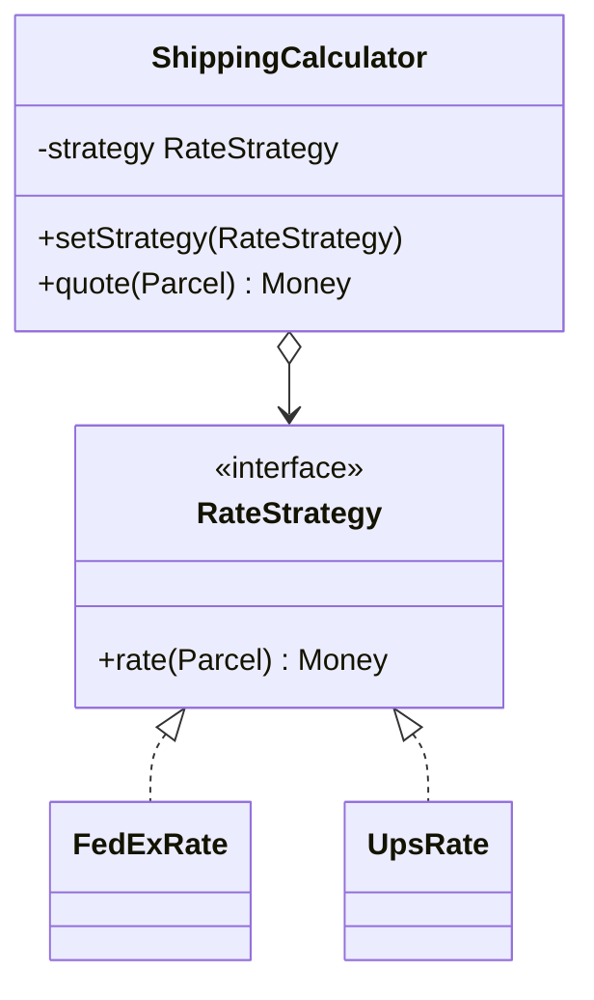

# Strategy

> Swap an algorithm at runtime behind one interface, instead of branching on a type inside the caller.

**Family:** Behavioral
**Also called:** Policy

## The problem

One job has several ways to do it. Shipping cost is calculated differently by carrier. Sorting differs by dataset size. Pricing differs by customer tier. Compression differs by file type.

Written directly, it becomes a branch:

```java
if (carrier.equals("fedex")) { /* twenty lines */ }
else if (carrier.equals("ups")) { /* twenty different lines */ }
else if (carrier.equals("dhl")) { /* twenty more */ }
```

The method grows past what fits on a screen. Every new carrier means editing a method that already works and retesting the ones you did not touch. Testing one carrier means constructing the whole order.

## The idea in one picture

Getting to the airport by car, train, or bicycle. The trip is the same problem. Each option is a complete way to do it, and you pick one at the door.



## How it works

Each branch of the old conditional becomes its own class implementing a shared interface. The context holds one strategy and delegates to it. Choosing which strategy to use happens outside, usually at construction or from configuration.

The context no longer knows how many strategies exist. That is what makes adding one a new file rather than an edit.

## Code

```java
interface RateStrategy {
    Money rate(Parcel parcel);
}

final class FedExRate implements RateStrategy {
    public Money rate(Parcel p) { return Money.of(4.99 + 0.5 * p.kilos()); }
}

final class ShippingCalculator {
    private RateStrategy strategy;
    ShippingCalculator(RateStrategy strategy) { this.strategy = strategy; }
    Money quote(Parcel p) { return strategy.rate(p); }   // no branching left
}
```

```python
from typing import Callable

# A strategy can be a class, but in Python it is usually just a function.
def fedex_rate(parcel: Parcel) -> float:
    return 4.99 + 0.5 * parcel.kilos

class ShippingCalculator:
    def __init__(self, rate: Callable[[Parcel], float]):
        self._rate = rate

    def quote(self, parcel: Parcel) -> float:
        return self._rate(parcel)
```

```typescript
type RateStrategy = (parcel: Parcel) => number;

const fedExRate: RateStrategy = (p) => 4.99 + 0.5 * p.kilos;

class ShippingCalculator {
  constructor(private readonly rate: RateStrategy) {}
  quote(p: Parcel): number { return this.rate(p); }
}
```

Full runnable versions: [`StrategyDemo.java`](../../examples/java/StrategyDemo.java), [`strategy.py`](../../examples/python/strategy.py), [`strategy.ts`](../../examples/typescript/strategy.ts).

## When to use it

- A conditional selects between several complete algorithms for the same job.
- New variants arrive regularly, and often from other teams.
- Each variant deserves its own tests, without constructing the whole context.
- The choice is data: a config value, a feature flag, a customer setting.

## When not to use it

- **There are two branches and there will never be three.** An `if` is clearer. Refactor when the third arrives.
- **The branches are one line each.** A map from key to value beats a class per entry.
- **The variants need different inputs.** If one strategy needs the customer and another needs the warehouse, the shared interface grows a parameter object that half of them ignore. That is a sign the abstraction is wrong.
- **The choice never changes at runtime.** Then a compile-time decision, or [Bridge](../structural/bridge.md), fits better.

## What it costs

| You gain | You pay |
|---|---|
| New variants without editing working code | One class per variant, and a file to open to see what happens |
| Each algorithm testable in isolation | Callers must know enough to choose, unless a factory chooses for them |
| Behavior configurable at runtime | An interface that has to fit every variant, including future ones |

## Mistakes that show up in code review

- **A factory with the original switch inside.** Sometimes fine, since one switch in one place is better than five spread out. But be honest that the branching moved rather than disappeared.
- **Strategies that hold mutable state.** A shared strategy instance used by two threads then produces wrong answers under load.
- **An interface with a method nobody uses.** Added for one variant, implemented as a no-op by the rest.
- **A class where a function would do.** In any language with first-class functions, a one-method interface is usually just a function type.

## Often confused with

| Looks like | Actual difference |
|---|---|
| [State](state.md) | Identical structure. In Strategy the caller picks, the strategies do not know about each other, and the choice usually stands for the whole operation. In State the object changes its own delegate as it moves through a lifecycle, and states know which state comes next |
| [Bridge](../structural/bridge.md) | Same shape, larger scope. Bridge is a structural split of two hierarchies decided at design time. Strategy is one swappable behavior, often chosen per call |
| [Template Method](template-method.md) | Template Method varies steps through inheritance, and the flow is fixed in the base class. Strategy replaces the whole algorithm through composition |
| [Command](command.md) | Command packages a request to run later, with arguments captured. Strategy packages how to do something, and runs now |

## In modern languages

This is the pattern most reduced by first-class functions. A one-method interface is a function type, and the whole pattern becomes "take a function as an argument". Python, JavaScript, Kotlin, and Go all do this. Keep the interface when a strategy needs several related methods, when it needs a name for discovery, or when you want a registry mapping configuration values to implementations.

## Related

- [State](state.md), the same structure with a different rule about who picks.
- [Bridge](../structural/bridge.md), the structural version at hierarchy scale.
- [Factory Method](../creational/factory-method.md), commonly used to choose which strategy to install.

## Go deeper

Full lesson with diagrams and worked examples in [Grokking Design Patterns for Engineers and Managers](https://www.designgurus.io/course/grokking-design-patterns-for-engineers-and-managers?utm_source=github&utm_medium=repo&utm_campaign=design-patterns). For how patterns are tested in a low-level design round, see [Grokking the Object-Oriented Design Interview](https://www.designgurus.io/course/grokking-the-object-oriented-design-interview?utm_source=github&utm_medium=repo&utm_campaign=design-patterns).
