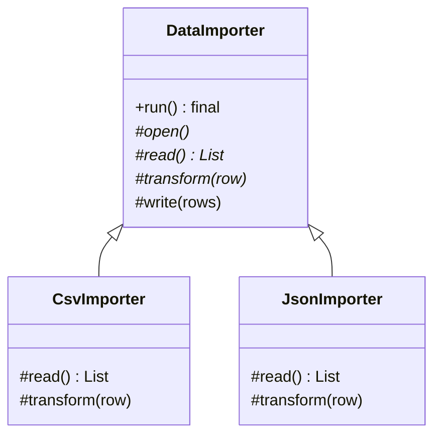

# Template Method

> Fix the steps of an algorithm in a base class, and let subclasses fill in the steps that differ.

**Family:** Behavioral
**Also called:** nothing else.

## The problem

Three data importers all do the same five things: open the source, read records, validate, transform, write to the database. Only reading and transforming differ between CSV, JSON, and XML.

Copy the class three times and you have the same five-step flow in three places. Fix a bug in the writing step and you fix it three times, or, more likely, twice. The duplication is not in the code that differs. It is in the code that does not.

## The idea in one picture

A recipe for a hot drink: boil water, add the main ingredient, pour into a cup, add condiments. Tea and coffee differ in two steps out of four. Nobody writes two separate recipes.



## How it works

The base class has one method that contains the whole algorithm as a sequence of calls. That method is final, so no subclass can change the order. Steps that are always the same are implemented in the base class. Steps that vary are abstract, and each subclass supplies its own.

There is a third kind of step worth knowing: the **hook**. It is a method with an empty or default implementation, so subclasses may override it but do not have to. Hooks are how you offer an optional step without forcing every subclass to implement it.

## Code

```java
abstract class DataImporter {
    // The algorithm. Final, so the order is not negotiable.
    public final ImportResult run(Path source) {
        List<Row> rows = read(source);
        List<Row> valid = rows.stream().filter(this::isValid).toList();
        List<Record> records = valid.stream().map(this::transform).toList();
        beforeWrite(records);          // hook: optional
        return write(records);
    }

    protected abstract List<Row> read(Path source);       // must be supplied
    protected abstract Record transform(Row row);         // must be supplied

    protected boolean isValid(Row row) { return !row.isEmpty(); }   // sensible default
    protected void beforeWrite(List<Record> records) { }            // hook, does nothing
    protected ImportResult write(List<Record> records) { /* shared */ }
}

final class CsvImporter extends DataImporter {
    protected List<Row> read(Path source) { /* CSV specific */ }
    protected Record transform(Row row)   { /* CSV specific */ }
}
```

```python
class DataImporter(ABC):
    def run(self, source: str) -> ImportResult:      # the template
        rows = self.read(source)
        valid = [r for r in rows if self.is_valid(r)]
        records = [self.transform(r) for r in valid]
        self.before_write(records)
        return self.write(records)

    @abstractmethod
    def read(self, source: str) -> list: ...

    @abstractmethod
    def transform(self, row) -> "Record": ...

    def is_valid(self, row) -> bool: return bool(row)   # overridable default
    def before_write(self, records) -> None: pass       # hook
```

```typescript
abstract class DataImporter {
  run(source: string): ImportResult {
    const rows = this.read(source);
    const records = rows.filter((r) => this.isValid(r)).map((r) => this.transform(r));
    this.beforeWrite(records);
    return this.write(records);
  }
  protected abstract read(source: string): Row[];
  protected abstract transform(row: Row): Record;
  protected isValid(row: Row): boolean { return true; }
  protected beforeWrite(_: Record[]): void {}
}
```

Full runnable versions: [`TemplateMethodDemo.java`](../../examples/java/TemplateMethodDemo.java), [`template_method.py`](../../examples/python/template_method.py), [`template-method.ts`](../../examples/typescript/template-method.ts).

## When to use it

- Several classes follow the same sequence and differ in one or two steps.
- The order of steps is a rule that subclasses must not change, such as a lifecycle, a transaction boundary, or a security check.
- You are writing a framework and want extension points that are safe by construction.
- Duplication exists in the shared flow, not in the varying parts.

## When not to use it

- **The steps vary more than they stay the same.** Then the base class holds almost nothing and inheritance buys nothing.
- **Subclasses need to change the order.** The pattern exists to prevent that. If order should vary, use composition.
- **You need to combine variations.** Inheritance gives one axis. A CSV importer that is also encrypted needs a second axis, and you cannot inherit from two parents. Use [Strategy](strategy.md) or [Decorator](../structural/decorator.md).
- **The subclasses would exist only to satisfy the pattern.** If a subclass has one method and no identity, pass a function instead.

## What it costs

| You gain | You pay |
|---|---|
| The shared flow written once, in one place | Inheritance, which is the most rigid form of reuse in the language |
| The order guaranteed, and enforceable with `final` | Reading one subclass does not show the flow: you must open the parent too |
| Clear, named extension points for a framework | Changing the base class can break every subclass, including ones you cannot see |

## Mistakes that show up in code review

- **A non-final template method.** A subclass overrides it, changes the order, and the guarantee is gone.
- **Too many abstract steps.** Nine required methods make the base class a form to fill in. Convert most to hooks with defaults.
- **The base class calling an abstract method from its constructor.** The subclass field it depends on is not initialized yet. This produces a null that is genuinely hard to trace.
- **A protected step that is really public API.** Extension points are for subclasses. If callers need it, that is a different method.
- **Deep hierarchies.** Three levels of template methods, each overriding some of the parent's, is unreadable. Two levels is the practical limit.

## Often confused with

| Looks like | Actual difference |
|---|---|
| [Strategy](strategy.md) | Template Method varies steps through inheritance, and the flow lives in the base class. Strategy replaces a whole algorithm through composition. Strategy composes and is testable alone. Template Method is simpler when the flow is genuinely fixed |
| [Factory Method](../creational/factory-method.md) | A specialization of this pattern where the varying step is "which object to create" |
| [Decorator](../structural/decorator.md) | Decorator adds behavior around a call from outside. Template Method fills in a gap left inside |

## In modern languages

Passing functions gives the same result with less rigidity: `runImport(source, { read, transform })` needs no subclass and composes freely. Python's higher-order functions and TypeScript's object-of-callbacks are both idiomatic. The inheritance version still earns its place in frameworks, where subclassing is the documented extension mechanism and the base class needs to enforce a lifecycle, as in test fixtures, servlet lifecycles, and Android activities.

## Related

- [Strategy](strategy.md), the composition-based alternative.
- [Factory Method](../creational/factory-method.md), the special case for object creation.
- [Bridge](../structural/bridge.md), when the variation needs two independent axes.

## Go deeper

Full lesson with diagrams and worked examples in [Grokking Design Patterns for Engineers and Managers](https://www.designgurus.io/course/grokking-design-patterns-for-engineers-and-managers?utm_source=github&utm_medium=repo&utm_campaign=design-patterns). For how patterns are tested in a low-level design round, see [Grokking the Object-Oriented Design Interview](https://www.designgurus.io/course/grokking-the-object-oriented-design-interview?utm_source=github&utm_medium=repo&utm_campaign=design-patterns).
