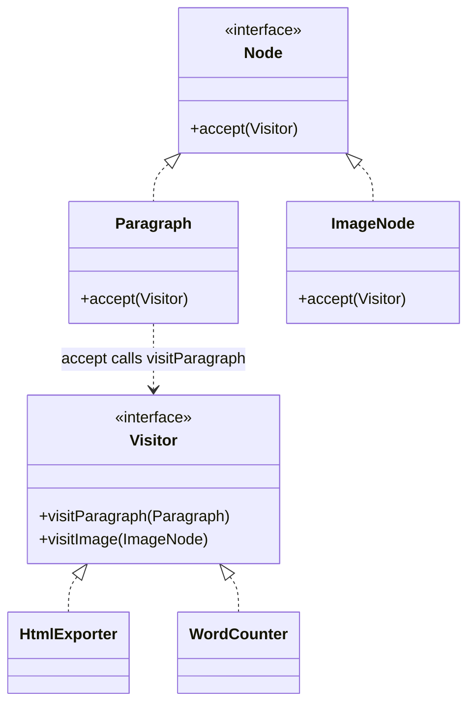

# Visitor

> Add a new operation to a class hierarchy without editing any of its classes.

**Family:** Behavioral
**Also called:** nothing else.

## The problem

You have a stable set of node types: a document made of paragraphs, images, tables, and code blocks. The operations keep multiplying. Export to HTML. Export to PDF. Count words. Validate links. Extract a table of contents.

Put each operation on the node classes and every node gains a method per operation. Five node types times six operations is thirty methods, spread across five files, and the HTML export logic is scattered rather than readable in one place. Adding a seventh operation means editing all five classes.

## The idea in one picture

A building inspector visits every room. The rooms do not know how to inspect themselves, and the same rooms accept a different inspector next month.



## How it works

Each node type gets one method, `accept(visitor)`, and its whole body is a call back to the visitor method for its own type. The visitor interface declares one method per node type. Each concrete visitor implements all of them, and holds one complete operation in one file.

The two-step dispatch, node calls visitor, visitor's typed method runs, is called double dispatch. It exists because most languages pick a method based on one type, not two. This is the pattern's real mechanism, and it is why the code looks strange the first time.

## Code

```java
interface Visitor {
    void visitParagraph(Paragraph p);
    void visitImage(ImageNode i);
}

interface Node {
    void accept(Visitor v);
}

final class Paragraph implements Node {
    final String text;
    Paragraph(String text) { this.text = text; }
    public void accept(Visitor v) { v.visitParagraph(this); }   // the only line, ever
}

final class WordCounter implements Visitor {                    // one operation, one file
    int total = 0;
    public void visitParagraph(Paragraph p) { total += p.text.split("\\s+").length; }
    public void visitImage(ImageNode i)     { /* images have no words */ }
}

WordCounter counter = new WordCounter();
for (Node n : document) n.accept(counter);
```

```python
class Paragraph:
    def accept(self, visitor):
        return visitor.visit_paragraph(self)

class WordCounter:
    def __init__(self): self.total = 0
    def visit_paragraph(self, p): self.total += len(p.text.split())
    def visit_image(self, i): pass
```

```typescript
// In TypeScript a discriminated union plus a switch is usually clearer.
type Node = { kind: "paragraph"; text: string } | { kind: "image"; alt: string };

function countWords(nodes: Node[]): number {
  return nodes.reduce((total, n) => {
    switch (n.kind) {
      case "paragraph": return total + n.text.split(/\s+/).length;
      case "image": return total;
    }
  }, 0);
}
```

Full runnable versions: [`VisitorDemo.java`](../../examples/java/VisitorDemo.java), [`visitor.py`](../../examples/python/visitor.py), [`visitor.ts`](../../examples/typescript/visitor.ts).

## When to use it

- The set of types is stable and the set of operations is not. This condition is the whole decision.
- One operation spans many types and should be readable in one place, such as a serializer, a type checker, or a pretty printer.
- The node classes belong to someone else, or should stay free of concerns like rendering.
- You are writing a compiler, an interpreter, or anything that walks a syntax tree. This is the pattern's home ground.

## When not to use it

- **New types get added often.** Adding one node type means editing the visitor interface and every visitor that implements it. If types change more than operations, this pattern is exactly backwards. Put the methods on the classes instead.
- **There are two or three operations and they will not grow.** Methods on the classes are simpler.
- **Your language has pattern matching over sealed types.** Then a `match` gives you the same separation with compile-time exhaustiveness and none of the double dispatch.
- **Visitors need access to private node state.** They only get the public surface, and widening it to serve a visitor defeats the encapsulation.

## What it costs

| You gain | You pay |
|---|---|
| New operations without touching the node classes | New node types require editing every visitor: the trade is explicit and one-directional |
| One operation readable in one file | Double dispatch is unfamiliar and slows down first-time readers |
| Accumulated results and shared context per visit | Node classes must expose enough state for visitors to work, weakening encapsulation |

## Mistakes that show up in code review

- **`accept` doing more than one call.** Its body is `v.visitX(this)` and nothing else. Any logic in there belongs in a visitor.
- **Using it where types change.** The most common misuse, and it is painful: every new node type breaks every visitor, including third-party ones.
- **Stateful visitors reused across traversals.** A word counter that is not reset gives a total for two documents.
- **Visitors that check node types.** If a visitor contains `instanceof`, the double dispatch was pointless.
- **Mixing traversal into `accept`.** Decide deliberately whether the node walks its children or the visitor does. Doing both gives you double visits.

## Often confused with

| Looks like | Actual difference |
|---|---|
| [Iterator](iterator.md) | Iterator decides the order of the walk. Visitor decides what happens at each element. They are complementary, and normally used together |
| [Strategy](strategy.md) | Strategy swaps one algorithm behind one interface. Visitor spreads one algorithm across many types via double dispatch |
| [Composite](../structural/composite.md) | Composite is the tree. Visitor is how you add operations over it without editing the node classes |
| Pattern matching | Same goal, better mechanism where the language supports it. A `match` over a sealed hierarchy is exhaustive at compile time and needs no `accept` methods |

## In modern languages

Sealed interfaces plus pattern matching replace this pattern outright: Rust enums with `match`, Scala sealed traits, Kotlin sealed classes, TypeScript discriminated unions, and Java's pattern matching for `switch` all give you one operation in one place, with the compiler checking that every type is handled. The classic form still matters in older Java and C# codebases, in abstract syntax tree tooling, and wherever the node classes must not be modified at all.

## Related

- [Composite](../structural/composite.md), the structure visitors usually walk.
- [Iterator](iterator.md), for the traversal itself.
- [Strategy](strategy.md), when the operation does not need to vary by type.

## Go deeper

Full lesson with diagrams and worked examples in [Grokking Design Patterns for Engineers and Managers](https://www.designgurus.io/course/grokking-design-patterns-for-engineers-and-managers?utm_source=github&utm_medium=repo&utm_campaign=design-patterns). For how patterns are tested in a low-level design round, see [Grokking the Object-Oriented Design Interview](https://www.designgurus.io/course/grokking-the-object-oriented-design-interview?utm_source=github&utm_medium=repo&utm_campaign=design-patterns).
