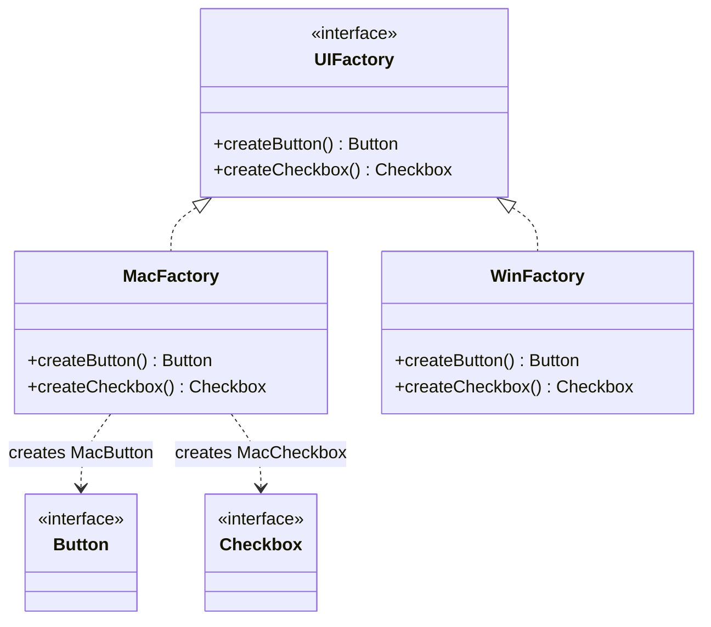

# Abstract Factory

> Create families of related objects that must match, without naming their concrete classes.

**Family:** Creational
**Also called:** Kit

## The problem

Some objects only work with their own kind. A macOS button belongs with a macOS checkbox. A Postgres connection belongs with a Postgres query builder and a Postgres dialect. A test environment needs a fake payment client, a fake mailer, and a fake clock, all fake together.

If each object is created independently, nothing stops a Windows button appearing next to a macOS checkbox. The mismatch compiles fine and shows up as a bug report with a screenshot.

## The idea in one picture

You do not order a chair, a table, and a lamp separately and hope they match. You pick one furniture line, and it supplies all three in the same style.



## How it works

One interface declares a create method per product in the family. Each concrete factory implements all of them and returns products of a single matching variant. Client code takes the factory as a constructor argument and calls the create methods. The client never names a concrete product, so a mismatched pair is not expressible.

The choice happens once, usually at startup, and everything downstream inherits it.

## Code

```java
interface UIFactory {
    Button createButton();
    Checkbox createCheckbox();
}

class MacFactory implements UIFactory {
    public Button createButton() { return new MacButton(); }
    public Checkbox createCheckbox() { return new MacCheckbox(); }
}

class SettingsScreen {
    private final Button button;
    private final Checkbox checkbox;

    SettingsScreen(UIFactory factory) {
        this.button = factory.createButton();
        this.checkbox = factory.createCheckbox();
    }
}
```

```python
class UIFactory(Protocol):
    def create_button(self) -> Button: ...
    def create_checkbox(self) -> Checkbox: ...

class MacFactory:
    def create_button(self) -> Button: return MacButton()
    def create_checkbox(self) -> Checkbox: return MacCheckbox()

class SettingsScreen:
    def __init__(self, factory: UIFactory):
        self.button = factory.create_button()
        self.checkbox = factory.create_checkbox()
```

```typescript
interface UIFactory {
  createButton(): Button;
  createCheckbox(): Checkbox;
}

class MacFactory implements UIFactory {
  createButton(): Button { return new MacButton(); }
  createCheckbox(): Checkbox { return new MacCheckbox(); }
}
```

Full runnable versions: [`AbstractFactoryDemo.java`](../../examples/java/AbstractFactoryDemo.java), [`abstract_factory.py`](../../examples/python/abstract_factory.py), [`abstract-factory.ts`](../../examples/typescript/abstract-factory.ts).

## When to use it

- Products come in variants, and mixing variants is a bug rather than a feature.
- Swapping one implementation means swapping several related ones at the same time.
- You want one switch at startup between real dependencies and test doubles, covering the whole set.

## When not to use it

- **The products are not actually related.** If a caller needs a logger and a payment client, that is dependency injection, not a family. Pass them separately.
- **There is one variant.** Adding a factory interface for a set that will never have a second member is pure cost.
- **The family keeps growing.** Every new product type means editing the interface and every concrete factory. Beyond five or six products, that is a chore each time. Consider a service registry or a container instead.
- **Your dependency injection container already does it.** Most containers can bind a whole profile of implementations at once. That is this pattern, configured rather than coded.

## What it costs

| You gain | You pay |
|---|---|
| Mismatched combinations become impossible | An interface plus one class per variant, so the type count multiplies |
| One place to switch a whole environment | Adding a product to the family means editing every factory |
| Client code with no concrete dependencies | An extra layer to read through when tracing what got created |

## Mistakes that show up in code review

- **A factory that returns products from more than one variant.** That is the exact bug the pattern exists to prevent, and it usually arrives during a hurried fix.
- **Client code casting the returned product to a concrete type.** The cast reintroduces the coupling and will throw the first time the other variant is used.
- **Using it for unrelated dependencies.** A factory with `createLogger` and `createInvoice` on it is not a family, it is a bag.
- **Building the factory choice deep in the call stack.** Choose once at the composition root, then pass it down.

## Often confused with

| Looks like | Actual difference |
|---|---|
| [Factory Method](factory-method.md) | Factory Method produces one product and uses inheritance. Abstract Factory produces a family and uses composition. Concrete factories are often implemented with factory methods inside |
| [Builder](builder.md) | Abstract Factory returns finished products immediately. Builder assembles one product over several steps and returns it at the end |
| [Facade](../structural/facade.md) | Both hide a subsystem. Facade simplifies calls to an existing subsystem, Abstract Factory decides what gets constructed |
| Dependency injection container | Same job at a larger scale, configured instead of hand written. If you already have a container, prefer it |

## In modern languages

A factory interface with several methods can be a plain object holding several factory functions. In TypeScript, `{ button: () => Button; checkbox: () => Checkbox }` gives you the same guarantee with no classes. Python code often uses a module per variant, since a module is already a namespace of related constructors. In Go, a struct of function fields is the common idiom.

## Related

- [Factory Method](factory-method.md), the single-product version, and the usual way each concrete factory is built.
- [Singleton](singleton.md), because one factory instance per variant is normally enough.
- [Prototype](prototype.md), when a factory produces variants by cloning configured instances.

## Go deeper

Full lesson with diagrams and worked examples in [Grokking Design Patterns for Engineers and Managers](https://www.designgurus.io/course/grokking-design-patterns-for-engineers-and-managers?utm_source=github&utm_medium=repo&utm_campaign=design-patterns). For how patterns are tested in a low-level design round, see [Grokking the Object-Oriented Design Interview](https://www.designgurus.io/course/grokking-the-object-oriented-design-interview?utm_source=github&utm_medium=repo&utm_campaign=design-patterns).
