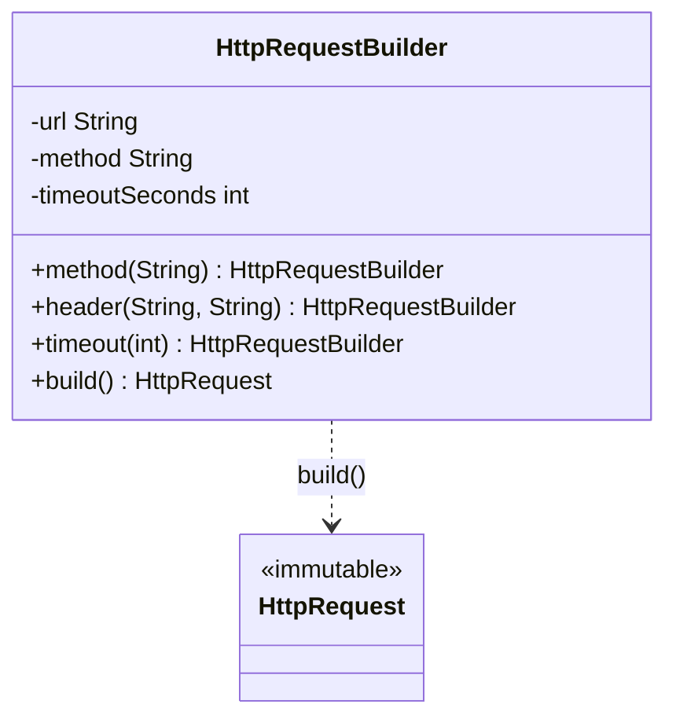

# Builder

> Assemble a complex object step by step, so callers never face a constructor with twelve arguments.

**Family:** Creational
**Also called:** nothing else, though the fluent variant is sometimes called a fluent interface.

## The problem

An object has many fields. Most are optional. The constructor grows:

```java
new HttpRequest(url, "GET", headers, null, 30, 3, true, false, null);
```

Nobody can read that call. What is `true`? Which of the two nulls is the body? The usual fix is more constructors, one per combination, which is called the telescoping constructor and gets worse with every field.

The other usual fix is a no-argument constructor plus setters. That works, but now the object exists in a half built state, and nothing stops a caller from using it before it is ready. If the object should be immutable, setters are not an option at all.

## The idea in one picture

You do not hand a sandwich shop nine ingredients in a fixed order. You say what you want, one item at a time, and take the finished sandwich at the end.



## How it works

A separate builder object collects the values. Each setter records one value and returns the builder, so calls chain. The `build` method validates the combination and constructs the real object in one shot. The product can stay immutable, because it is only ever constructed complete.

Validation in `build` is the part people skip, and it is the part that earns the pattern. It is the one place that can check rules across fields, such as "a body is not allowed on a GET".

## Code

```java
public final class HttpRequest {
    private final String url, method;
    private final int timeoutSeconds;

    private HttpRequest(Builder b) {
        this.url = b.url;
        this.method = b.method;
        this.timeoutSeconds = b.timeoutSeconds;
    }

    public static Builder to(String url) { return new Builder(url); }

    public static final class Builder {
        private final String url;
        private String method = "GET";
        private int timeoutSeconds = 30;

        private Builder(String url) { this.url = url; }

        public Builder method(String m) { this.method = m; return this; }
        public Builder timeout(int s) { this.timeoutSeconds = s; return this; }

        public HttpRequest build() {
            if (timeoutSeconds <= 0) throw new IllegalArgumentException("timeout must be positive");
            return new HttpRequest(this);
        }
    }
}

// Call site reads like a sentence.
HttpRequest r = HttpRequest.to("https://api.example.com").method("POST").timeout(5).build();
```

```python
@dataclass(frozen=True)
class HttpRequest:
    url: str
    method: str = "GET"
    timeout_seconds: int = 30

class HttpRequestBuilder:
    def __init__(self, url: str):
        self._values = {"url": url}

    def method(self, m: str) -> "HttpRequestBuilder":
        self._values["method"] = m
        return self

    def build(self) -> HttpRequest:
        if self._values.get("timeout_seconds", 30) <= 0:
            raise ValueError("timeout must be positive")
        return HttpRequest(**self._values)
```

```typescript
class HttpRequestBuilder {
  private values: { url: string; method?: string; timeoutSeconds?: number };
  constructor(url: string) { this.values = { url }; }
  method(m: string): this { this.values.method = m; return this; }
  build(): Readonly<HttpRequest> { /* validate, then construct */ }
}
```

Full runnable versions: [`BuilderDemo.java`](../../examples/java/BuilderDemo.java), [`builder.py`](../../examples/python/builder.py), [`builder.ts`](../../examples/typescript/builder.ts).

## When to use it

- The constructor has grown past four or five arguments, and several are optional.
- Several arguments share a type, so callers can silently pass them in the wrong order.
- The object should be immutable, but building it needs several steps.
- Rules span fields, and you want one place that checks them before the object exists.

## When not to use it

- **The object has three fields and they are all required.** A constructor is shorter and does the same job.
- **Your language has named arguments with defaults.** Python and Kotlin already solve the readability problem. `HttpRequest(url, method="POST", timeout=5)` needs no builder. Reach for the pattern there only when you need cross-field validation or staged construction.
- **The builder just copies fields with no validation.** Then it is boilerplate. Either add the validation or drop the builder.
- **The object is mutable and short lived anyway.** Setters are fine for a throwaway object.

## What it costs

| You gain | You pay |
|---|---|
| Readable call sites that name every value | A second class, with every field declared twice |
| Immutable products, safe to share between threads | More code to keep in sync when a field is added |
| One place for validation across fields | An extra `build()` that a caller can forget, leaving a builder where a product was expected |

## Mistakes that show up in code review

- **No validation in `build`.** The most common version, and the one that turns the pattern into typing practice.
- **The builder being reusable by accident.** If `build` can be called twice, and the second product shares a mutable list with the first, you have a bug that appears only under load. Copy collections on build.
- **Returning the product type from a setter.** Then chaining stops working. Every setter returns the builder.
- **A builder for a class with a sensible constructor.** Adding one to a three-field value object is noise.

## Often confused with

| Looks like | Actual difference |
|---|---|
| [Abstract Factory](abstract-factory.md) | Abstract Factory returns finished products right away, and its point is matching variants. Builder produces one product over several calls, and its point is complexity |
| [Prototype](prototype.md) | Prototype starts from an existing configured object and copies it. Builder starts from nothing and adds |
| Fluent interfaces generally | Chaining is a style, not a pattern. A builder chains, but chaining alone does not make something a builder |

## In modern languages

Python and Kotlin have keyword arguments with defaults, which removes the main reason for this pattern. TypeScript gets most of the way with an options object: `new HttpRequest({ url, method: "POST" })` is readable and type checked. The builder still earns its place when construction is staged, when the product must be immutable and validated as a whole, or when a fluent API is the point, as in test data builders and query builders.

## Related

- [Factory Method](factory-method.md) and [Abstract Factory](abstract-factory.md), for choosing which type to create rather than how to assemble it.
- [Composite](../structural/composite.md), which builders are often used to assemble, since trees are awkward to write in one constructor call.

## Go deeper

Full lesson with diagrams and worked examples in [Grokking Design Patterns for Engineers and Managers](https://www.designgurus.io/course/grokking-design-patterns-for-engineers-and-managers?utm_source=github&utm_medium=repo&utm_campaign=design-patterns). For how patterns are tested in a low-level design round, see [Grokking the Object-Oriented Design Interview](https://www.designgurus.io/course/grokking-the-object-oriented-design-interview?utm_source=github&utm_medium=repo&utm_campaign=design-patterns).
