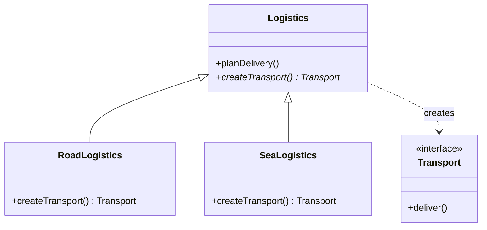

# Factory Method

> Let a subclass decide which concrete type to create, without the base class knowing the type exists.

**Family:** Creational
**Also called:** Virtual Constructor

## The problem

A class needs to create an object, but it should not know which concrete class. A report generator produces a document. A logistics planner creates a vehicle. A parser builds a node. The moment you write `new PdfDocument()` inside the generator, that generator is welded to PDF, and adding HTML output means editing a class that already works.

The usual first attempt is a switch statement on a type string. It works, and then it appears in four more methods, and every new type means finding all five.

## The idea in one picture

A delivery company plans routes the same way for every shipment. Road, sea, and air branches each supply their own vehicle. Head office writes the plan once and never names a truck.



## How it works

The base class declares a method that returns the product type, and leaves it abstract. All the shared logic lives in the base class and calls that method instead of a constructor. Each subclass overrides it and returns its own concrete product. The base class never learns what came back beyond the interface.

## Code

```java
abstract class Logistics {
    // Shared logic. It never names a concrete Transport.
    public String planDelivery(String destination) {
        Transport t = createTransport();
        return t.deliver(destination);
    }

    protected abstract Transport createTransport();
}

class RoadLogistics extends Logistics {
    @Override
    protected Transport createTransport() {
        return new Truck();
    }
}
```

```python
from abc import ABC, abstractmethod

class Logistics(ABC):
    def plan_delivery(self, destination: str) -> str:
        return self.create_transport().deliver(destination)

    @abstractmethod
    def create_transport(self) -> "Transport": ...

class RoadLogistics(Logistics):
    def create_transport(self) -> "Transport":
        return Truck()
```

```typescript
abstract class Logistics {
  planDelivery(destination: string): string {
    return this.createTransport().deliver(destination);
  }
  protected abstract createTransport(): Transport;
}

class RoadLogistics extends Logistics {
  protected createTransport(): Transport {
    return new Truck();
  }
}
```

Full runnable versions: [`FactoryMethodDemo.java`](../../examples/java/FactoryMethodDemo.java), [`factory_method.py`](../../examples/python/factory_method.py), [`factory-method.ts`](../../examples/typescript/factory-method.ts).

## When to use it

- A class contains real shared logic, and only one step of it varies by type.
- New types will be added by other people, possibly in other modules, and you do not want them editing your class.
- You want to give subclasses a hook for what gets created, including in tests.

## When not to use it

- **You have one product type and no second one in sight.** Call the constructor. Add the pattern when the second type arrives.
- **There is no shared logic in the base class.** If the base class does nothing but the create call, you have written an interface with extra ceremony. A plain function that returns the right object is clearer.
- **The choice is data, not code.** If types are picked by a config string and never carry different behavior, a map from string to constructor is shorter and easier to read than a subclass per type.

## What it costs

| You gain | You pay |
|---|---|
| New types without touching working code | One subclass per product type, so the class count grows |
| Shared logic written once | An extra hop when reading: the created type is not visible at the call site |
| A natural seam for tests to inject a fake | Inheritance, which is harder to compose than passing a function |

## Mistakes that show up in code review

- **A switch statement inside the factory method.** That defeats it. If the base class still knows all the types, nothing was decoupled. That version is a simple factory, which is fine, but it is not this pattern.
- **The factory method being public.** It is a hook for subclasses, not part of the class's API. Keep it protected.
- **Duplicating the shared logic in each subclass.** Then the base class holds nothing and the pattern gave you nothing.
- **Reaching for it too early.** One implementation plus a factory method is the most common form of over-engineering in this whole family.

## Often confused with

| Looks like | Actual difference |
|---|---|
| [Abstract Factory](abstract-factory.md) | Factory Method makes one product through inheritance. Abstract Factory makes a family of related products through composition |
| Simple factory (a static `create` with a switch) | Not a Gang of Four pattern, and often the right answer. It centralizes the switch instead of removing it |
| [Template Method](../behavioral/template-method.md) | Same mechanism, different purpose. Template Method varies a step of an algorithm, Factory Method varies which object gets made. Factory Method is a specialization of it |
| [Builder](builder.md) | Factory Method picks a type in one call. Builder assembles one complex object over several calls |

## In modern languages

Anywhere functions are first class, you can pass a factory function instead of subclassing. In Python that means `Logistics(create_transport=Truck)`. In TypeScript it means a `() => Transport` in the constructor. This is usually better: it composes, it needs no class, and a test can supply a lambda. Reach for the inheritance version when the creating class is part of a framework other people extend.

## Related

- [Abstract Factory](abstract-factory.md), when one choice must produce several matched objects.
- [Prototype](prototype.md), when copying a configured instance beats constructing a new one.
- [Template Method](../behavioral/template-method.md), the general form of "base class defines the flow, subclass fills a step".

## Go deeper

Full lesson with diagrams and worked examples in [Grokking Design Patterns for Engineers and Managers](https://www.designgurus.io/course/grokking-design-patterns-for-engineers-and-managers?utm_source=github&utm_medium=repo&utm_campaign=design-patterns). For how patterns are tested in a low-level design round, see [Grokking the Object-Oriented Design Interview](https://www.designgurus.io/course/grokking-the-object-oriented-design-interview?utm_source=github&utm_medium=repo&utm_campaign=design-patterns).
