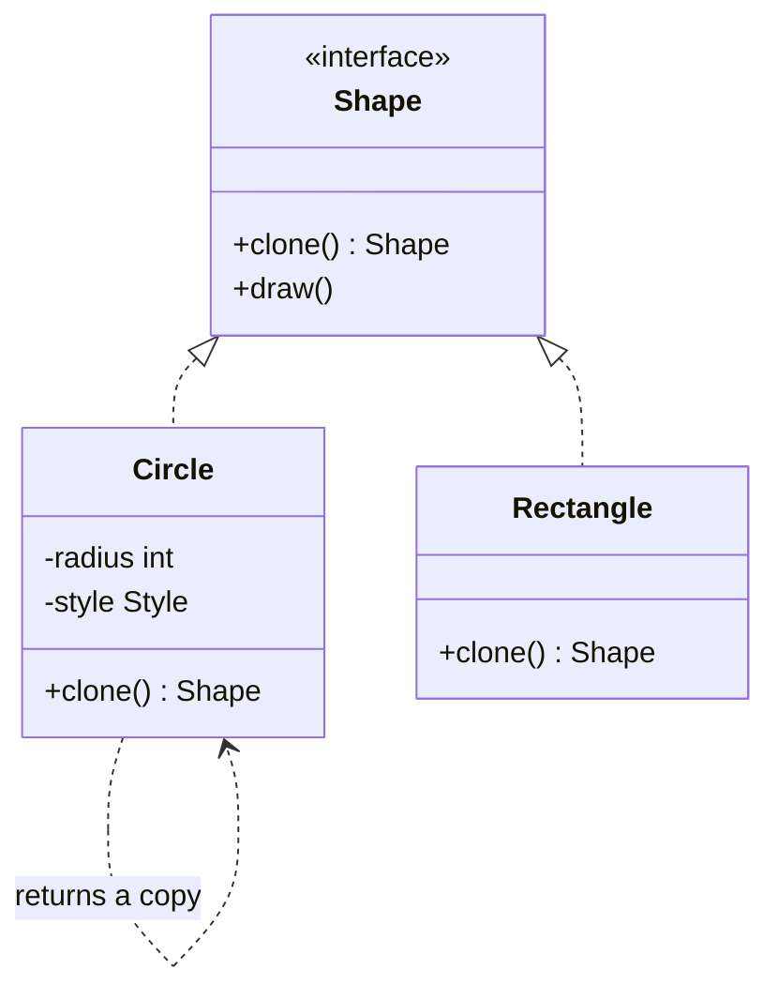

# Prototype

> Create a new object by copying a configured one, instead of building it from scratch.

**Family:** Creational
**Also called:** Clone

## The problem

Producing a fresh object is sometimes expensive or awkward. The setup reads a file, queries a database, parses a template, or applies forty defaults. If you already have an object in exactly the right shape, constructing another one from nothing repeats all that work.

There is a second version of the problem that matters more in practice. Sometimes the code holding the object does not know its concrete class. It has a `Shape`, and it needs another `Shape` just like it. Calling a constructor is not possible, because there is no constructor to name.

## The idea in one picture

A photocopier does not care what is on the page. It produces another one just like it.



## How it works

The interface declares a `clone` method. Each concrete class implements it by constructing a copy of itself, field by field. The caller holds only the interface, calls `clone`, and gets an object of the same concrete type without ever naming it.

The whole difficulty of this pattern is one question: how deep does the copy go?

- A **shallow copy** copies field values. Any field holding a reference now points at the same object as the original.
- A **deep copy** also copies what those references point at, recursively.

Shallow is fast and correct for immutable fields. Deep is correct for mutable fields and costs more. Getting this wrong is the source of essentially every bug this pattern produces.

## Code

```java
interface Shape {
    Shape clone();
    String describe();
}

final class Circle implements Shape {
    private final int radius;
    private final List<String> tags;

    Circle(int radius, List<String> tags) {
        this.radius = radius;
        this.tags = new ArrayList<>(tags); // copy on the way in
    }

    @Override
    public Shape clone() {
        return new Circle(this.radius, this.tags); // constructor copies the list again
    }
}
```

A copy constructor is the clearer way to do this in Java. Avoid `Cloneable` and `Object.clone()`: they are widely regarded as a design mistake, they bypass constructors, and the shallow behavior surprises people.

```python
import copy

class Circle:
    def __init__(self, radius: int, tags: list[str]):
        self.radius = radius
        self.tags = tags

    def clone(self) -> "Circle":
        return copy.deepcopy(self)
```

```typescript
class Circle {
  constructor(readonly radius: number, readonly tags: string[]) {}
  clone(): Circle {
    return new Circle(this.radius, [...this.tags]); // spread copies the array
  }
}
```

Full runnable versions: [`PrototypeDemo.java`](../../examples/java/PrototypeDemo.java), [`prototype.py`](../../examples/python/prototype.py), [`prototype.ts`](../../examples/typescript/prototype.ts).

## When to use it

- Setup is expensive, and a correctly configured instance already exists. Parsed templates and preloaded game entities are the classic cases.
- The code needs a new object of a type it cannot name, because it only holds an interface.
- You want the user to save configurations as reusable starting points, such as document templates or saved search filters.
- Object creation should stay open ended, with new kinds registered at runtime rather than compiled in.

## When not to use it

- **Construction is cheap.** Then a constructor is clearer and has no copy semantics to get wrong.
- **The object has identity.** Copying something with a database primary key, a socket, or an open file handle produces an object that looks valid and is not.
- **The graph behind it is deep.** A deep copy of a large object graph can cost more than rebuilding, and it can copy things you never meant to duplicate, such as a shared cache.
- **The object is immutable.** There is nothing to protect, so share the instance instead of copying it.

## What it costs

| You gain | You pay |
|---|---|
| New objects without repeating expensive setup | Every class must maintain its own copy logic, and it drifts when a field is added |
| Creation without naming a concrete class | Shallow versus deep is a decision per field, and mistakes are silent |
| Runtime configurable object creation | Cycles in the object graph need special handling or they loop forever |

## Mistakes that show up in code review

- **A shallow copy of a mutable collection.** The copy and the original share the list. One of them adds an item, and both change. This is the single most common bug here.
- **A new field added without updating `clone`.** The copy silently loses data. There is no compiler error, and often no test.
- **Cloning something that owns a resource.** Two objects now believe they own one connection.
- **Using Java's `Cloneable`.** It does not declare `clone`, the default is shallow, and it skips constructors, so final fields and invariants are not applied. Write a copy constructor.

## Often confused with

| Looks like | Actual difference |
|---|---|
| [Factory Method](factory-method.md) | Factory Method builds a new object from nothing and picks the type by subclass. Prototype copies an existing instance and gets the type for free |
| [Builder](builder.md) | Builder assembles a product step by step. Prototype starts from a finished product and duplicates it |
| [Flyweight](../structural/flyweight.md) | Direct opposite. Flyweight shares one instance to avoid copies. Prototype makes copies so instances do not share |
| [Memento](../behavioral/memento.md) | Both capture state. Memento stores it to restore the same object later. Prototype produces a second live object |

## In modern languages

Python gives you `copy.copy` and `copy.deepcopy`, so the pattern is a one-line method and the real work is deciding which to call. JavaScript has `structuredClone` for deep copies of plain data, and spread syntax for shallow ones. Records and value types in Java, C#, and Kotlin support copy-with-changes directly, which covers most of what people used this pattern for. Reach for an explicit `clone` when copy depth varies by field, or when the type is genuinely unknown to the caller.

## Related

- [Abstract Factory](abstract-factory.md), which sometimes produces its products by cloning stored prototypes.
- [Composite](../structural/composite.md), because copying a tree is the case where deep versus shallow matters most.
- [Memento](../behavioral/memento.md), for capturing state to restore rather than to duplicate.

## Go deeper

Full lesson with diagrams and worked examples in [Grokking Design Patterns for Engineers and Managers](https://www.designgurus.io/course/grokking-design-patterns-for-engineers-and-managers?utm_source=github&utm_medium=repo&utm_campaign=design-patterns). For how patterns are tested in a low-level design round, see [Grokking the Object-Oriented Design Interview](https://www.designgurus.io/course/grokking-the-object-oriented-design-interview?utm_source=github&utm_medium=repo&utm_campaign=design-patterns).
