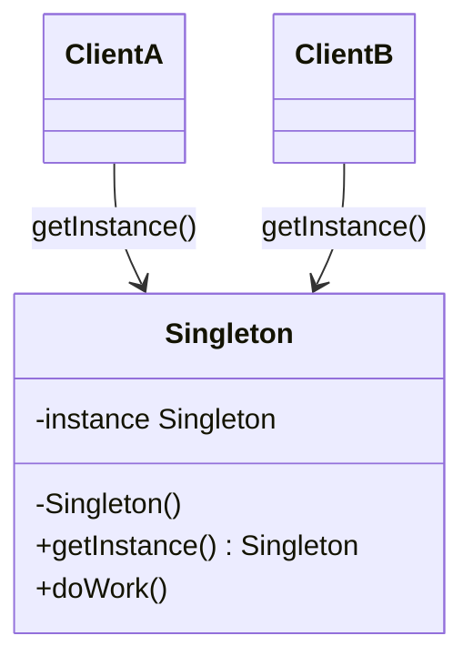

# Singleton

> One instance of a class, with one place that owns its lifecycle.

**Family:** Creational
**Also called:** nothing else, but it gets confused with a static utility class constantly.

## The problem

Some things should exist once per process. A database connection pool. A configuration object read from disk at startup. A metrics registry. If every caller builds its own, you get twenty connection pools, twenty file reads, and metrics scattered across twenty registries that nobody can total up.

The naive fix is a global variable. That works until you need to test the code, at which point the global is shared between tests and the results depend on execution order.

## The idea in one picture

A building has one fuse box. Any room can reach it, but nobody installs a second one.



## How it works

The constructor is private, so no caller can build one. A static accessor returns the single instance, creating it on the first call. Every later call gets the same object back. The class itself owns the lifecycle, which is the part that separates a Singleton from a global variable somebody assigns to.

## Code

```java
public final class ConfigStore {
    private static final ConfigStore INSTANCE = new ConfigStore();
    private final Map<String, String> values = new HashMap<>();

    private ConfigStore() {
        values.put("region", "us-east-1");
    }

    public static ConfigStore getInstance() {
        return INSTANCE;
    }

    public String get(String key) {
        return values.get(key);
    }
}
```

Loading the instance in a static field is the simplest correct version in Java. The class loader guarantees it happens once, and it is thread safe without a lock.

```python
class ConfigStore:
    _instance = None

    def __new__(cls):
        if cls._instance is None:
            cls._instance = super().__new__(cls)
            cls._instance.values = {"region": "us-east-1"}
        return cls._instance
```

```typescript
class ConfigStore {
  private static instance: ConfigStore | null = null;
  private values = new Map<string, string>([["region", "us-east-1"]]);

  private constructor() {}

  static getInstance(): ConfigStore {
    if (!ConfigStore.instance) ConfigStore.instance = new ConfigStore();
    return ConfigStore.instance;
  }
}
```

Full runnable versions: [`SingletonDemo.java`](../../examples/java/SingletonDemo.java), [`singleton.py`](../../examples/python/singleton.py), [`singleton.ts`](../../examples/typescript/singleton.ts).

## When to use it

- The object wraps a genuinely single resource: a connection pool, a thread pool, a hardware device handle.
- Creating it is expensive and the cost must be paid exactly once per process.
- You need one registry that everything reports into, such as metrics or feature flags.

## When not to use it

This is the most overused pattern in the set, so this section is longer than usual.

- **You just want easy access to an object.** That is what passing an argument is for. Convenience is not a design reason.
- **The object holds mutable state that tests will touch.** Every test now shares it. You will spend an afternoon on a test that passes alone and fails in the suite.
- **Your framework already does this.** Any dependency injection container gives you a single instance per container, without the private constructor, and lets tests swap it. If you are using Spring, Guice, NestJS, or anything similar, register it as a singleton scope and stop.
- **You have more than one process.** A Singleton is one instance per process, not one per system. On four servers you have four. People forget this and use it for locking or ID generation, which is a correctness bug, not a style problem.

## What it costs

| You gain | You pay |
|---|---|
| One instance, guaranteed, with one owner | Hidden dependency: a class using it does not declare it in its constructor |
| No repeated setup cost | Hard to substitute in a test unless you add a reset hook, which then exists in production code |
| A single place to look for that resource | Global mutable state, with every problem global mutable state has always had |

## Mistakes that show up in code review

- **A Singleton that is really a global.** If it holds mutable data that unrelated callers write to, you have written a global variable with extra steps.
- **Lazy initialization without thread safety.** The `if (instance == null) instance = new ...` check runs in two threads at once and you get two instances. In Java, use a static final field or an enum. Double-checked locking works only with `volatile`, and most people write it wrong.
- **Using it for coordination across machines.** Uniqueness stops at the process boundary. Distributed locking is a different problem, covered in [system-patterns](../../system-patterns/README.md).
- **No way to reset it.** Then integration tests cannot get a clean state, and somebody adds a public `reset()` that production code eventually calls by accident.

## Often confused with

| Looks like | Actual difference |
|---|---|
| Static utility class | A static class cannot implement an interface or be passed as an argument. A Singleton is still an object, so it can be substituted. That is the whole reason to prefer it |
| [Prototype](prototype.md) | Opposite intent. Singleton guarantees one instance, Prototype exists to make many by copying |
| Dependency injection singleton scope | Same outcome, better mechanism. The container owns the lifecycle, callers still declare the dependency, and tests can replace it |

## In modern languages

Python module-level objects are already singletons: a module runs once and everything importing it gets the same object. Writing `__new__` gymnastics is usually unnecessary. In Go, a package-level variable with `sync.Once` is the idiomatic form. In Java, a single-element enum is the shortest thread-safe version and it survives serialization. In JavaScript and TypeScript, a module that exports an instantiated object gives you the same thing for free.

## Related

- [Abstract Factory](abstract-factory.md) and [Builder](builder.md) are often implemented as singletons, since one factory is usually enough.
- For the system-level version of "only one of these should be running", see the distributed consistency group in [system-patterns](../../system-patterns/README.md).

## Go deeper

Full lesson with diagrams and worked examples in [Grokking Design Patterns for Engineers and Managers](https://www.designgurus.io/course/grokking-design-patterns-for-engineers-and-managers?utm_source=github&utm_medium=repo&utm_campaign=design-patterns). For how patterns are tested in a low-level design round, see [Grokking the Object-Oriented Design Interview](https://www.designgurus.io/course/grokking-the-object-oriented-design-interview?utm_source=github&utm_medium=repo&utm_campaign=design-patterns).
