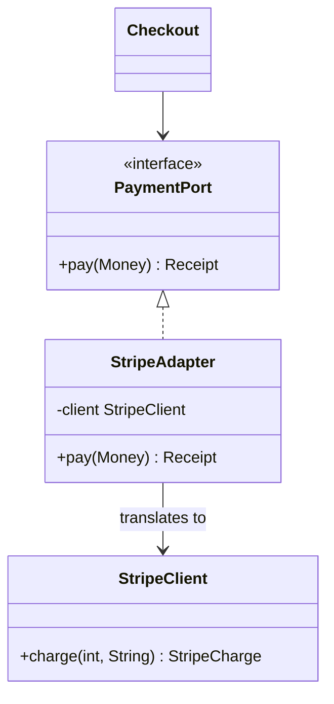

# Adapter

> Make an incompatible interface fit the one your code already expects.

**Family:** Structural
**Also called:** Wrapper

## The problem

Your application speaks one interface. Something you need to use speaks another. A payment library returns `charge(amountInCents, currencyCode)`, your code calls `pay(Money)`. A legacy service returns XML, everything downstream expects JSON. A third-party analytics client wants `track(String, Map)`, your ports expect `record(Event)`.

You cannot change the other side. It is a vendor library, another team's service, or code that fifty other callers depend on. Changing your side means editing every call site to match a shape you did not choose, and doing it again when the vendor is replaced.

## The idea in one picture

A travel plug does not rewire the hotel or the laptop. It sits between them and translates the shape.



## How it works

The adapter implements the interface your code expects. Inside, it holds an instance of the incompatible class and translates each call: it converts the arguments, calls the other method, converts the result back, and maps the errors. Your code never sees the foreign shape. The foreign class never learns about yours.

Error translation is the part people forget. If a vendor exception leaks through the adapter, callers end up catching a vendor type, and the coupling you removed comes straight back.

## Code

```java
interface PaymentPort {
    Receipt pay(Money amount);
}

final class StripeAdapter implements PaymentPort {
    private final StripeClient client;

    StripeAdapter(StripeClient client) { this.client = client; }

    @Override
    public Receipt pay(Money amount) {
        try {
            StripeCharge c = client.charge(amount.cents(), amount.currency().code());
            return new Receipt(c.getId(), amount);
        } catch (StripeException e) {
            throw new PaymentFailed(e.getMessage(), e); // vendor type stops here
        }
    }
}
```

```python
class StripeAdapter:  # satisfies the PaymentPort protocol
    def __init__(self, client: StripeClient):
        self._client = client

    def pay(self, amount: Money) -> Receipt:
        try:
            charge = self._client.charge(amount.cents, amount.currency)
            return Receipt(charge.id, amount)
        except StripeError as e:
            raise PaymentFailed(str(e)) from e
```

```typescript
class StripeAdapter implements PaymentPort {
  constructor(private readonly client: StripeClient) {}

  pay(amount: Money): Receipt {
    const charge = this.client.charge(amount.cents, amount.currency);
    return { id: charge.id, amount };
  }
}
```

Full runnable versions: [`AdapterDemo.java`](../../examples/java/AdapterDemo.java), [`adapter.py`](../../examples/python/adapter.py), [`adapter.ts`](../../examples/typescript/adapter.ts).

## When to use it

- You are integrating a third-party library and want exactly one place that knows its shape.
- You expect to replace the vendor later, or to run two vendors side by side during a migration.
- Legacy code has an interface you cannot change and callers you do not want to teach.
- Tests need a fake, and the vendor client is hard to fake directly.

## When not to use it

- **You control both sides.** Then fix the interface. An adapter between two things you own is a permanent tax on a problem you could delete.
- **The two models are genuinely different.** If translating loses information or requires guessing, the adapter becomes a small application with its own bugs. Rethink the boundary instead.
- **You are adding behavior, not translating.** That is [Decorator](decorator.md). An adapter changes the interface and keeps behavior. A decorator keeps the interface and changes behavior.

## What it costs

| You gain | You pay |
|---|---|
| One place that knows the foreign shape | One more class, and one more hop in every stack trace |
| Vendor swaps that touch a single file | Translation can lose detail, and the loss is invisible at the call site |
| Test doubles that implement your interface, not theirs | Two models to keep in sync when the vendor changes theirs |

## Mistakes that show up in code review

- **Vendor types in the adapter's signature.** If `pay` returns a `StripeCharge`, nothing was decoupled. Only your own types cross the boundary.
- **Leaking vendor exceptions.** Catch them, translate them, and let callers handle your error type.
- **Business logic creeping in.** Retry policy, pricing rules, and fraud checks belong outside. An adapter that grows rules becomes the thing everybody is afraid to touch.
- **One adapter per call site.** Write it once and share it. Three adapters for the same client will drift.

## Often confused with

| Looks like | Actual difference |
|---|---|
| [Decorator](decorator.md) | Decorator keeps the same interface and adds behavior. Adapter changes the interface and keeps behavior |
| [Facade](facade.md) | Facade simplifies a subsystem you chose to hide. Adapter reconciles an interface you did not choose. A facade defines a new easier interface, an adapter conforms to an existing one |
| [Proxy](proxy.md) | Proxy keeps the same interface and controls access. Adapter changes the interface |
| [Bridge](bridge.md) | Bridge is designed in up front to let two hierarchies vary. Adapter is added afterward to make existing code work |

## In modern languages

Structural typing helps: in TypeScript and Go, a small object or struct with the right methods is already an adapter, with no `implements` clause needed. In Python, a Protocol gives the same effect with type checking. Where a target interface has one method, a function is enough: pass `(amount) => stripe.charge(...)` instead of writing a class.

## Related

- [Facade](facade.md), when the goal is a simpler front door rather than a matching shape.
- [Decorator](decorator.md) and [Proxy](proxy.md), the other two wrappers, separated by intent rather than structure.
- [Strategy](../behavioral/strategy.md), which adapters are often written to satisfy.

## Go deeper

Full lesson with diagrams and worked examples in [Grokking Design Patterns for Engineers and Managers](https://www.designgurus.io/course/grokking-design-patterns-for-engineers-and-managers?utm_source=github&utm_medium=repo&utm_campaign=design-patterns). For how patterns are tested in a low-level design round, see [Grokking the Object-Oriented Design Interview](https://www.designgurus.io/course/grokking-the-object-oriented-design-interview?utm_source=github&utm_medium=repo&utm_campaign=design-patterns).
