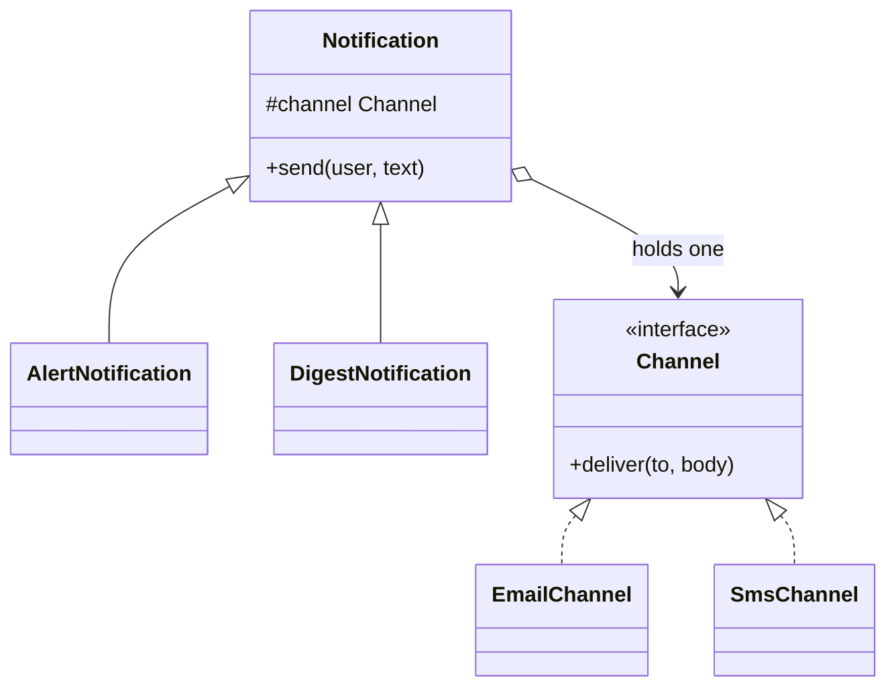

# Bridge

> Split one class into two hierarchies that vary independently, before they multiply into a class explosion.

**Family:** Structural
**Also called:** Handle/Body

## The problem

Two things vary at once. You have three kinds of notification (alert, reminder, digest) and three delivery channels (email, SMS, push). If notification type and channel both live in the class hierarchy, you need nine classes. Add a fourth channel and you need twelve. Add a fourth type and you need sixteen.

This is the class explosion, and the giveaway is a class name with two nouns in it: `EmailAlert`, `SmsDigest`, `PushReminder`. Every one of them duplicates either the message building or the sending.

## The idea in one picture

A TV remote and a TV are separate things. Any remote works any TV that speaks the same protocol. Nobody builds a SonyRemoteForModel55X.



Three types plus three channels is six classes instead of nine, and the gap widens fast: four and four is eight instead of sixteen.

## How it works

Pick which dimension is the abstraction and which is the implementation. The abstraction (notification type) holds a reference to an implementation (channel) rather than inheriting from it. The abstraction defines the high-level flow. The implementation exposes primitive operations. Each side is subclassed separately, and any pair can be combined at runtime.

The reference between them is the bridge. Composition where you would have written inheritance is the entire trick.

## Code

```java
interface Channel {                       // implementation side
    void deliver(String to, String body);
}

abstract class Notification {             // abstraction side
    protected final Channel channel;
    protected Notification(Channel channel) { this.channel = channel; }
    public abstract void send(String user, String text);
}

class AlertNotification extends Notification {
    AlertNotification(Channel c) { super(c); }
    @Override public void send(String user, String text) {
        channel.deliver(user, "[ALERT] " + text);
    }
}

// Any pairing works, chosen at runtime.
new AlertNotification(new SmsChannel()).send("+1555", "disk 91% full");
```

```python
class Notification:
    def __init__(self, channel: Channel):
        self.channel = channel

class AlertNotification(Notification):
    def send(self, user: str, text: str) -> None:
        self.channel.deliver(user, f"[ALERT] {text}")
```

```typescript
abstract class Notification {
  constructor(protected readonly channel: Channel) {}
  abstract send(user: string, text: string): void;
}

class AlertNotification extends Notification {
  send(user: string, text: string): void {
    this.channel.deliver(user, `[ALERT] ${text}`);
  }
}
```

Full runnable versions: [`BridgeDemo.java`](../../examples/java/BridgeDemo.java), [`bridge.py`](../../examples/python/bridge.py), [`bridge.ts`](../../examples/typescript/bridge.ts).

## When to use it

- Two dimensions vary, and both will keep growing. Renderers and shapes, drivers and databases, message types and transports.
- You want to pick the pairing at runtime, or configure it per environment.
- The implementation side should be replaceable without every abstraction knowing, for example swapping a real channel for a test one.
- A platform-specific layer needs to stay isolated from the logic above it.

## When not to use it

- **One dimension has a single member.** With one channel, the bridge is an extra interface for nothing. Add it when the second one arrives.
- **The dimensions are not independent.** If some combinations are invalid, the pattern lets you build objects that should not exist, and you end up with runtime checks that inheritance would have prevented.
- **The split is not obvious.** If you cannot say in one sentence which side is the abstraction, the design is not ready. Writing the wrong split costs more than the class explosion.

## What it costs

| You gain | You pay |
|---|---|
| Adding a type or a channel is one class, not a row of them | Two hierarchies to hold in your head instead of one |
| Runtime pairing, and easy test substitution | Indirection: reading one call means looking at two files |
| A platform layer that stays isolated | Up-front design that is expensive to change once code depends on both sides |

## Mistakes that show up in code review

- **Leaking implementation details into the abstraction.** If the notification class checks `if (channel instanceof SmsChannel)`, the bridge is broken. Push the difference down into the channel.
- **An implementation interface that is too specific.** If it grows a method that only one abstraction uses, every other implementation gets a method that throws.
- **Confusing it with Strategy in review.** They look identical in code. The difference is scope and permanence, and it is worth saying out loud in the pull request.
- **Applying it to one axis.** A bridge with one implementation is an interface with extra steps.

## Often confused with

| Looks like | Actual difference |
|---|---|
| [Strategy](../behavioral/strategy.md) | Structurally the same. Strategy swaps one algorithm inside an object, usually per call. Bridge is a structural decision made once, splitting a whole hierarchy so both sides can grow |
| [Adapter](adapter.md) | Adapter is added after the fact to reconcile interfaces you did not design. Bridge is designed in up front so two dimensions never multiply |
| [Abstract Factory](../creational/abstract-factory.md) | Often used together. The factory decides which implementation gets bridged in, then steps out of the way |
| [State](../behavioral/state.md) | State swaps the delegate as the object moves through a lifecycle. A bridge's implementation is normally set once and left alone |

## In modern languages

The implementation side can be a function or a small object rather than an interface. In TypeScript, `type Channel = (to: string, body: string) => void` is enough for one-method implementations. Go's structural interfaces make the pattern almost invisible: define the small interface where it is used, and the split falls out naturally. In Python, passing any object with a `deliver` method works without declaring anything.

## Related

- [Strategy](../behavioral/strategy.md), the behavioral twin of the same structure.
- [Abstract Factory](../creational/abstract-factory.md), for choosing which implementation to bridge to.
- [Adapter](adapter.md), when the implementation side is a foreign interface that needs translating first.

## Go deeper

Full lesson with diagrams and worked examples in [Grokking Design Patterns for Engineers and Managers](https://www.designgurus.io/course/grokking-design-patterns-for-engineers-and-managers?utm_source=github&utm_medium=repo&utm_campaign=design-patterns). For how patterns are tested in a low-level design round, see [Grokking the Object-Oriented Design Interview](https://www.designgurus.io/course/grokking-the-object-oriented-design-interview?utm_source=github&utm_medium=repo&utm_campaign=design-patterns).
