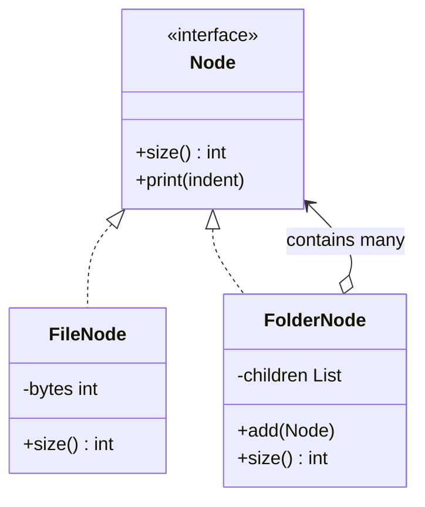

# Composite

> Treat a single object and a tree of objects through the same interface.

**Family:** Structural
**Also called:** Object Tree

## The problem

You have a structure that nests. A folder holds files and other folders. An invoice holds line items and grouped bundles that hold their own items. A UI panel holds widgets and other panels.

Now compute the total size, or the total price, or render the whole thing. Without a pattern, every operation starts with a type check:

```java
if (node instanceof File) { total += ((File) node).size(); }
else { for (Node child : ((Folder) node).children()) { /* recurse */ } }
```

That check appears in every operation, and each one has to get the recursion right on its own.

## The idea in one picture

A box can hold items or smaller boxes. To find the total weight, you weigh the outer box, and it asks whatever is inside.



The recursive edge, a folder containing nodes that may themselves be folders, is what makes it a composite.

## How it works

One interface covers both cases. Leaves implement it by doing the actual work. Composites implement it by delegating to their children and combining the results. Client code holds the interface and never asks which kind it has.

The recursion lives in one place, inside the composite, rather than in every caller.

## Code

```java
interface Node {
    long size();
}

record FileNode(String name, long bytes) implements Node {
    public long size() { return bytes; }
}

final class FolderNode implements Node {
    private final List<Node> children = new ArrayList<>();

    FolderNode add(Node child) { children.add(child); return this; }

    @Override
    public long size() {
        long total = 0;
        for (Node c : children) total += c.size(); // works for files and folders alike
        return total;
    }
}
```

```python
class FileNode:
    def __init__(self, name: str, size_bytes: int):
        self.name, self._bytes = name, size_bytes
    def size(self) -> int:
        return self._bytes

class FolderNode:
    def __init__(self, name: str):
        self.name, self.children = name, []
    def add(self, child):
        self.children.append(child)
        return self
    def size(self) -> int:
        return sum(child.size() for child in self.children)
```

```typescript
interface Node { size(): number }

class FolderNode implements Node {
  private children: Node[] = [];
  add(child: Node): this { this.children.push(child); return this; }
  size(): number { return this.children.reduce((t, c) => t + c.size(), 0); }
}
```

Full runnable versions: [`CompositeDemo.java`](../../examples/java/CompositeDemo.java), [`composite.py`](../../examples/python/composite.py), [`composite.ts`](../../examples/typescript/composite.ts).

## When to use it

- The data is genuinely a tree: file systems, org charts, category hierarchies, nested UI, expression trees.
- Callers should not care whether they hold one item or a group.
- Operations over the tree keep being added, and you do not want each one writing its own traversal.

## When not to use it

- **The structure is flat.** A list is not a tree. If nothing nests, the interface adds nothing.
- **Leaves and composites have almost nothing in common.** Forcing one interface over two unrelated things gives you methods that throw, which is worse than the type check you removed.
- **The tree is deep and the operation is hot.** Recursion over a deep tree costs stack frames and cache misses. A flattened index or an iterative walk may be the right call.
- **You need the tree to change while you read it.** Concurrent modification during recursion is a real hazard and the pattern does nothing to help.

## What it costs

| You gain | You pay |
|---|---|
| Uniform treatment: no type checks at call sites | The shared interface drifts toward the widest common denominator |
| Recursion written once, reused by every operation | Type safety loosens: the compiler cannot stop you adding a child to something that should not have one |
| New node types without touching callers | Deep trees mean deep stacks, and a cycle means an infinite loop |

## Mistakes that show up in code review

- **`add` and `remove` on the leaf interface.** The transparent version puts child management on the shared interface, so every file gets an `add` that throws. The safe version puts them only on the composite, at the cost of a cast when you need them. Pick one deliberately and say which in the code review.
- **No cycle protection.** If a folder can contain an ancestor, `size()` never returns. Check on insert, not during traversal.
- **A composite that assumes its children are leaves.** It compiles, and it silently ignores nested groups.
- **Recomputing on every call.** Totals over a large tree get recomputed constantly. Cache and invalidate upward, or accept the cost knowingly.

## Often confused with

| Looks like | Actual difference |
|---|---|
| [Decorator](decorator.md) | Both wrap objects of the same interface. Decorator wraps exactly one and adds behavior. Composite holds many and aggregates results |
| [Visitor](../behavioral/visitor.md) | Complementary, not competing. Composite gives you the tree, Visitor adds new operations over it without editing the node classes |
| [Iterator](../behavioral/iterator.md) | Iterator walks a structure. Composite is the structure. They pair well |
| [Chain of Responsibility](../behavioral/chain-of-responsibility.md) | A chain is linear and passes a request along. A composite is a tree and fans out to all children |

## In modern languages

A sum type expresses this better than an interface in languages that have one. Rust enums, TypeScript discriminated unions, and Python's `match` over dataclasses let you write the tree as data and the operations as functions, which the compiler can check for completeness. In TypeScript, `type Node = { kind: "file"; bytes: number } | { kind: "folder"; children: Node[] }` gives you exhaustiveness checking that the class version cannot.

## Related

- [Visitor](../behavioral/visitor.md), for adding operations over a composite without editing every node class.
- [Iterator](../behavioral/iterator.md), for walking the tree in a defined order.
- [Builder](../creational/builder.md), which is often how a composite gets assembled readably.
- [Flyweight](flyweight.md), when a large tree repeats the same leaf data many times.

## Go deeper

Full lesson with diagrams and worked examples in [Grokking Design Patterns for Engineers and Managers](https://www.designgurus.io/course/grokking-design-patterns-for-engineers-and-managers?utm_source=github&utm_medium=repo&utm_campaign=design-patterns). For how patterns are tested in a low-level design round, see [Grokking the Object-Oriented Design Interview](https://www.designgurus.io/course/grokking-the-object-oriented-design-interview?utm_source=github&utm_medium=repo&utm_campaign=design-patterns).
