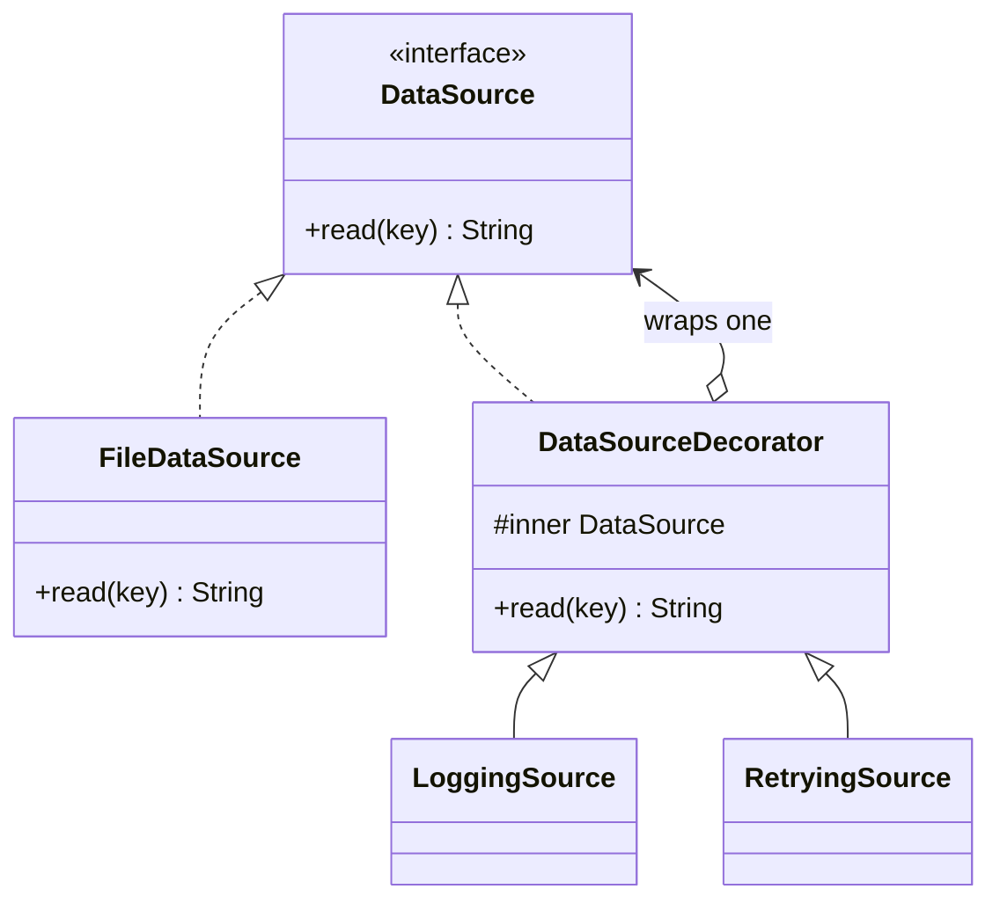

# Decorator

> Add behavior to one object at runtime, without touching its class and without a subclass per combination.

**Family:** Structural
**Also called:** Wrapper

## The problem

A data source needs logging. Then it needs retries. Then metrics. Then a cache. Different callers need different combinations, and some need them in a different order.

Inheritance cannot express this. `LoggingRetryingCachingDataSource` works for exactly one combination, and the number of classes doubles with every concern you add. Putting all four concerns inside the class works until you need one without the cache, and now there is a boolean flag, then four flags, then a method nobody can read.

## The idea in one picture

You put on a jacket, then a coat. Each layer adds something. You are still a person, and anything that works with a person still works.



## How it works

The decorator implements the same interface as the thing it wraps, and holds one instance of it. Each method does its own work and delegates the rest inward. Because a decorator is itself the interface, another decorator can wrap it, so layers stack to any depth.

Order is part of the design. Retry outside cache retries a cache lookup. Cache outside retry caches the result of a retried call. Those are different systems, and the difference is only visible in the wrapping order.

## Code

```java
interface DataSource {
    String read(String key);
}

abstract class DataSourceDecorator implements DataSource {
    protected final DataSource inner;
    protected DataSourceDecorator(DataSource inner) { this.inner = inner; }
}

final class LoggingSource extends DataSourceDecorator {
    LoggingSource(DataSource inner) { super(inner); }
    @Override public String read(String key) {
        System.out.println("read " + key);
        return inner.read(key);       // do the extra bit, then delegate
    }
}

// Layers stack, and the order is the design.
DataSource ds = new LoggingSource(new RetryingSource(new FileDataSource()));
```

```python
class LoggingSource:
    def __init__(self, inner):
        self._inner = inner
    def read(self, key: str) -> str:
        print(f"read {key}")
        return self._inner.read(key)

ds = LoggingSource(RetryingSource(FileDataSource()))
```

```typescript
class LoggingSource implements DataSource {
  constructor(private readonly inner: DataSource) {}
  read(key: string): string {
    console.log(`read ${key}`);
    return this.inner.read(key);
  }
}
```

Full runnable versions: [`DecoratorDemo.java`](../../examples/java/DecoratorDemo.java), [`decorator.py`](../../examples/python/decorator.py), [`decorator.ts`](../../examples/typescript/decorator.ts).

## When to use it

- Cross-cutting concerns stack in combinations: logging, retry, caching, metrics, authorization, compression.
- The set of concerns is chosen at runtime or per environment, not compiled in.
- You cannot modify the class, because it is a vendor type or a shared one.
- You want each concern tested on its own, which layered wrappers make easy.

## When not to use it

- **There is one concern and there always will be.** Put it in the class.
- **The concern needs to see inside.** A decorator only has the public interface. If it needs private state, it is not the right tool.
- **Your platform has a better mechanism.** Middleware, interceptors, and aspect-oriented hooks are decorators with framework support. Use those rather than hand rolling ten wrappers.
- **The stack is deep.** Eight layers means eight frames in every stack trace and a debugging session where nobody can tell which layer changed the value.

## What it costs

| You gain | You pay |
|---|---|
| Combinations without a class per combination | Stack traces get long, and the real work is at the bottom |
| Each concern isolated and testable alone | Object identity breaks: the outer object is not the inner one, so `equals` and `instanceof` surprise people |
| Behavior chosen at runtime | Order becomes a correctness concern that nothing in the type system checks |

## Mistakes that show up in code review

- **Forgetting to delegate.** A decorator that handles one method and drops the rest silently changes behavior. In Java, extend an abstract decorator that forwards everything by default.
- **Order assumed rather than stated.** Write down why retry is outside cache. The next person will get it wrong otherwise.
- **Decorators holding state that assumes a single wrap.** Wrap the same instance twice and a counter double counts.
- **Using it where the interface changes.** Then it is an [Adapter](adapter.md), and calling it a decorator confuses the review.

## Often confused with

| Looks like | Actual difference |
|---|---|
| [Proxy](proxy.md) | Same structure. Proxy controls whether and when the call happens, and usually manages the inner object's lifecycle. Decorator always calls through and adds behavior you asked for |
| [Adapter](adapter.md) | Adapter changes the interface. Decorator keeps it identical, which is what allows stacking |
| [Composite](composite.md) | Composite holds many children and aggregates. Decorator holds exactly one and enhances |
| [Chain of Responsibility](../behavioral/chain-of-responsibility.md) | A chain lets a handler stop the request. A decorator stack always continues inward |

## In modern languages

Python's `@decorator` syntax is a function-level version of the same idea, and for one-function objects it removes the pattern entirely. JavaScript and TypeScript do this with higher-order functions: `withRetry(withLogging(fetchUser))`. Most web frameworks express it as middleware, which is a decorator stack around a request handler. The class version still earns its place when the interface has several methods and you want each concern to touch only some of them.

## Related

- [Proxy](proxy.md) and [Adapter](adapter.md), the other two wrappers.
- [Chain of Responsibility](../behavioral/chain-of-responsibility.md), for stacks where a layer may stop the request.
- [Strategy](../behavioral/strategy.md), when the variation is one swapped algorithm rather than stacked layers.

## Go deeper

Full lesson with diagrams and worked examples in [Grokking Design Patterns for Engineers and Managers](https://www.designgurus.io/course/grokking-design-patterns-for-engineers-and-managers?utm_source=github&utm_medium=repo&utm_campaign=design-patterns). For how patterns are tested in a low-level design round, see [Grokking the Object-Oriented Design Interview](https://www.designgurus.io/course/grokking-the-object-oriented-design-interview?utm_source=github&utm_medium=repo&utm_campaign=design-patterns).
