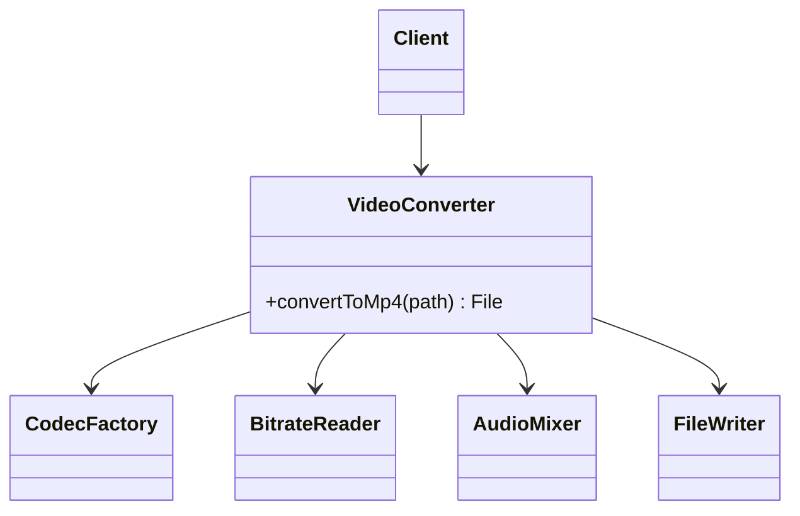

# Facade

> Put one simple entry point in front of a subsystem that is more complicated than most callers need.

**Family:** Structural
**Also called:** nothing else.

## The problem

Doing one useful thing takes six objects in the right order. To convert a video you must open the file, read the codec, pick a decoder, decode frames, pick an encoder, set a bitrate, write the output, and close the handles. Every caller that wants "convert this to MP4" writes those eight lines, and each one gets the cleanup slightly wrong.

The subsystem is not badly designed. It is powerful, and power means options. The problem is that ninety percent of callers want one default path.

## The idea in one picture

A restaurant kitchen has stations, timers, and a whole workflow. You read a menu and say one sentence.



## How it works

One class exposes a small number of methods that describe outcomes rather than steps. Inside, it holds the subsystem objects and performs the usual sequence, including the cleanup. Callers depend on the facade. The subsystem stays exactly as it is, and anyone who needs the full control can still use it directly.

That last point matters. A facade adds a door. It does not lock the others.

## Code

```java
public final class VideoConverter {
    public File convertToMp4(String sourcePath) {
        VideoFile file = new VideoFile(sourcePath);
        Codec source = CodecFactory.extract(file);
        VideoStream decoded = BitrateReader.read(file, source);
        VideoStream converted = BitrateReader.convert(decoded, new Mp4Codec());
        return FileWriter.write(AudioMixer.fix(converted), "mp4");
    }
}

// Every caller, everywhere:
File out = new VideoConverter().convertToMp4("talk.ogg");
```

```python
class VideoConverter:
    def convert_to_mp4(self, source_path: str) -> str:
        file = VideoFile(source_path)
        codec = CodecFactory.extract(file)
        stream = BitrateReader.read(file, codec)
        converted = BitrateReader.convert(stream, Mp4Codec())
        return FileWriter.write(AudioMixer.fix(converted), "mp4")
```

```typescript
class VideoConverter {
  convertToMp4(sourcePath: string): string {
    const file = new VideoFile(sourcePath);
    const codec = CodecFactory.extract(file);
    const stream = BitrateReader.read(file, codec);
    return FileWriter.write(AudioMixer.fix(BitrateReader.convert(stream, new Mp4Codec())), "mp4");
  }
}
```

Full runnable versions: [`FacadeDemo.java`](../../examples/java/FacadeDemo.java), [`facade.py`](../../examples/python/facade.py), [`facade.ts`](../../examples/typescript/facade.ts).

## When to use it

- A common task takes several coordinated calls, and the sequence is copied in many places.
- You want one boundary between your application and a large library, so a future replacement touches one file.
- A legacy subsystem needs a modern entry point while the old one keeps working during a migration.
- A module should expose a small public surface and keep the rest internal.

## When not to use it

- **The subsystem is already simple.** A facade over two method calls is a layer that adds nothing.
- **Callers need the full range.** If every caller reaches past the facade for one option, the facade is wrong. Either widen it deliberately or drop it.
- **You are hiding a mess instead of fixing it.** A facade over an unreliable subsystem gives you a tidy front and the same failures. Sometimes the honest move is to fix or replace what is behind it.

## What it costs

| You gain | You pay |
|---|---|
| Callers write one line instead of eight | Another class that must stay current as the subsystem changes |
| One place that knows the correct sequence and cleanup | It attracts features and can grow into a god object |
| A single seam for replacing the subsystem later | The simplification is opinionated, and someone will need the option it drops |

## Mistakes that show up in code review

- **The facade grows business rules.** It should sequence calls, not make decisions. Once pricing logic lands in it, it stops being a facade.
- **Leaking subsystem types.** If `convertToMp4` returns a `BitrateReader.Stream`, callers are coupled to the subsystem again.
- **Making it the only way in.** Hiding the subsystem behind private access forces the next unusual requirement into the facade. Leave the door open.
- **One facade for unrelated subsystems.** A class with `convertVideo` and `sendInvoice` on it is a utility bag.

## Often confused with

| Looks like | Actual difference |
|---|---|
| [Adapter](adapter.md) | Adapter conforms to an interface that already exists, because a caller demands that shape. Facade invents a new, simpler interface because none existed |
| [Proxy](proxy.md) | Proxy has the same interface as the thing behind it and controls access. Facade has a different, smaller interface and controls complexity |
| [Mediator](../behavioral/mediator.md) | Mediator sits between peers that would otherwise talk to each other, and they know about it. Facade is one-directional and the subsystem does not know it exists |
| [Abstract Factory](../creational/abstract-factory.md) | Abstract Factory hides construction of a family. Facade hides use of a subsystem |

## In modern languages

A module is a facade. In Python, a package `__init__.py` that exports three functions and keeps the rest private is exactly this pattern with no class involved. In Go, a package with a small exported surface does the same. In TypeScript, a barrel file that re-exports a curated set is the common form. Reach for an actual class when the facade needs to hold state, such as configured subsystem instances or a connection.

## Related

- [Adapter](adapter.md), when the goal is matching an interface you did not choose.
- [Singleton](../creational/singleton.md), since one facade instance is usually enough.
- [Mediator](../behavioral/mediator.md), for coordinating peers rather than fronting a subsystem.

## Go deeper

Full lesson with diagrams and worked examples in [Grokking Design Patterns for Engineers and Managers](https://www.designgurus.io/course/grokking-design-patterns-for-engineers-and-managers?utm_source=github&utm_medium=repo&utm_campaign=design-patterns). For how patterns are tested in a low-level design round, see [Grokking the Object-Oriented Design Interview](https://www.designgurus.io/course/grokking-the-object-oriented-design-interview?utm_source=github&utm_medium=repo&utm_campaign=design-patterns).
