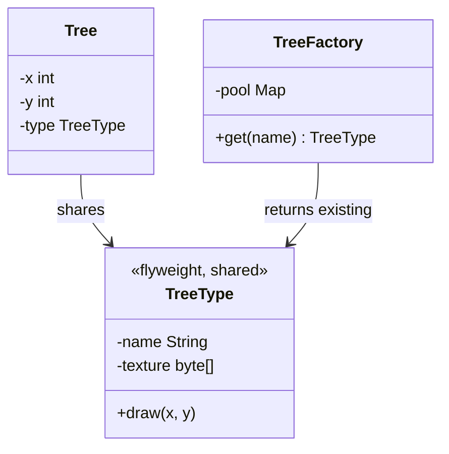

# Flyweight

> Share the part of the state that repeats, so millions of objects fit in memory.

**Family:** Structural
**Also called:** Cache (loosely, and the loose use causes confusion)

## The problem

A game holds a million trees. Each tree object stores its position, and also its mesh, its texture, and its colour. The position is different for every tree. The mesh and texture are identical across the whole forest, and they are the large fields.

A million copies of a two megabyte texture is not a performance problem, it is a crash. The same shape appears in text editors storing a font per character, map applications storing an icon per marker, and any system holding many objects that differ in a small way.

## The idea in one picture

A library does not print a copy of a book for each reader. One copy exists, and each reader has their own bookmark.



## How it works

Split the state in two.

- **Intrinsic state** is shared and identical across many objects. The mesh, the texture, the glyph shape. It must be immutable, because everyone holds the same instance.
- **Extrinsic state** is unique per object and stays outside the flyweight. The position, the index in the document. It gets passed in as a method argument.

A factory owns a pool of flyweights and returns an existing instance when one matches. Callers never construct flyweights directly, because that would defeat the sharing.

## Code

```java
final class TreeType {                       // intrinsic, immutable, shared
    private final String name;
    private final byte[] texture;
    TreeType(String name, byte[] texture) { this.name = name; this.texture = texture; }
    void draw(int x, int y) { /* uses shared texture, position passed in */ }
}

final class TreeFactory {
    private static final Map<String, TreeType> POOL = new HashMap<>();
    static TreeType get(String name, byte[] texture) {
        return POOL.computeIfAbsent(name, n -> new TreeType(n, texture));
    }
}

record Tree(int x, int y, TreeType type) {   // extrinsic state lives here
    void draw() { type.draw(x, y); }
}
```

```python
class TreeFactory:
    _pool: dict[str, "TreeType"] = {}

    @classmethod
    def get(cls, name: str, texture: bytes) -> "TreeType":
        if name not in cls._pool:
            cls._pool[name] = TreeType(name, texture)
        return cls._pool[name]
```

```typescript
class TreeFactory {
  private static pool = new Map<string, TreeType>();
  static get(name: string, texture: Uint8Array): TreeType {
    let t = TreeFactory.pool.get(name);
    if (!t) { t = new TreeType(name, texture); TreeFactory.pool.set(name, t); }
    return t;
  }
}
```

Full runnable versions: [`FlyweightDemo.java`](../../examples/java/FlyweightDemo.java), [`flyweight.py`](../../examples/python/flyweight.py), [`flyweight.ts`](../../examples/typescript/flyweight.ts).

## When to use it

- You hold a very large number of objects, and memory is the actual constraint you measured.
- Most of each object's data repeats across instances.
- The repeating part can be made immutable.
- Object identity does not matter to callers, because they will be sharing instances whether they know it or not.

## When not to use it

- **You have not measured.** This pattern is a memory optimization. Applying it before profiling is the definition of premature optimization, and it makes the code harder to read for nothing.
- **The shared part cannot be immutable.** If one holder mutates it, every holder sees the change. That is a bug that shows up far from its cause.
- **The counts are small.** A thousand objects do not need this. A million might.
- **The unique state is most of the object.** Then there is nothing worth sharing.

## What it costs

| You gain | You pay |
|---|---|
| Memory that drops by orders of magnitude in the right case | Code split into two pieces of state, which is harder to follow |
| A pool that also removes repeated construction cost | The pool holds strong references, so it can become a memory leak of its own |
| Cache friendliness, since the shared data stays hot | Thread safety: the pool needs it, and the flyweight must be immutable to be safe |

## Mistakes that show up in code review

- **A mutable flyweight.** One caller sets a colour, and every tree in the forest changes. This is the failure mode, and it is always confusing to debug.
- **A pool that never evicts.** A flyweight pool keyed by user input grows without limit. That is a memory leak wearing an optimization's clothes.
- **Passing extrinsic state into the constructor.** If position ends up inside the flyweight, sharing stops being possible and nothing was saved.
- **Calling any cache a flyweight.** A cache stores results to avoid recomputation, and entries can be evicted freely. A flyweight exists to share identical immutable state, and it is normally required for correctness of memory use, not speed.

## Often confused with

| Looks like | Actual difference |
|---|---|
| A cache | A cache is about avoiding repeated work and can drop entries at will. A flyweight is about avoiding duplicate state, and the sharing is the point |
| [Singleton](../creational/singleton.md) | Singleton has exactly one instance for the whole program. Flyweight has one instance per distinct value, so it is a pool of many |
| [Prototype](../creational/prototype.md) | Opposite intent. Prototype makes independent copies. Flyweight avoids copies by sharing |
| Object pool | An object pool lends out objects and takes them back, and the objects are mutable and exclusive. Flyweights are shared simultaneously and never returned |

## In modern languages

String interning is a flyweight built into the runtime, and Java, Python, and .NET all do it. Java's `Integer.valueOf` caches small values for the same reason. Immutable value types and records make the intrinsic side easy to express safely. In Python, `sys.intern` and `functools.lru_cache` on a factory function give you the pattern in one line. Any language with structural sharing in its persistent data structures is applying the same idea underneath.

## Related

- [Composite](composite.md), because large trees are where the repetition usually shows up.
- [Factory Method](../creational/factory-method.md), since flyweights are always handed out by a factory.
- [Proxy](proxy.md), when the goal is deferring the cost of a heavy object rather than sharing it.

## Go deeper

Full lesson with diagrams and worked examples in [Grokking Design Patterns for Engineers and Managers](https://www.designgurus.io/course/grokking-design-patterns-for-engineers-and-managers?utm_source=github&utm_medium=repo&utm_campaign=design-patterns). For how patterns are tested in a low-level design round, see [Grokking the Object-Oriented Design Interview](https://www.designgurus.io/course/grokking-the-object-oriented-design-interview?utm_source=github&utm_medium=repo&utm_campaign=design-patterns).
