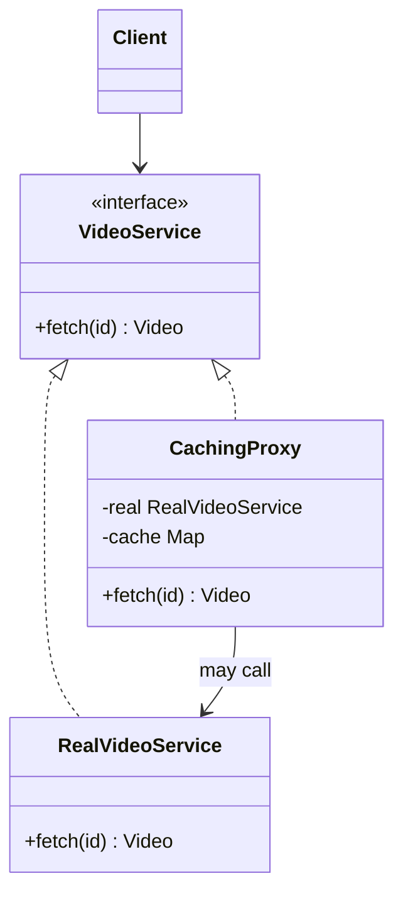

# Proxy

> Stand in for another object, with the same interface, to control access, cost, or timing.

**Family:** Structural
**Also called:** Surrogate

## The problem

Sometimes the real object should not be used directly, or not yet.

- It is expensive to create, and most requests never need it. Loading a hundred megabyte model at startup wastes minutes when nine of ten runs never call it.
- It lives on another machine, and callers should not write network code.
- Not every caller is allowed to use it, and the check does not belong inside the object.
- Every call should be logged or counted, and the class is not yours to edit.

In each case you want something that looks exactly like the real object and decides what actually happens.

## The idea in one picture

A credit card stands in for the money in your account. It has the same interface at the till, and it applies rules before the money moves.



## How it works

The proxy implements the same interface as the real object and holds a reference to it, often creating it lazily. On each call it decides: serve from a cache, check permission, connect over the network, count the call, or simply pass through. Callers cannot tell the difference, which is the requirement.

The four classic kinds are worth naming, because they have different failure modes:

| Kind | What it does |
|---|---|
| Virtual | Delays creating the expensive object until first real use |
| Remote | Makes a call on another machine look local |
| Protection | Checks whether the caller is allowed, before delegating |
| Logging or caching | Records or reuses results around the real call |

## Code

```java
interface VideoService {
    Video fetch(String id);
}

final class CachingProxy implements VideoService {
    private final VideoService real;
    private final Map<String, Video> cache = new HashMap<>();

    CachingProxy(VideoService real) { this.real = real; }

    @Override
    public Video fetch(String id) {
        return cache.computeIfAbsent(id, real::fetch);  // may skip the real call entirely
    }
}
```

```python
class LazyModelProxy:
    def __init__(self, path: str):
        self._path, self._real = path, None

    def predict(self, x):
        if self._real is None:            # built on first real use, not at startup
            self._real = HeavyModel(self._path)
        return self._real.predict(x)
```

```typescript
class ProtectionProxy implements VideoService {
  constructor(private readonly real: VideoService, private readonly role: string) {}
  fetch(id: string): Video {
    if (this.role !== "member") throw new Error("not allowed");
    return this.real.fetch(id);
  }
}
```

Full runnable versions: [`ProxyDemo.java`](../../examples/java/ProxyDemo.java), [`proxy.py`](../../examples/python/proxy.py), [`proxy.ts`](../../examples/typescript/proxy.ts).

## When to use it

- Creation is expensive and often unnecessary. Lazy loading is the most common real use.
- Access control belongs outside the object, especially when the object is shared or third party.
- A remote call should look like a local one, which is what every generated client stub is.
- You need caching, counting, or logging around a class you cannot change.

## When not to use it

- **The object is cheap.** Lazy loading something small adds a null check to every method for no benefit.
- **The proxy would hide an important cost.** A remote proxy that looks local invites callers to use it in a loop. Network calls that look like field access produce the worst performance bugs in distributed systems.
- **Your framework already provides it.** Object relational mappers, dependency injection containers, and service meshes all generate proxies. Hand writing one alongside them causes two layers of surprise.
- **You want to add behavior, not control access.** That is [Decorator](decorator.md).

## What it costs

| You gain | You pay |
|---|---|
| Deferred cost, access control, or transparent remoting | One more indirection, and stack traces that no longer name the real class |
| Callers that do not change at all | Latency and failure hide behind a normal-looking method call |
| A place for cross-cutting rules on a class you do not own | Lazy creation adds a thread safety question that is easy to get wrong |

## Mistakes that show up in code review

- **Lazy initialization without synchronization.** Two threads call `fetch` at once and both build the expensive object. Sometimes harmless, sometimes not.
- **A cache with no expiry or bound.** A caching proxy is a cache, and every cache needs a size limit and an invalidation story. Without them it is a leak that also serves stale data.
- **Making a remote call look free.** Callers write `for (id : ids) service.fetch(id)` and produce a thousand round trips. Expose a batch method or make the cost visible.
- **Swallowing errors to keep the illusion.** Returning `null` when the real object failed converts a clear error into a mystery further down.

## Often confused with

| Looks like | Actual difference |
|---|---|
| [Decorator](decorator.md) | Nearly identical structure, different intent. Decorator adds behavior and always delegates. Proxy controls whether the call happens at all, and usually owns the real object's lifecycle |
| [Adapter](adapter.md) | Adapter changes the interface. Proxy keeps it identical |
| [Facade](facade.md) | Facade offers a new, simpler interface over several objects. Proxy mirrors one object's interface exactly |
| A cache | A caching proxy is one kind of proxy. Not every cache is a proxy, and not every proxy caches |

## In modern languages

JavaScript has a built-in `Proxy` object that intercepts property access and calls, which is how many reactive frameworks and mocking libraries work. Python's `__getattr__` gives you the same reach. Java has dynamic proxies in the standard library, and every mocking framework is built on them. In practice most proxies today are generated rather than written: object relational mappers create lazy-loading proxies for relations, and remote procedure call tools generate client stubs.

## Related

- [Decorator](decorator.md) and [Adapter](adapter.md), the other two wrappers.
- [Flyweight](flyweight.md), the other memory-motivated structural pattern.
- The API and edge group in [system-patterns](../../system-patterns/README.md), which is the same idea one altitude up: reverse proxies, API gateways, and sidecars are proxies for whole services.

## Go deeper

Full lesson with diagrams and worked examples in [Grokking Design Patterns for Engineers and Managers](https://www.designgurus.io/course/grokking-design-patterns-for-engineers-and-managers?utm_source=github&utm_medium=repo&utm_campaign=design-patterns). For how patterns are tested in a low-level design round, see [Grokking the Object-Oriented Design Interview](https://www.designgurus.io/course/grokking-the-object-oriented-design-interview?utm_source=github&utm_medium=repo&utm_campaign=design-patterns).
