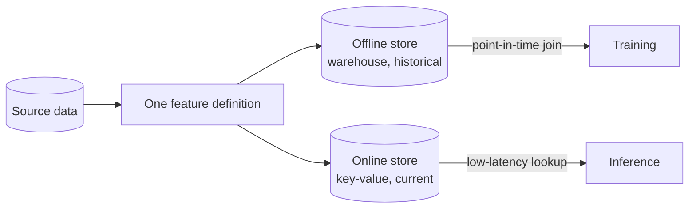

# Feature Store

> Compute a feature once, and serve the identical value to training and to production.

**Group:** AI-era infrastructure

## What it is

A system that stores and serves the inputs to a model. It has two halves that must agree: an **offline store** holding historical values for training, and an **online store** serving current values at low latency for inference.

The point is not storage. It is that both halves are produced by **one definition**, so the feature a model was trained on is the feature it receives in production.

## The failure it prevents

Training-serving skew. The model is trained on `avg_order_value_30d` computed by a Spark job from the warehouse. At inference, a service computes the same-named feature from the production database, in a different language, by a different engineer, eight months later. One counts cancelled orders and the other does not.

The model's accuracy drops in production, offline evaluation shows nothing wrong, and the cause is invisible because both numbers look plausible. This is one of the most common and most expensive failures in production machine learning, and it is silent by construction.

The second failure is **label leakage through time travel**: building a training set by joining current feature values to historical labels, so the model trains on information that did not exist when the prediction was made. Offline metrics look excellent and production performance is poor.

## How it works

Two mechanisms carry the pattern:

**Point-in-time correctness.** When building a training set, the join must return each feature's value **as of** the label's timestamp, not its current value. A feature store that does this join for you removes an entire class of subtle bugs.

**Materialization.** Values computed in the offline pipeline are pushed to the online store on a schedule, so inference reads a precomputed value rather than recomputing it. Some features are streaming and updated continuously, and some are computed at request time because they depend on the request itself.

## Knobs and typical numbers

| Knob | Typical starting value | Raise it when | Lower it when |
|---|---|---|---|
| Online lookup latency | Under 10 ms at p99 for a batch of features | Never higher for interactive inference | Always aim lower |
| Materialization frequency | Hourly for batch features, seconds for streaming | Features change fast and freshness matters | Compute cost dominates |
| Feature freshness target | Minutes to hours by feature, defined per feature | Behavioral features that shift quickly | Demographic features that barely move |
| Features fetched per request | Tens to low hundreds, in one batched call | Rich models | Latency budget is tight |
| Training-serving skew check | Run on every model release | Always | Never skip |

Always fetch features in **one batched call**. A model needing 80 features that issues 80 lookups has already lost its latency budget.

## Trade-offs

| You gain | You pay |
|---|---|
| One definition, so training and serving cannot drift | A significant piece of infrastructure to run and to learn |
| Point-in-time joins, removing leakage bugs | Materialization pipelines that must be monitored like any other pipeline |
| Feature reuse across teams and models | Governance overhead: ownership, versioning, deprecation |
| A place to monitor feature drift | Overkill for one model with five features |

## Failure modes

- **Two definitions with one name.** The failure the pattern exists to prevent, and it reappears whenever a team computes a feature outside the store "just for this model".
- **Stale online values.** The materialization job failed at 02:00, and inference has been serving yesterday's values ever since. Nothing errors. Alert on feature staleness, not just on job success.
- **Point-in-time joins done by hand.** Writing the as-of join manually is error-prone, and the error direction always favors optimistic offline metrics.
- **Null handling that differs between stores.** Training sees a missing feature as `NaN` and imputes the mean, while serving sends zero. The model receives a value it never saw in training.
- **Adding a feature store for one model.** The infrastructure cost is real. Below roughly three models sharing features, a well-tested shared library and a scheduled job are usually the better answer.
- **Unbounded feature sprawl.** Two thousand registered features, most unused, none owned. Require an owner and a deprecation review.
- **Ignoring feature drift.** The input distribution shifts, the model degrades gradually, and nobody notices because accuracy is only measured at release.

## What to instrument

- **Feature freshness per feature**, measured as the age of the newest value in the online store. This is the metric that catches silent staleness.
- **Online lookup latency at p99**, per batch, since this sits directly in the inference path.
- **Training-serving skew**, by logging the features actually used at inference and comparing their distribution to the training set. Run it as a scheduled check, not just at release.
- **Null and default rate per feature**, which reveals broken upstream pipelines before accuracy drops.
- **Feature drift**, comparing the serving distribution against the training distribution over time.
- **Materialization job success and duration**, alerted on lateness rather than only on failure.

## Real systems that use it

- **Uber's Michelangelo** introduced the concept publicly, motivated by exactly the training-serving skew problem across many models and teams.
- **Feast** is the common open-source implementation, with pluggable offline and online stores.
- **Tecton, Databricks Feature Store, and Vertex AI Feature Store** are the managed offerings, all built around the same offline and online split with point-in-time joins.

## Pairs with

- [Model serving](model-serving.md), which is the consumer of the online store.
- [Change data capture](../data-intensive/change-data-capture.md), a common way to keep streaming features current.
- [Stream processing](https://github.com/design-gurus/grokking-system-design/blob/main/patterns/batch-vs-stream-processing.md), for features computed over recent windows.
- [Cache-aside](../caching/cache-aside.md), since the online store is a cache with correctness requirements.

## Go deeper

Covered lesson by lesson, with diagrams and honest trade-offs, in [System Design Patterns](https://www.designgurus.io/course/system-design-patterns?utm_source=github&utm_medium=repo&utm_campaign=design-patterns). For interview framing, see [grokking-system-design](https://github.com/design-gurus/grokking-system-design) and [Grokking the System Design Interview](https://www.designgurus.io/course/grokking-the-system-design-interview?utm_source=github&utm_medium=repo&utm_campaign=design-patterns).
