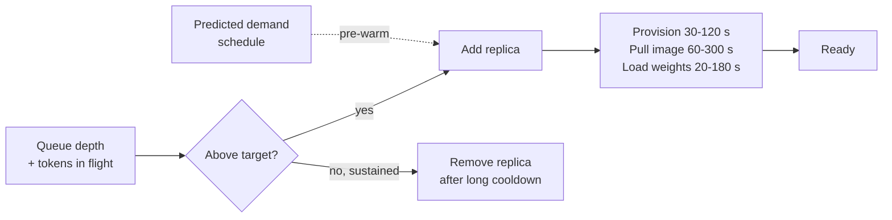

# GPU Auto-Scaling

> Scaling the most expensive machine you rent, when cold start is measured in minutes.

**Group:** AI-era infrastructure

## What it is

Adjusting the number of accelerator instances to match inference demand. Conceptually it is [auto-scaling](../scaling/auto-scaling.md). Practically, three properties change every decision:

1. **Cost.** A GPU instance can cost 10 to 40 times a comparable CPU instance, so idle capacity is expensive in a way it is not for web tiers.
2. **Cold start.** Provisioning, pulling a large image, loading weights: minutes, not seconds.
3. **Scarcity.** The instance type you want may simply be unavailable in your region when you ask for it.

Together those mean the standard reactive policy, scale when CPU crosses 70 percent, is wrong here in almost every detail.

## The failure it prevents

Either paying for peak capacity around the clock, or failing under load. A model endpoint provisioned for its busiest hour costs the same at 04:00 as at 14:00, and for expensive hardware the difference over a year is substantial. Provisioned for average, it fails whenever demand rises.

## How it works

Four adaptations distinguish this from ordinary auto-scaling:

**Scale on queue depth, not utilization.** GPU utilization is a poor signal: it can read high while doing very little useful work, and it says nothing about waiting requests. Queue depth, or the time the oldest request has waited, tracks the thing users experience.

**Pre-warm on prediction, not reaction.** With a five-minute cold start, reactive scaling always arrives late. Scheduled scaling for known daily patterns does most of the work, with reactive scaling as the backstop.

**Keep a warm pool.** One or two idle-but-loaded replicas absorb a spike while new capacity provisions. This is deliberately paid-for idle capacity, and it is usually cheaper than the alternative.

**Scale to zero only when you mean it.** For batch or development workloads, zero is right and the first request waits minutes. For anything interactive, a minimum above zero is required.

Cutting cold start is the highest-leverage work available: cache images on the node, store weights on fast local storage rather than object storage, and use a smaller container.

## Knobs and typical numbers

| Knob | Typical starting value | Raise it when | Lower it when |
|---|---|---|---|
| Scaling signal | Queue depth or oldest-request wait time | Always prefer these | Never use raw GPU utilization alone |
| Target queue wait | 1 to 5 seconds for interactive | Batch workloads | Latency-sensitive products |
| Warm pool size | 1 to 2 replicas | Spikes are sharp and frequent | Cost pressure and smooth traffic |
| Scale-out cooldown | Short, 30 to 60 s, because provisioning is the real delay | Rarely | Always shorter than the cold start |
| Scale-in cooldown | Long, 15 to 30 minutes | Traffic is choppy | Rarely, because re-provisioning is expensive |
| Minimum replicas | 1 or more for interactive, 0 for batch | Availability requirements | Development environments |
| Cold start budget | Measure it: provision + pull + load | Not a knob, the number everything else derives from | Reduce it with caching |

Measure the three phases of cold start separately. Most teams discover the image pull dominates, and that is fixable without touching the model.

## Trade-offs

| You gain | You pay |
|---|---|
| Cost tracks demand on the most expensive hardware you rent | A warm pool that is deliberately idle, and therefore deliberately wasted |
| Capacity for spikes without provisioning for peak permanently | Cold start means the response is always late relative to the spike |
| Scale-to-zero for batch and development workloads | The first request after zero waits minutes |
| Pressure to reduce startup time, which helps everything | Capacity may be unavailable when you ask, and no policy fixes that |

## Failure modes

- **Reactive scaling against a spike.** Traffic triples in thirty seconds, capacity arrives four minutes later, and the incident is over. Pre-warm on schedule, and use a queue with [backpressure](https://github.com/design-gurus/grokking-system-design/blob/main/patterns/backpressure.md) to survive the gap.
- **Capacity that does not exist.** The scaling policy requests instances and the provider has none in that zone. Plan multi-zone and multi-instance-type fallbacks, and know what the service does when it cannot scale.
- **Scaling on GPU utilization.** It looks like a natural signal and it is a poor one. Memory-bound generation can show high utilization while throughput is low.
- **Flapping on expensive hardware.** Aggressive scale-in removes a replica, a request arrives, and a five-minute cold start begins. Scale-in cooldowns here should be much longer than in web tiers.
- **Ignoring the image pull.** A 15 GB container pulled from a remote registry can dominate startup. Cache it on the node or use a smaller base image.
- **Scale to zero on a user-facing endpoint.** The first user after a quiet period waits four minutes and leaves.
- **Requests dropped on scale-in.** Long generations are still streaming when the replica is removed. Drain properly, with a shutdown period longer than the longest generation.
- **No spend cap.** A retry loop scales the fleet and produces a very memorable invoice. Set a maximum and alert on approaching it.

## What to instrument

- **Queue wait time at p50 and p99**, which is the signal and the user experience together.
- **Cold start duration split into provision, pull, and load**, so you know which one to attack.
- **Replica utilization against cost**, expressed as cost per thousand inferences. This is the number that justifies the warm pool or kills it.
- **Failed capacity requests**, which is a scarcity problem no tuning will fix.
- **Time spent at maximum replicas**, indicating the cap is now the constraint.
- **Requests served during scale-in**, which must show zero failures.

## Real systems that use it

- **KEDA** scales Kubernetes workloads on queue depth and custom metrics, which is the right signal shape for this, and it supports scale to zero.
- **Ray Serve** manages replica autoscaling for model deployments with awareness of ongoing requests.
- **Managed inference endpoints** from the major clouds and from providers such as Modal and Replicate implement warm pools and scale-to-zero, and their pricing pages are effectively documentation of the cold start trade.

## Pairs with

- [Auto-scaling](../scaling/auto-scaling.md), the general pattern this specializes.
- [Model serving](model-serving.md), whose batching settings interact directly with how many replicas you need.
- [Semantic caching](semantic-caching.md), which reduces load and therefore the need to scale at all.
- [Graceful degradation](../reliability/graceful-degradation.md), for what to serve while capacity is provisioning.
- [Rate limiting](https://github.com/design-gurus/grokking-system-design/blob/main/patterns/rate-limiting.md), which protects scarce capacity better than scaling can.

## Go deeper

Covered lesson by lesson, with diagrams and honest trade-offs, in [System Design Patterns](https://www.designgurus.io/course/system-design-patterns?utm_source=github&utm_medium=repo&utm_campaign=design-patterns). For interview framing, see [grokking-system-design](https://github.com/design-gurus/grokking-system-design) and [Grokking the System Design Interview](https://www.designgurus.io/course/grokking-the-system-design-interview?utm_source=github&utm_medium=repo&utm_campaign=design-patterns).
