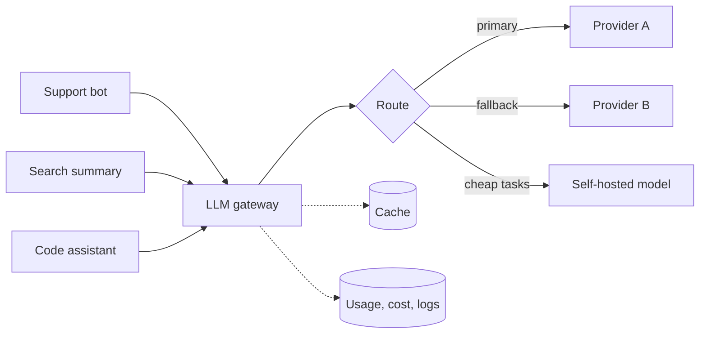

# LLM Gateway

> One control point for keys, quotas, routing, fallbacks, and cost per team.

**Group:** AI-era infrastructure
**Also called:** AI gateway, model router

## What it is

A service that sits between your applications and every model provider. Applications call the gateway. The gateway holds the credentials, chooses the model, enforces limits, retries and fails over, caches, and records what everything cost.

It is an [API gateway](https://github.com/design-gurus/grokking-system-design/blob/main/patterns/api-gateway.md) specialized for a workload where requests are slow, expensive, priced per token, and served by providers with hard rate limits.

## The failure it prevents

Every team integrating providers directly. That gives you provider keys in a dozen codebases, no idea which team spent what, no way to switch models without a code change and a deploy, and a provider outage that takes down every feature at once because nobody built a fallback.

The cost problem is the one that usually forces the issue. Without a gateway, the monthly invoice is a single number with no attribution, and nobody can tell which feature is responsible.

## How it works

What the gateway owns:

- **Credentials.** One place holding provider keys, rotated centrally. Applications hold a gateway token instead.
- **Routing.** Model selection by task, by tenant, or by cost. Cheap model for classification, expensive model for reasoning, without an application deploy.
- **Fallback.** Provider A returns 429 or 503, and the request goes to provider B. This is the largest single availability win, since provider outages are common and outside your control.
- **Budgets and quotas.** Per team, per tenant, per feature, enforced rather than reported after the fact.
- **Caching.** Exact-match caching for identical prompts, and [semantic caching](semantic-caching.md) for similar ones.
- **Observability.** Tokens in, tokens out, latency, and cost, attributed to a team and a feature.
- **Safety.** One place for prompt-injection filtering, personal-data redaction, and output checks.

Streaming is the constraint that complicates all of this: responses arrive token by token, so the gateway must proxy a stream while still counting tokens, applying policy, and handling a failure that occurs partway through a response.

## Knobs and typical numbers

| Knob | Typical starting value | Raise it when | Lower it when |
|---|---|---|---|
| Gateway added latency | Under 20 ms, excluding the model | Never much more | Always minimize, since it is pure overhead |
| Request timeout | 30 to 120 s for generation | Long outputs or reasoning models | Interactive paths with short answers |
| Retries on 429 or 5xx | 2, with backoff plus jitter, respecting `Retry-After` | Providers are flaky | Cost per attempt is high |
| Fallback trigger | After the primary fails or exceeds a latency threshold | Availability matters most | Model differences make fallback risky |
| Per-team budget window | Daily and monthly caps | Predictable workloads | Tight cost control |
| Cache TTL | Minutes to hours for stable prompts | Prompts repeat often | Content changes quickly |

Attribute every request to a team and a feature with a required header. Retrofitting attribution after six months of usage is far harder than requiring it from the first call.

## Trade-offs

| You gain | You pay |
|---|---|
| One place for keys, limits, routing, and cost attribution | A new service in the path of every model call |
| Provider failover without an application change | A single point of failure, which must be made highly available |
| Model swaps as configuration rather than deploys | Provider-specific features can be hidden by the abstraction |
| Cost visible per team and per feature, before the invoice | Streaming proxying is genuinely fiddly to implement well |

## Failure modes

- **The gateway becoming a single point of failure.** Every AI feature now depends on it. Run several replicas across zones, keep it stateless, and make sure it fails fast rather than hanging.
- **Fallback to a model that behaves differently.** The prompt was tuned for one model, the fallback interprets it differently, and output quality drops silently. Test prompts against every model in the fallback chain.
- **Retrying a partially streamed response.** The client already received 200 tokens when the provider fails. Restarting produces duplicated or contradictory text. Decide the policy explicitly: fail the request, or restart the stream with a marker.
- **Token counting that disagrees with the provider.** Your cost dashboard and the invoice differ, and nobody can reconcile them. Use the provider's reported usage as the source of truth.
- **Caching responses that should be personal.** A cached answer served across tenants leaks data. Key the cache by tenant, and never cache anything containing user-specific content by default.
- **Budget caps with no graceful behavior.** A team hits its cap mid-day and the feature returns errors. Decide in advance whether to degrade to a cheaper model, queue, or fail.
- **Abstracting away features you need.** A lowest-common-denominator interface hides tool use, structured outputs, or caching features specific to one provider. Allow passthrough for provider-specific options.
- **Logging full prompts and responses.** Convenient for debugging, and a serious privacy exposure. Redact by default, and set short retention.

## What to instrument

- **Cost per team, per feature, per model**, updated continuously rather than monthly. This is the reason the gateway exists for most organizations.
- **Tokens in and out per request**, since cost is driven by tokens and not by request count.
- **Time to first token and total generation time**, separately. Users experience the first one.
- **Fallback rate per provider**, which measures provider reliability with your own data.
- **429 rate per provider**, showing where you are against their limits.
- **Cache hit ratio and the cost avoided**, which justifies the caching work.
- **Gateway-added latency**, tracked so overhead does not creep.

## Real systems that use it

- **LiteLLM, Portkey, and Kong AI Gateway** are common implementations, all offering a unified interface, fallbacks, budgets, and usage tracking.
- **Cloudflare AI Gateway** provides caching, rate limiting, and analytics in front of multiple providers.
- **Most large organizations build their own**, because budget policy, tenant attribution, and safety filtering tend to be specific to the company.

## Pairs with

- [API gateway](https://github.com/design-gurus/grokking-system-design/blob/main/patterns/api-gateway.md), the general pattern this specializes.
- [Semantic caching](semantic-caching.md), usually implemented inside the gateway.
- [Circuit breaker](https://github.com/design-gurus/grokking-system-design/blob/main/patterns/circuit-breaker.md) and [retry with exponential backoff](../reliability/retry-exponential-backoff.md), for handling provider failures.
- [Rate limiting](https://github.com/design-gurus/grokking-system-design/blob/main/patterns/rate-limiting.md), enforced per tenant against a shared provider quota.
- [Model serving](model-serving.md), for the self-hosted models the gateway can route to.

## Go deeper

Covered lesson by lesson, with diagrams and honest trade-offs, in [System Design Patterns](https://www.designgurus.io/course/system-design-patterns?utm_source=github&utm_medium=repo&utm_campaign=design-patterns). For interview framing, see [grokking-system-design](https://github.com/design-gurus/grokking-system-design) and [Grokking the System Design Interview](https://www.designgurus.io/course/grokking-the-system-design-interview?utm_source=github&utm_medium=repo&utm_campaign=design-patterns).
