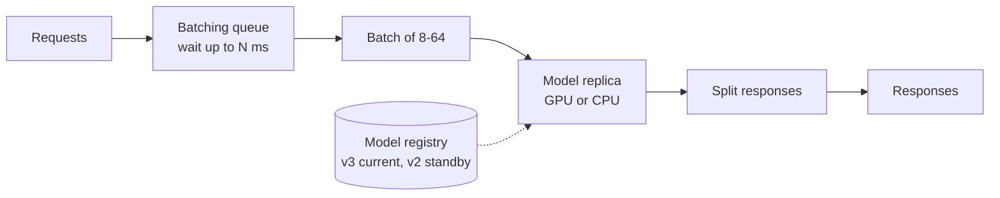

# Model Serving

> Put a model behind an API, with batching, versions, and a way back.

**Group:** AI-era infrastructure

## What it is

The infrastructure that turns a trained model into a service: loading weights, accepting requests, running inference, and returning predictions, with versioning and rollback like any other deployment.

What makes it different from serving ordinary code is the shape of the workload. The model is large, loading it is slow, the hardware is expensive and often scarce, and throughput depends heavily on batching requests together.

## The failure it prevents

A model that works in a notebook and cannot be operated. Without a serving layer you get one of two outcomes: the model is embedded in an application process, so every application instance loads gigabytes of weights and cannot scale independently, or each team builds its own serving code and none of them handle batching, versioning, or rollback.

## How it works

**Dynamic batching** is the mechanic that matters most on accelerators. A GPU processing one request uses a fraction of its capacity. The server holds arriving requests for a few milliseconds, forms a batch, and runs them together, often improving throughput several times over for a small, bounded latency cost.

**Continuous batching**, used by modern language-model servers, goes further: instead of waiting for every sequence in a batch to finish, it admits new requests as slots free up. For generation workloads where output lengths vary widely, this is a large throughput gain over static batching.

**Versioning and rollback** work like any deployment, with one difference: a model rollback may also need the matching feature definitions and preprocessing code. Version them together, or the rolled-back model receives inputs it was not trained on.

## Knobs and typical numbers

| Knob | Typical starting value | Raise it when | Lower it when |
|---|---|---|---|
| Max batch size | 8 to 64 for real-time inference | Throughput matters more than tail latency | Latency budget is tight |
| Batch wait timeout | 5 to 50 ms | Traffic is heavy enough to fill batches quickly | Every millisecond counts |
| Model load time | 10 s to several minutes, depending on size | Not a knob, a constraint to design around | Use smaller models or faster storage |
| Replicas per model | At least 2, across zones | Availability and throughput | Cost, for non-critical models |
| Request timeout | 1 to 10 s for classification, longer for generation | Long generations | Interactive paths |
| Concurrency per replica | Measured, not guessed | Utilization is low | Latency degrades under concurrency |

Measure the batch-size-to-latency curve for your model and hardware before choosing. The relationship is not linear, and the knee of that curve is where the right setting lives.

## Trade-offs

| You gain | You pay |
|---|---|
| Models scale independently of the applications using them | A network hop, so inference is no longer a function call |
| Batching gives large throughput gains on accelerators | Batching adds latency by design, and the wait must be tuned |
| Versioning, canaries, and rollback for models | Model artifacts are large, so deploys are slow |
| One place for inference metrics and cost accounting | Another service to run, with expensive and often scarce hardware |

## Failure modes

- **Cold start on scale-out.** A new replica must pull a multi-gigabyte artifact and load it into memory, taking minutes. Traffic arrives at a replica that is not ready, or the spike passes before capacity exists. Pre-pull images, keep warm standby replicas, and see [GPU auto-scaling](gpu-autoscaling.md).
- **Out-of-memory from a large batch.** Memory use scales with batch size times sequence length. A batch of long inputs kills the replica, taking the whole batch with it. Cap by total tokens, not by request count.
- **Preprocessing drift.** The serving path tokenizes or normalizes differently from training. Predictions degrade with no error anywhere. Ship preprocessing with the model artifact.
- **Silent accuracy decay.** Latency and error rate are healthy while predictions get steadily worse as the input distribution shifts. Technical monitoring will never catch this. Monitor prediction distributions and, where possible, delayed ground truth.
- **No rollback for the model and its inputs together.** Rolling back the model but not the feature pipeline gives the old model new-shaped inputs.
- **Batch timeout tuned once and forgotten.** Traffic patterns change, and a timeout that was right at 100 requests per second is wrong at 10.
- **Treating a GPU replica like a stateless web instance.** It is expensive, slow to start, and scarce. Scaling policies written for web tiers behave badly here.

## What to instrument

- **Latency split into queue wait, batch formation, and inference.** The split is what tells you whether to change batch settings or add replicas.
- **Actual batch size distribution.** If most batches are size 1, batching is not happening and the wait is pure added latency.
- **Accelerator utilization and memory headroom**, which is where the money is.
- **Prediction distribution over time**, per model version. A shift is the earliest available signal of a problem.
- **Requests per model version**, so a canary's share is visible.
- **Cost per thousand inferences**, tracked per version. Model changes move this number a lot.

## Real systems that use it

- **NVIDIA Triton, TorchServe, and TensorFlow Serving** are the general-purpose servers, all with dynamic batching and multi-version support.
- **vLLM and TensorRT-LLM** are the current standards for language models, built around continuous batching and paged attention for memory efficiency.
- **KServe and Seldon** add the Kubernetes control plane: autoscaling, canaries, and traffic splitting for model endpoints.

## Pairs with

- [Feature store](feature-store.md), which supplies the inputs and prevents preprocessing drift.
- [GPU auto-scaling](gpu-autoscaling.md), because this is the workload with a cold start measured in minutes.
- [Canary deployment](../operations/canary-deployment.md), for shifting traffic to a new model version on evidence.
- [Semantic caching](semantic-caching.md), which removes inference calls entirely for repeated questions.
- [LLM gateway](llm-gateway.md), when models are consumed as an external API rather than self-hosted.

## Go deeper

Covered lesson by lesson, with diagrams and honest trade-offs, in [System Design Patterns](https://www.designgurus.io/course/system-design-patterns?utm_source=github&utm_medium=repo&utm_campaign=design-patterns). For interview framing, see [grokking-system-design](https://github.com/design-gurus/grokking-system-design) and [Grokking the System Design Interview](https://www.designgurus.io/course/grokking-the-system-design-interview?utm_source=github&utm_medium=repo&utm_campaign=design-patterns).
