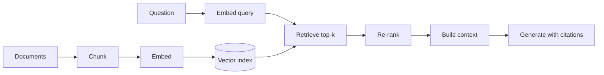

# RAG Pipeline

> Retrieval, ranking, and generation as one system, with failure modes at every stage.

**Group:** AI-era infrastructure
**Also called:** Retrieval-augmented generation

## What it is

Answer a question by retrieving relevant documents and putting them into the model's context, rather than relying on what the model memorized during training. The model's job becomes reading and synthesizing supplied text instead of recalling facts.

The reason to treat it as a system pattern rather than a modeling technique: the quality of the answer is dominated by retrieval, not by the model. Most disappointing deployments are retrieval problems wearing a generation costume.

## The failure it prevents

Answers that are confidently wrong and impossible to update. A model alone knows only what was in its training data, cannot cite a source, and cannot be corrected without retraining. For a support assistant answering questions about documentation that changed last Tuesday, that is unusable.

RAG makes the knowledge external, so it is updatable, auditable, and attributable to a source.

## How it works

Each stage has decisions that matter more than the model choice:

**Chunking.** Too small and a chunk lacks the context to be understood alone. Too large and it dilutes the embedding and wastes context window. Chunk on structure (sections, paragraphs) rather than on a fixed character count where the document allows it.

**Retrieval.** Pure vector search misses exact terms: product codes, error numbers, names. **Hybrid search**, combining vector similarity with keyword search, materially outperforms either alone for most real corpora, and this is one of the highest-return changes available.

**Re-ranking.** Retrieve 50 candidates cheaply, then score them with a cross-encoder that reads the query and each document together. This is slower per document and much more accurate, and it usually improves answer quality more than upgrading the generation model.

**Context construction.** More documents is not better. Models attend unevenly across a long context, with material in the middle receiving less weight, so putting 40 chunks in front of the model can perform worse than putting the best 5.

**Generation with citations.** Instruct the model to answer only from the supplied context and to cite which chunk supports each claim. Citations are what make the output checkable, and checkability is most of the operational value.

## Knobs and typical numbers

| Knob | Typical starting value | Raise it when | Lower it when |
|---|---|---|---|
| Chunk size | 200 to 500 tokens | Documents need broader context to make sense | Retrieval is returning irrelevant neighbors |
| Chunk overlap | 10 to 20% | Concepts span boundaries | Storage and duplicate results |
| Retrieved candidates (k) before re-rank | 20 to 100 | Recall is the bottleneck | Latency or cost |
| Chunks in the final context | 3 to 10 | The question genuinely needs breadth | Answers degrade with more context, which happens often |
| Hybrid weighting | Start near equal, tune on your corpus | Keyword matches matter (codes, names) | Semantic similarity dominates |
| Re-ranker | Cross-encoder on the top 50 | Quality matters | Latency budget is tight |
| Similarity floor | Set one, and return "I do not know" below it | Precision matters | Rarely omit it |

That last row is the one most often skipped. Without a floor, the pipeline always retrieves *something*, and the model dutifully answers from irrelevant text.

## Trade-offs

| You gain | You pay |
|---|---|
| Knowledge that updates without retraining | A pipeline with five stages, each of which can fail quietly |
| Citations, making answers checkable | Latency: embed, retrieve, re-rank, then generate |
| Access control possible at the document level | Chunking and retrieval tuning is ongoing work, not a one-time setup |
| Smaller models often suffice, since facts are supplied | Retrieval failures look like model failures, which misdirects debugging |

## Failure modes

- **Blaming the model for a retrieval failure.** The answer is wrong because the right chunk was never retrieved. Teams respond by upgrading the model, at higher cost and no improvement. Always evaluate retrieval separately from generation.
- **No "I do not know" path.** Nothing relevant was found, and the model answers anyway from whatever was retrieved. A similarity floor plus an explicit instruction is the fix.
- **Chunk boundaries splitting the answer.** The condition is in one chunk and the exception in the next, so the answer is confidently incomplete. Overlap helps, structural chunking helps more.
- **Vector-only retrieval on a corpus full of identifiers.** Error codes and part numbers are exactly what embeddings handle worst. Add keyword search.
- **Stale index.** Documents changed, the index did not, and answers cite deleted content. Tie reindexing to the content pipeline.
- **Access control ignored.** Retrieval returns a document the user is not allowed to read, and the model summarizes it into the answer. Filter by permission **before** retrieval, and re-check the final citations.
- **Prompt injection through retrieved content.** A document contains instructions aimed at the model. Retrieved text is untrusted input, and it must never be treated as instructions.
- **Context stuffed to the limit.** Adding chunks until the window is full lowers quality and raises cost.

## What to instrument

- **Retrieval recall against a labeled question set**: was the correct chunk in the retrieved set at all? This is the most valuable metric in the pipeline and the one most often missing.
- **Re-rank improvement**, comparing position before and after, which tells you whether the re-ranker earns its latency.
- **Answer groundedness**, measured by checking whether cited chunks actually support the claims. Automated graders plus periodic human review.
- **"I do not know" rate**, which should be non-zero. A pipeline that always answers is not detecting its own gaps.
- **Latency per stage**: embed, retrieve, re-rank, generate. The bottleneck is often not generation.
- **Cost per answered question**, including embedding, retrieval, and generation.
- **Citation click-through or user feedback**, which is the closest thing to ground truth in production.

## Real systems that use it

- **Documentation and support assistants** are the dominant production use, because the corpus is bounded, changes often, and citations matter.
- **LangChain and LlamaIndex** provide the pipeline building blocks; the tuning decisions above remain yours regardless of framework.
- **Cohere Rerank and open cross-encoder models** are the common re-ranking layer, and adding one is usually the single highest-return change to a mediocre pipeline.

## Pairs with

- [Vector database sharding](vector-database-sharding.md), once the index outgrows one node.
- [Semantic caching](semantic-caching.md), for the repeated questions that dominate real traffic.
- [LLM gateway](llm-gateway.md), for cost control, fallbacks, and attribution.
- [Feature store](feature-store.md), if retrieval is combined with structured features.
- [Graceful degradation](../reliability/graceful-degradation.md), for what to serve when retrieval or generation is unavailable.

## Go deeper

Covered lesson by lesson, with diagrams and honest trade-offs, in [System Design Patterns](https://www.designgurus.io/course/system-design-patterns?utm_source=github&utm_medium=repo&utm_campaign=design-patterns). For interview framing, see [grokking-system-design](https://github.com/design-gurus/grokking-system-design) and [Grokking the System Design Interview](https://www.designgurus.io/course/grokking-the-system-design-interview?utm_source=github&utm_medium=repo&utm_campaign=design-patterns).
