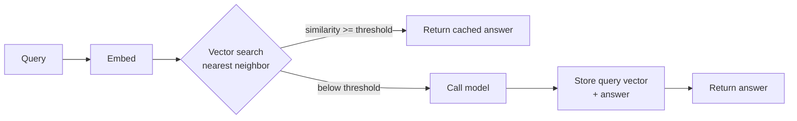

# Semantic Caching

> Reuse an answer for a question that is similar, not identical.

**Group:** AI-era infrastructure

## What it is

A cache keyed by meaning instead of by exact string. The query is embedded into a vector, compared against the vectors of previously answered queries, and if one is close enough, its stored answer is returned without calling the model.

An ordinary cache would treat "how do I reset my password" and "I forgot my password, what now" as two unrelated keys. Semantically they are one question, and a semantic cache serves the second from the first.

## The failure it prevents

Paying full inference cost for questions you have already answered. In a support assistant, a small number of intents cover a large share of traffic, phrased in endless variations. Exact-match caching catches almost none of them, because users never type the same sentence twice.

The saving is on two axes at once: cost per call, and latency. A cache hit answers in tens of milliseconds instead of seconds.

## How it works

The whole pattern rests on **one number: the similarity threshold**. Set it too low and the cache returns answers to questions the user did not ask, which is far worse than a slow answer. Set it too high and almost nothing hits, and you have added an embedding call for no benefit.

The asymmetry matters when tuning. A false negative costs one model call. A false positive gives the user a confidently wrong answer, and they may not notice it is wrong. Start conservative.

Some queries must never be cached across users: anything containing personal data, anything whose answer depends on the user's account, and anything time-sensitive. Cache scope has to be a deliberate decision, per query type, not a global setting.

## Knobs and typical numbers

| Knob | Typical starting value | Raise it when | Lower it when |
|---|---|---|---|
| Cosine similarity threshold | 0.90 to 0.97, tuned on real traffic | False negatives dominate and answers are generic | Any false positive is observed |
| TTL | Minutes to hours | Answers are stable reference content | Answers depend on changing data |
| Cache scope | Per tenant by default | Content is genuinely public | Anything user-specific |
| Embedding latency | Under 20 ms | Never much more, it is on every request | Use a small, fast embedding model |
| Max cache entries | Thousands to millions, by traffic | Query variety is high | Memory or index cost |
| Minimum query length | Skip very short queries | Short queries are ambiguous and cache badly | Rarely |

Tune the threshold on a labeled sample of real query pairs, not by intuition. Take a few hundred pairs, mark which should be treated as the same question, and pick the threshold that produces zero false positives before maximizing hits.

## Trade-offs

| You gain | You pay |
|---|---|
| Cost avoided on repeated questions, often a large fraction | An embedding call and a vector search on every request |
| Latency dropping from seconds to tens of milliseconds | A threshold that is genuinely hard to set correctly |
| Load removed from scarce inference capacity | False positives: confidently wrong answers to the wrong question |
| Consistent answers to the same question | Stale answers when underlying data changes |

## Failure modes

- **Threshold too permissive.** "How do I cancel my subscription" matches "how do I change my subscription" and the user is told how to cancel. This is the failure that damages trust, and it is silent.
- **Negation collapsing.** Embeddings often place "is X safe" and "is X not safe" very close together. Short queries differing by one negation are a known weak spot. Guard with a length threshold or a lexical check.
- **Caching personalized answers.** "What is my balance" cached across users is a data breach. Scope by tenant and user, and exclude query classes that reference account state.
- **Stale answers after the source changed.** The documentation was updated and the cache serves last week's answer for hours. Tie the TTL to how often the underlying content changes, and invalidate on content updates.
- **Cache lookup slower than expected.** A vector search over millions of entries with the wrong index adds latency to every request, including misses.
- **No way to measure correctness.** Hit ratio looks great and nobody knows whether the hits were right. Sample hits and evaluate them, or you are optimizing a number that may be harmful.
- **Caching the prompt instead of the intent.** Including a timestamp or a session id in the embedded text makes every query unique and the cache useless.

## What to instrument

- **Hit ratio, and cost avoided** in currency, which is the justification.
- **Similarity score distribution for hits**, watched near the threshold. A cluster just above it is where false positives live.
- **Sampled human evaluation of cache hits.** Take a sample weekly and check that the served answer actually answers the question. This is the only real correctness signal.
- **Latency for hits and misses separately**, including embedding time on the miss path.
- **Staleness**, measured as the age of served answers.
- **Per-tenant hit ratio**, which reveals whether one tenant's cache is being used by another.

## Real systems that use it

- **GPTCache** is the common open-source implementation, with pluggable embedding models and vector stores.
- **Portkey, Helicone, and similar gateway products** offer semantic caching as a feature, which is the usual place to put it. See [LLM gateway](llm-gateway.md).
- **Support and documentation assistants** are where it pays best, because question variety is high and intent variety is low.

## Pairs with

- [LLM gateway](llm-gateway.md), the natural home for this.
- [Cache-aside](../caching/cache-aside.md), whose TTL and invalidation lessons apply here unchanged.
- [Vector database sharding](vector-database-sharding.md), for when the cache index outgrows one node.
- [RAG pipeline](rag-pipeline.md), where the retrieval step can be cached separately from the generation step.
- [GPU auto-scaling](gpu-autoscaling.md), since every cache hit is capacity you do not have to provision.

## Go deeper

Covered lesson by lesson, with diagrams and honest trade-offs, in [System Design Patterns](https://www.designgurus.io/course/system-design-patterns?utm_source=github&utm_medium=repo&utm_campaign=design-patterns). For interview framing, see [grokking-system-design](https://github.com/design-gurus/grokking-system-design) and [Grokking the System Design Interview](https://www.designgurus.io/course/grokking-the-system-design-interview?utm_source=github&utm_medium=repo&utm_campaign=design-patterns).
