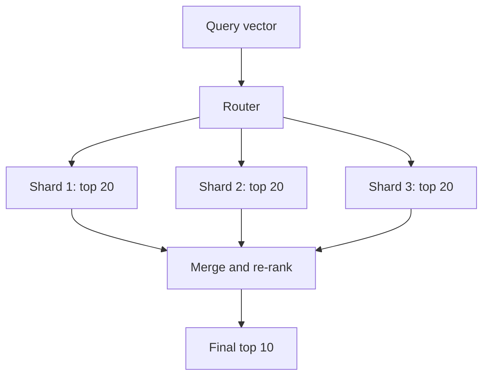

# Vector Database Sharding

> Splitting an index whose accuracy depends on seeing enough of it.

**Group:** AI-era infrastructure

## What it is

Distributing a vector index across nodes when it no longer fits on one, and combining the per-node results into one ranked answer.

The reason it deserves its own page, rather than being a footnote to [sharding](https://github.com/design-gurus/grokking-system-design/blob/main/patterns/sharding-partitioning.md), is that vector search is **approximate**. A relational shard returns exactly the rows matching your predicate. A vector shard returns its best guess at the nearest neighbors, and sharding changes the quality of that guess in ways a key-value store never experiences.

## The failure it prevents

An index that outgrows one machine. Vectors are large: 100 million embeddings at 768 dimensions in 4-byte floats is roughly 300 GB of raw vectors, before the index structure, which for graph-based indexes adds substantially more. Once the index no longer fits in memory, latency collapses, because these algorithms are built on the assumption of memory-resident data.

## How it works

**Scatter-gather is the default.** The query goes to every shard, each returns its local best candidates, and the router merges by score. It is simple and correct, and it means latency is set by the slowest shard, so tail latency grows as shards are added.

**Over-fetch is required.** To return a correct global top 10, each shard must return more than 10, because the true global top 10 may be unevenly distributed. Fetching top 20 to 50 per shard and re-ranking is normal, and it costs bandwidth.

**Metadata filtering interacts badly with sharding.** Filtering by tenant or by date before the vector search can leave a shard with very few candidates, hurting recall. Filtering after the search can return nothing at all if the top candidates are all filtered out. Vector databases differ significantly in how they handle this, and it is worth testing rather than assuming.

Two partitioning strategies:

- **Random or hash partitioning.** Even load, and every query must hit every shard.
- **Semantic or tenant partitioning.** Route a query to relevant shards only, which cuts fan-out. It works well for hard boundaries such as tenant, and poorly for clustering by content, because query topics do not stay aligned with cluster boundaries over time.

For multi-tenant systems, partitioning by tenant is usually right: it removes fan-out, gives isolation, and makes deletion straightforward.

## Knobs and typical numbers

| Knob | Typical starting value | Raise it when | Lower it when |
|---|---|---|---|
| Vectors per shard | 10 to 50 million, memory permitting | Memory headroom exists | Latency at p99 is degrading |
| Over-fetch per shard | 2 to 5 times the final top-k | Recall measures low | Bandwidth or merge cost matters |
| Replicas per shard | 2 or more | Read throughput and availability | Cost |
| HNSW `ef_search` | 64 to 200 | Recall is too low | Latency is too high |
| Recall target | 0.95 or above at the chosen top-k | Quality-sensitive applications | Latency-critical, quality-tolerant |
| Index rebuild cadence | After large batch updates | Heavy deletion or drift | Rebuilds are expensive |

**Measure recall, not just latency.** A sharded vector search can be fast and quietly wrong. Keep a ground-truth set computed by exact brute-force search and compare against it after every configuration change.

## Trade-offs

| You gain | You pay |
|---|---|
| Index size beyond one machine's memory | Every query fans out, so tail latency follows the slowest shard |
| Parallel search across shards | Over-fetch, merging, and re-ranking overhead |
| Isolation and simple deletion when sharded by tenant | Recall can drop in ways that are invisible without measurement |
| Independent scaling of hot tenants | Rebalancing an index is far more expensive than rebalancing rows |

## Failure modes

- **Recall degrading silently.** Results are returned quickly, they look plausible, and the genuinely best matches were missed. Nothing errors. This is the defining risk, and only a ground-truth comparison detects it.
- **Insufficient over-fetch.** Each shard returns its top 10, the merge takes the best 10 of those, and the true global top 10 is not what you got.
- **Tail latency from fan-out.** With 20 shards, the p99 of the query is close to the p99.95 of a single shard. Adding shards makes this worse, not better.
- **Filtering applied at the wrong stage.** Pre-filtering shrinks the candidate pool below what the index needs to work well. Post-filtering can return an empty result while relevant matches existed. Know which your database does.
- **Deletes that are only marked.** Most vector indexes tombstone rather than remove, so memory and search cost do not fall after deletion. A rebuild or compaction is needed, and it is expensive.
- **Rebalancing underestimated.** Moving vectors between shards means rebuilding index structures, not just copying rows. Plan capacity so this is rare.
- **Embedding model changed without reindexing.** New vectors are in a different space from old ones, and similarity scores across the boundary are meaningless. A model change means a full reindex, and it should be planned as a migration.

## What to instrument

- **Recall against a ground-truth set**, run on a schedule and after every configuration change. This is the most important metric on this page.
- **p99 latency per shard and for the merged query**, so fan-out cost is visible.
- **Vectors per shard and memory headroom**, to see skew before it becomes a problem.
- **Deleted-but-present vector count**, which drives the rebuild decision.
- **Over-fetch effectiveness**: how often a result in the final top-k came from outside a shard's top-k. That tells you whether over-fetch is sized correctly.
- **Query fan-out width**, which should fall if you partition by tenant.

## Real systems that use it

- **Weaviate, Qdrant, and Milvus** all shard with scatter-gather and expose the recall and latency knobs directly, which makes them good systems to learn the trade-offs on.
- **Pinecone** manages sharding behind a serverless interface, trading control for operational simplicity.
- **Elasticsearch and OpenSearch** added vector search to an existing sharded engine, so their behavior around filtering and fan-out follows their established model.

## Pairs with

- [Sharding](https://github.com/design-gurus/grokking-system-design/blob/main/patterns/sharding-partitioning.md), the general pattern and its key-choice lessons.
- [RAG pipeline](rag-pipeline.md), the main consumer of a vector index.
- [Semantic caching](semantic-caching.md), which removes repeated queries before they reach the index.
- [Consistent hashing](https://github.com/design-gurus/grokking-system-design/blob/main/patterns/consistent-hashing.md), for limiting how much moves when shard count changes.

## Go deeper

Covered lesson by lesson, with diagrams and honest trade-offs, in [System Design Patterns](https://www.designgurus.io/course/system-design-patterns?utm_source=github&utm_medium=repo&utm_campaign=design-patterns). For interview framing, see [grokking-system-design](https://github.com/design-gurus/grokking-system-design) and [Grokking the System Design Interview](https://www.designgurus.io/course/grokking-the-system-design-interview?utm_source=github&utm_medium=repo&utm_campaign=design-patterns).
