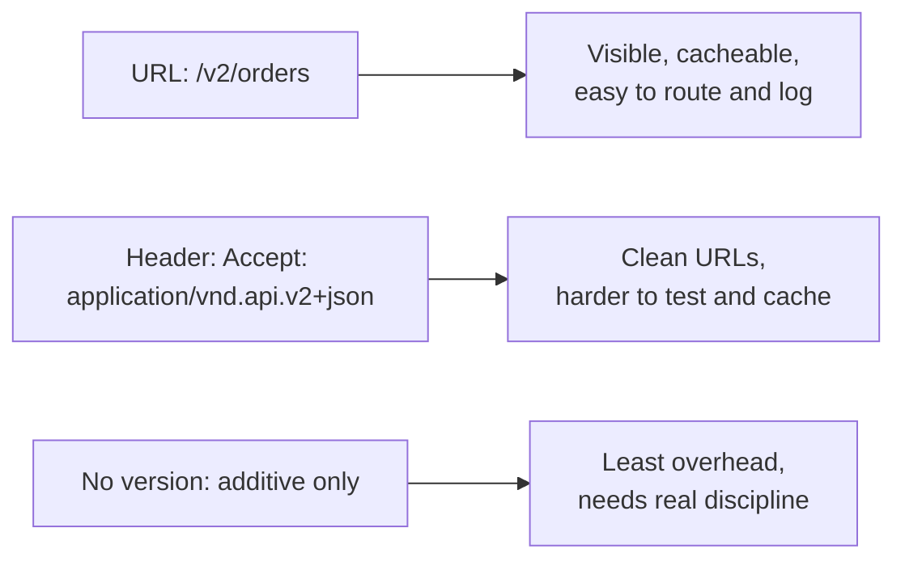

# API Versioning

> Change a contract without breaking clients you do not control.

**Group:** API and edge

## What it is

A strategy for evolving an API while old clients keep working. It covers where the version lives (URL, header, or nothing), what counts as a breaking change, how long old versions are supported, and how they are eventually retired.

The most useful reframing: **most changes should not need a version at all.** Versioning is the expensive fallback for the changes that genuinely break someone. A team that versions every change ends up maintaining six versions and shipping slowly.

## The failure it prevents

Breaking clients you cannot deploy. A mobile app in the field for eighteen months. A partner integration written by someone who left. An internal service owned by a team on a different release cycle. Renaming a field breaks all of them, and you find out from support tickets rather than from tests.

## How it works

The first question is what actually breaks a client:

| Safe (additive) | Breaking |
|---|---|
| Adding an optional response field | Removing or renaming a field |
| Adding an optional request parameter | Making an optional parameter required |
| Adding a new endpoint | Changing a field's type or format |
| Adding a value to a response enum, if clients tolerate unknowns | Changing default behavior or sort order |
| Relaxing a validation rule | Tightening validation, or changing error codes |

Adding an enum value is the row that surprises people. It is safe only if clients were written to ignore unknown values, which must be stated in the API contract from day one.

Three placements, and each has a real cost:

URL versioning wins in practice for public APIs because it is visible in logs, testable in a browser, and trivial to route. Header versioning is cleaner in theory and worse in operations.

**Retirement is the part teams skip.** A version with no removal date is a version forever. Publish the deprecation date when the new version ships, warn in response headers, measure who is still on the old one, and contact them directly.

## Knobs and typical numbers

| Knob | Typical starting value | Raise it when | Lower it when |
|---|---|---|---|
| Concurrent supported versions | 2, at most 3 | A major migration is in flight | Maintenance cost is hurting delivery |
| Deprecation notice period | 6 to 12 months for a public API | Enterprise partners with slow cycles | Internal APIs, where weeks can be enough |
| Mobile version support window | 12 to 18 months after release | Users upgrade slowly | You can force upgrades |
| Sunset warning headers | From the day deprecation is announced | Always | Never omit |
| Traffic threshold to retire | Under 0.1% of requests, and no strategic client | Never purely on percentage | Always check who, not just how many |

Use the standard `Deprecation` and `Sunset` HTTP headers rather than inventing your own. Tooling understands them.

## Trade-offs

| You gain | You pay |
|---|---|
| Clients keep working while the API evolves | Every supported version is code, tests, and documentation to maintain |
| A clear contract with partners about stability | Bugs must often be fixed in several versions |
| Freedom to redesign badly shaped endpoints | Version proliferation if there is no retirement discipline |
| A forcing function for thinking about compatibility | Internal complexity leaks into routing, logging, and metrics |

## Failure modes

- **Versioning everything.** A new version for an additive change trains clients to ignore versions and multiplies your maintenance.
- **No retirement plan.** Version 1 is still serving traffic four years later because nobody set a date.
- **Breaking changes shipped inside a version.** Tightening validation "because the old behavior was a bug" breaks clients just as surely as a rename. If it changes what a client sees, it is breaking.
- **Versioning the whole API for one endpoint.** Every client must migrate for a change affecting one route. Prefer per-resource evolution where the platform allows it.
- **Forgetting non-response contracts.** Error codes, rate limits, pagination behavior, and webhook payloads are all part of the contract, and all get changed without a version.
- **No visibility into who is on which version.** Then retirement is guesswork, and you will break someone important.
- **Mobile treated like web.** A web client is on the new version within a day. A mobile client may never upgrade. Version windows must be set by the slowest client.

## What to instrument

- **Request volume per version**, per client identity. Retirement decisions need both numbers.
- **Unique clients per deprecated version**, which is the list to email.
- **Deprecated endpoint usage**, tracked per endpoint rather than only per version.
- **Errors from clients sending unknown enum values or fields**, which reveal tolerance assumptions that were never true.
- **Time since deprecation announcement**, visible on a dashboard so retirement stays on someone's agenda.

## Real systems that use it

- **Stripe** versions per account: a client is pinned to the version it was created with, and upgrades explicitly. This gives them freedom to change while nothing breaks, at the cost of substantial internal machinery for translating between versions.
- **GitHub** used header-based media type versioning for its REST API, then moved much of its surface to GraphQL, where clients select fields and additive changes are safe by default.
- **Kubernetes** runs alpha, beta, and stable versions per API group with a published deprecation policy, and conversion between versions is handled by the server.

## Pairs with

- [Backend for frontend](backend-for-frontend.md), which can absorb version differences so downstream services do not have to.
- [API gateway](https://github.com/design-gurus/grokking-system-design/blob/main/patterns/api-gateway.md), the natural place to route versions and inject deprecation headers.
- [Feature flags](../operations/feature-flags.md), for rolling out behavior changes to a subset of clients before making them the default.
- [Cursor-based pagination](cursor-pagination.md), since changing a sort order after publishing cursors is a breaking change.

## Go deeper

Covered lesson by lesson, with diagrams and honest trade-offs, in [System Design Patterns](https://www.designgurus.io/course/system-design-patterns?utm_source=github&utm_medium=repo&utm_campaign=design-patterns). For interview framing, see [grokking-system-design](https://github.com/design-gurus/grokking-system-design) and [Grokking the System Design Interview](https://www.designgurus.io/course/grokking-the-system-design-interview?utm_source=github&utm_medium=repo&utm_campaign=design-patterns).
