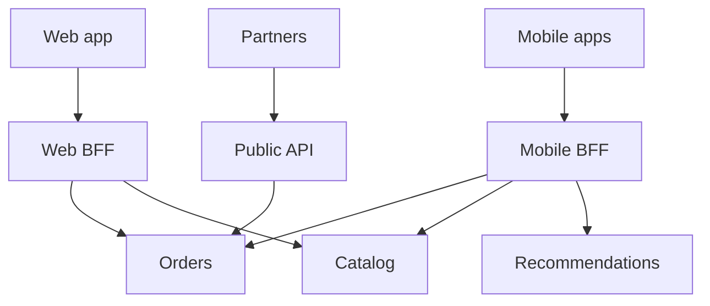

# Backend for Frontend

> One API per client type, instead of one API that fits none of them.

**Group:** API and edge
**Also called:** BFF

## What it is

A separate backend service for each client: one for the web application, one for iOS and Android, one for the public API or partner integrations. Each is owned by the team that owns that client, and each shapes the data exactly for its screens.

Behind them sit the same downstream services. The BFF does not own data. It aggregates, trims, and reshapes.

## The failure it prevents

A single general-purpose API becoming everyone's compromise. The mobile team wants a small payload with three fields. The web team wants nested data for a rich page. The partner API needs stability across years. One endpoint serving all three grows optional parameters, response variants, and a version negotiation scheme, and every change risks breaking a client the team cannot test.

The second failure is chattiness. A mobile screen needing data from five services makes five round trips over a mobile network, where each is 100 ms or worse. A BFF makes those five calls in the data center and returns one response.

## How it works

Each BFF calls the downstream services in parallel, composes the result, and returns exactly what one screen needs. Ownership is the part that makes it work: the mobile team owns the mobile BFF and can change it in the same pull request as the app change, without coordinating with a platform team.

The line to hold is that a BFF contains **presentation logic only**. Formatting, aggregation, field selection, and client-specific defaults belong there. Pricing rules, authorization decisions, and business invariants do not, because duplicating them across three BFFs guarantees they will drift.

## Knobs and typical numbers

| Knob | Typical starting value | Raise it when | Lower it when |
|---|---|---|---|
| Number of BFFs | One per client type, so usually 2 to 4 | A client type has genuinely different needs | You are creating one per screen, which is too far |
| Downstream calls per BFF request | Under 10, in parallel | A screen genuinely needs more | Latency is dominated by fan-out |
| BFF response timeout | Tighter than the client's, often 1 to 2 seconds | Never above the client's patience | Mobile networks, where users give up early |
| Per-downstream timeout inside the BFF | 200 to 500 ms for optional data | The data is essential | The data is decorative |
| Cache TTL in the BFF | Seconds to minutes for composed responses | Composition is expensive and data is stable | Data is personalized or fast-moving |

## Trade-offs

| You gain | You pay |
|---|---|
| Each client gets exactly the payload it needs | More services to deploy, monitor, and secure |
| Client teams ship without waiting on a platform team | Logic can be duplicated across BFFs if the boundary is not held |
| Fan-out happens in the data center, not over a mobile network | Another hop in every request path |
| A natural place for client-specific degradation | An easy place for business logic to leak into |

## Failure modes

- **Business logic drifting into the BFF.** Then the same rule exists in three places and they disagree within a quarter. Review for this specifically.
- **The BFF becoming a monolith.** One BFF serving web, mobile, and partners is just the general-purpose API again, with an extra hop.
- **Sequential downstream calls.** Five calls at 80 ms each is 400 ms serially and 80 ms in parallel. This is the single biggest performance mistake in BFFs.
- **No per-dependency timeout or fallback.** One slow optional service makes the whole composed response slow. Use [bulkhead](../reliability/bulkhead.md) and [graceful degradation](../reliability/graceful-degradation.md).
- **Duplicating authorization.** Each BFF implementing its own permission checks means one will be wrong. Authorize in the downstream services, and treat the BFF as an untrusted caller.
- **One BFF per screen.** A reasonable pattern taken too far, giving forty tiny services that nobody maintains.
- **Forgetting old app versions.** Mobile clients are not upgraded on your schedule, so a mobile BFF must support versions in the field for months. See [API versioning](api-versioning.md).

## What to instrument

- **Latency per composed endpoint**, plus a breakdown by downstream call. The breakdown is what shows sequential fan-out.
- **Fan-out count per request**, watched for growth as screens get richer.
- **Degradation rate per optional downstream**, per BFF.
- **Payload size per client type**, since a growing mobile payload is a regression users feel.
- **Client version distribution** hitting each BFF, which tells you when an old response shape can be retired.

## Real systems that use it

- **SoundCloud** introduced and named the pattern, after a single API could not serve their web and mobile clients well.
- **Netflix** built device-specific adapters for the same reason, since a television, a phone, and a browser need very different payloads from the same services.
- **GraphQL gateways** are frequently deployed as a BFF, with each client requesting exactly the fields it needs. That solves shaping while leaving aggregation, auth, and caching to design.

## Pairs with

- [API gateway](https://github.com/design-gurus/grokking-system-design/blob/main/patterns/api-gateway.md), which handles cross-cutting concerns. A BFF sits behind it and handles shaping.
- [Bulkhead](../reliability/bulkhead.md) and [graceful degradation](../reliability/graceful-degradation.md), both essential given the fan-out.
- [API versioning](api-versioning.md), especially for mobile clients you cannot force to upgrade.
- [Cursor-based pagination](cursor-pagination.md), for the list endpoints a BFF exposes.

## Go deeper

Covered lesson by lesson, with diagrams and honest trade-offs, in [System Design Patterns](https://www.designgurus.io/course/system-design-patterns?utm_source=github&utm_medium=repo&utm_campaign=design-patterns). For interview framing, see [grokking-system-design](https://github.com/design-gurus/grokking-system-design) and [Grokking the System Design Interview](https://www.designgurus.io/course/grokking-the-system-design-interview?utm_source=github&utm_medium=repo&utm_campaign=design-patterns).
