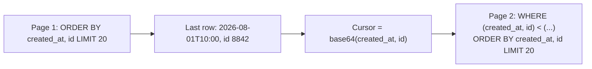

# Cursor-Based Pagination

> Page through changing data without skipping or repeating rows, which offset pagination cannot do.

**Group:** API and edge
**Also called:** Keyset pagination, seek method

## What it is

Instead of "give me rows 40 to 60", the client says "give me 20 rows after this cursor". The cursor encodes the sort position of the last row returned, so the next query resumes exactly where the previous one stopped.

Two problems get solved at once: correctness on data that changes while a client is paging, and query performance deep into a result set.

## The failure it prevents

**Skipped and duplicated rows.** With `OFFSET 40 LIMIT 20`, a client reads page 3. Meanwhile someone inserts a row near the top. Every row shifts down by one, so page 4 starts one row later than it should, and one row is never seen. Delete a row instead and one row appears twice. Users report "missing items" that no one can reproduce, because the bug depends on write timing.

**Deep offsets being slow.** `OFFSET 1000000 LIMIT 20` requires the database to find and discard a million rows to return twenty. The query gets slower the further the client pages, and a scraper paging to the end can pin a database core for minutes.

## How it works



```sql
-- Offset: reads and discards everything before the window
SELECT * FROM posts ORDER BY created_at DESC, id DESC LIMIT 20 OFFSET 100000;

-- Cursor: jumps straight to the position using the index
SELECT * FROM posts
WHERE (created_at, id) < ('2026-08-01 10:00:00', 8842)
ORDER BY created_at DESC, id DESC
LIMIT 20;
```

Two requirements make it correct:

1. **A stable, unique sort key.** Sorting by `created_at` alone breaks when two rows share a timestamp, because the cursor cannot say which one it stopped at. Always append a unique tiebreaker, normally the primary key.
2. **An index matching the sort.** The composite index on `(created_at, id)` is what turns the seek into an index range scan.

The cursor should be opaque to clients: encode the fields, and treat its format as internal. A cursor that is visibly `id=8842` invites clients to construct their own, which freezes your sort order forever.

## Knobs and typical numbers

| Knob | Typical starting value | Raise it when | Lower it when |
|---|---|---|---|
| Default page size | 20 to 50 | Clients are servers doing bulk reads | Rows are large or expensive to render |
| Maximum page size | 100 to 1,000 | Bulk export use cases exist | Payload size or query cost is a concern |
| Cursor encoding | Base64 of the sort tuple, opaque | Always opaque | Never expose raw ids as the contract |
| Cursor expiry | None for keyset cursors, or hours if signed | Cursors encode a snapshot | Never require expiry unless you must |
| Index | Composite, matching the exact sort order | Always | Always |

Return the next cursor in the response rather than making the client build it. A `nextCursor` field, null at the end, is the whole client contract.

## Trade-offs

| You gain | You pay |
|---|---|
| No skipped or duplicated rows as data changes | No jumping to page 47, because there is no page number |
| Constant query cost regardless of depth | The sort key must be indexed and cannot change per request without care |
| Works well for infinite scroll, which is most modern interfaces | No total count, unless you compute it separately |
| Naturally resumable after a client restart | Multi-column sorts make the cursor and the query more complex |

## Failure modes

- **No unique tiebreaker.** Two rows with identical timestamps at a page boundary cause one to be skipped or repeated. This is the most common bug and it appears only under load.
- **Cursor and sort order disagreeing.** The client passes a cursor built for `created_at` and the query sorts by `updated_at`. The result is arbitrary. Encode the sort order in the cursor and validate it.
- **Exposing raw ids as cursors.** Clients will hand-construct them, and you can never change the ordering afterwards.
- **Missing composite index.** The seek becomes a scan, and the pattern's performance advantage disappears while the complexity remains.
- **Offering page numbers anyway.** Product asks for "page 12 of 40", which cursors cannot answer. Decide early, because retrofitting is painful. Offer offsets only for small, stable datasets.
- **Users needing a total count.** Cursor pagination gives none. An approximate count from statistics, or a capped count such as "1000+", is usually enough.
- **Cursors that leak data.** An unsigned cursor can be altered to seek into rows the user cannot see. Authorize the query, not the cursor.

## What to instrument

- **Query latency by page depth.** With cursors it should be flat. If it rises, the index is not being used.
- **Rows examined versus rows returned.** A healthy keyset query is close to 1:1.
- **Distribution of page depth per client.** Clients paging very deep are usually scrapers or a broken loop.
- **Invalid or rejected cursors**, which indicate client bugs or tampering.
- **Page size requested versus granted**, to see clients pushing at the cap.

## Real systems that use it

- **Slack, Stripe, and GitHub** all expose cursor pagination on their list endpoints, with an opaque cursor and a next-page link, precisely because their data changes while clients page.
- **The GraphQL Relay connection specification** standardizes cursor pagination with `edges`, `cursor`, and `pageInfo`, which is why most GraphQL APIs use it.
- **Twitter's API** moved to cursors early, since a timeline is the worst possible case for offset pagination.

## Pairs with

- [Backend for frontend](backend-for-frontend.md), which usually exposes these list endpoints to clients.
- [Rate limiting](https://github.com/design-gurus/grokking-system-design/blob/main/patterns/rate-limiting.md), since paging endpoints are what scrapers hit hardest.
- [API versioning](api-versioning.md), because changing a sort order is a breaking change once cursors exist.
- [Sharding](https://github.com/design-gurus/grokking-system-design/blob/main/patterns/sharding-partitioning.md), where cursors must encode the shard as well as the position.

## Go deeper

Covered lesson by lesson, with diagrams and honest trade-offs, in [System Design Patterns](https://www.designgurus.io/course/system-design-patterns?utm_source=github&utm_medium=repo&utm_campaign=design-patterns). For interview framing, see [grokking-system-design](https://github.com/design-gurus/grokking-system-design) and [Grokking the System Design Interview](https://www.designgurus.io/course/grokking-the-system-design-interview?utm_source=github&utm_medium=repo&utm_campaign=design-patterns).
