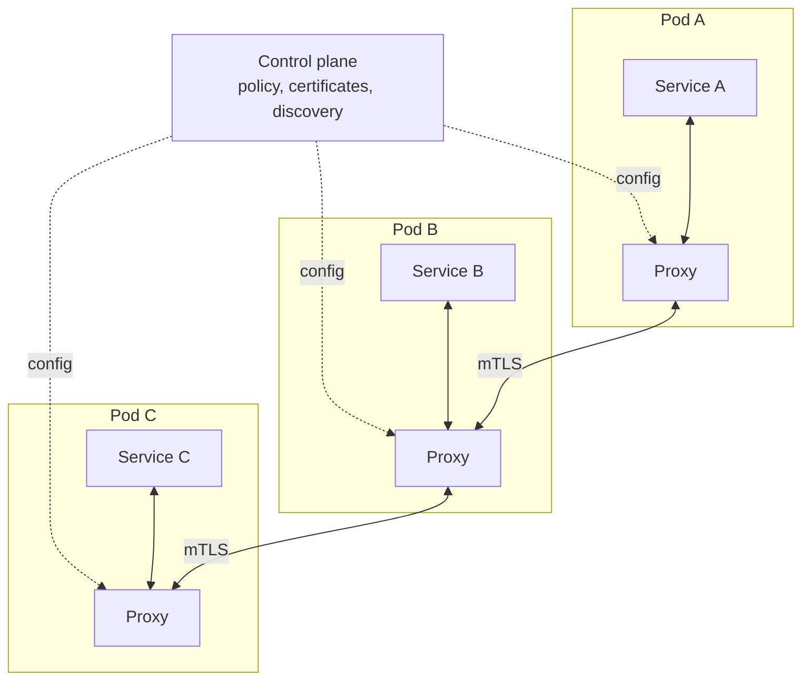

# Service Mesh

> Sidecars with a control plane. The question is whether you are big enough to need one.

**Group:** API and edge

## What it is

A dedicated infrastructure layer for service-to-service communication. A [sidecar](sidecar.md) proxy next to every service handles the traffic (the data plane), and a central control plane configures all of them: routing rules, retry policies, mutual TLS certificates, and traffic splits.

The distinction from a plain sidecar is the control plane. One policy change applies fleet-wide, immediately, with no redeploy.

## The failure it prevents

Network policy scattered across services and impossible to change. Without a mesh, "encrypt all internal traffic" means every team adds TLS to their service. "Retry idempotent GETs twice" means every team configures a client library. "Send 5 percent of traffic to the new version" means a custom deployment mechanism per service.

With a mesh, each of those is one policy object, applied everywhere, verifiable centrally.

## How it works

The control plane distributes configuration and issues short-lived certificates, giving every service identity and encrypted traffic without any application change. The data plane enforces it on every request.

What you get in return, and it is a genuinely strong list: mutual TLS everywhere with automatic rotation, uniform retries and timeouts, circuit breaking, per-route traffic splitting for canaries, request mirroring, authorization policies between services, and consistent golden metrics for every service in one place.

The honest counterweight is operational cost. A mesh is a distributed system you now run, with its own upgrades, its own failure modes, and a learning curve that is real. Teams routinely underestimate this.

**Sidecarless modes** have changed the calculation recently: Istio's ambient mode and Cilium's eBPF-based approach move much of the work into a shared per-node component, removing the per-pod proxy for many cases. That lowers the resource cost but does not lower the operational one.

## Knobs and typical numbers

| Knob | Typical starting value | Raise it when | Lower it when |
|---|---|---|---|
| Added latency per hop | 0.5 to 2 ms, twice per call | Expect it and measure it | Latency-critical paths may bypass |
| Proxy memory per pod | 50 to 150 MB | Large service catalogs | Fleet-wide memory cost matters |
| Certificate lifetime | 24 hours or less, rotated automatically | Never long | Shorter is better if rotation is reliable |
| Retry policy at the mesh | 1 retry on idempotent methods only | Rarely | Any application-level retry exists |
| Rollout scope | One namespace first, then expand | Never enable fleet-wide on day one | Always start small |

The threshold question, answered honestly: a mesh usually starts paying for itself somewhere around **20 or more services across 2 or more languages**, with a platform team that owns it. Below that, a shared library plus an ingress proxy plus [sidecar](sidecar.md) log agents cover most of the benefit at a fraction of the cost.

## Trade-offs

| You gain | You pay |
|---|---|
| Mutual TLS everywhere, with automatic rotation | A new distributed system to operate, upgrade, and debug |
| One place to change retry, timeout, and routing policy | Two proxy hops of latency on every internal call |
| Uniform metrics and traces without touching services | Per-pod resource cost multiplied by the fleet |
| Traffic splitting, mirroring, and fault injection for free | A real learning curve, and a control plane outage is a large event |

## Failure modes

- **Adopting it too early.** Five services, one language, one team. The mesh costs more than the problems it solves, and it will be the cause of your next three incidents.
- **Double retries.** The mesh retries and the application library retries. Nine calls reach a struggling dependency instead of one. Choose one layer, explicitly, and disable the other.
- **Control plane outage.** Data plane proxies usually keep running with their last configuration, which is the correct design, but nothing new can be configured and certificates eventually expire. Know your proxies' behavior when the control plane is unreachable, before you need to.
- **Mutual TLS enabled in strict mode too quickly.** Anything not yet in the mesh, including databases, cron jobs, and legacy services, stops being reachable. Use permissive mode first.
- **Debugging confusion.** Errors from the proxy look like errors from the service. Learn to read proxy response flags, and separate mesh-generated responses in dashboards.
- **Upgrades treated as routine.** Data plane and control plane version skew has real constraints. Upgrades need a plan and a rollback path.
- **Expecting it to fix application problems.** A mesh does not fix a slow query, a bad schema, or a chatty call pattern. It makes them visible, which is genuinely useful and often mistaken for a solution.

## What to instrument

- **Golden metrics per service pair**: request rate, error rate, and latency for every caller-callee edge. This is the mesh's best gift, and most teams never look at it.
- **Mesh-generated responses separated from application responses**, especially 503s.
- **Certificate expiry and rotation failures**, which fail closed and take down traffic.
- **Control plane health and config propagation delay**, which is how long a policy change takes to reach every proxy.
- **Latency added by the mesh**, tracked over time so upgrades that regress it are caught.
- **Proxy resource usage across the fleet**, as a single total.

## Real systems that use it

- **Istio** is the most feature-complete, with Envoy as the data plane, and its ambient mode removes the per-pod sidecar for many workloads.
- **Linkerd** trades features for simplicity, using a purpose-built lightweight Rust proxy, and is the common recommendation for teams that want mutual TLS and metrics without Istio's surface area.
- **Cilium** implements mesh functions with eBPF at the kernel level, avoiding per-pod proxies for a large part of the work.

## Pairs with

- [Sidecar](sidecar.md), the data plane component the mesh coordinates.
- [Circuit breaker](https://github.com/design-gurus/grokking-system-design/blob/main/patterns/circuit-breaker.md), [retry with exponential backoff](../reliability/retry-exponential-backoff.md), and [timeout](../reliability/timeout.md), the policies it centralizes.
- [Canary deployment](../operations/canary-deployment.md), which mesh traffic splitting makes precise.
- [Distributed tracing](../operations/distributed-tracing.md), which the mesh bootstraps but cannot complete without application support.
- [API gateway](https://github.com/design-gurus/grokking-system-design/blob/main/patterns/api-gateway.md), which handles north-south traffic while the mesh handles east-west.

## Go deeper

Covered lesson by lesson, with diagrams and honest trade-offs, in [System Design Patterns](https://www.designgurus.io/course/system-design-patterns?utm_source=github&utm_medium=repo&utm_campaign=design-patterns). For interview framing, see [grokking-system-design](https://github.com/design-gurus/grokking-system-design) and [Grokking the System Design Interview](https://www.designgurus.io/course/grokking-the-system-design-interview?utm_source=github&utm_medium=repo&utm_campaign=design-patterns).
