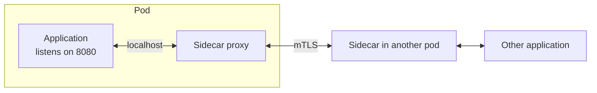

# Sidecar

> Move cross-cutting concerns out of the application process and into a container beside it.

**Group:** API and edge
**Interview framing:** [proxies in grokking-system-design](https://github.com/design-gurus/grokking-system-design/blob/main/patterns/proxies.md)

## What it is

A second process deployed alongside the application, sharing its lifecycle and its network namespace. The application talks to localhost, and the sidecar handles the concern: mutual TLS, retries, metrics, log shipping, secret rotation, or traffic routing.

The application does not know it is there, which is the point. A Python service, a Java service, and a Go service all get the same behavior with no shared library.

## The failure it prevents

The same cross-cutting logic reimplemented per language, and then drifting. A company with services in four languages needs mutual TLS, retries with backoff, connection pooling, distributed tracing, and metrics in all four. That is four libraries to write, four to keep in step, and a security fix that requires every team to upgrade a dependency and redeploy.

With a sidecar, the behavior is upgraded by changing one image, and it applies to every service regardless of language.

## How it works

The sidecar shares the pod: same network namespace, so localhost works, and same lifecycle, so it starts and stops with the application. Traffic is redirected transparently, usually with iptables rules, so the application's outbound calls pass through the sidecar without any code change.

Common jobs: mutual TLS between services, retries and timeouts, circuit breaking, load balancing, traffic splitting for canaries, metrics collection, log forwarding, and secret injection.

The costs are real and often understated: one extra process per pod (memory and CPU), and two extra network hops per request, one on each side. At normal service latencies this is small. At very low latencies it is not.

## Knobs and typical numbers

| Knob | Typical starting value | Raise it when | Lower it when |
|---|---|---|---|
| Sidecar memory | 50 to 150 MB per pod | Many routes and endpoints to track | Memory pressure across a large fleet |
| Sidecar CPU | 0.05 to 0.2 vCPU at moderate traffic | High request rates | Cost matters at scale |
| Added latency per hop | Roughly 0.5 to 2 ms | Expect two hops per call | Latency-critical paths may need to bypass |
| Startup ordering | Sidecar ready before the application starts | Always | Never invert |
| Shutdown ordering | Application drains before the sidecar exits | Always | Never invert |

Multiply the per-pod cost by pod count. A 100 MB sidecar across 2,000 pods is 200 GB of memory spent on infrastructure, which is a real line item and a real argument to have.

## Trade-offs

| You gain | You pay |
|---|---|
| One implementation for every language | An extra process per pod, with its memory and CPU |
| Security and reliability upgrades without touching application code | Two more network hops per request |
| Uniform metrics and traces across a heterogeneous fleet | Debugging now spans application and sidecar, and the boundary is confusing |
| Traffic control (canaries, mirroring) without redeploying services | Startup and shutdown ordering problems that are easy to get wrong |

## Failure modes

- **Startup race.** The application starts, makes an outbound call, and the sidecar is not ready, so the call fails. Every sidecar platform has a mechanism for this; use it rather than adding a sleep.
- **Shutdown race.** The sidecar exits first and the application's in-flight requests fail during every deploy. Drain the application first.
- **Double retries.** The sidecar retries and the application library also retries. Three by three is nine calls to a struggling dependency. Pick one layer and disable the other.
- **Resource limits sized for the application only.** The pod gets throttled or evicted because nobody budgeted for the sidecar.
- **Latency-sensitive paths.** Two extra hops on a 2 ms call is a large relative cost. Some paths justify bypassing the mesh.
- **Debugging confusion.** A 503 from the sidecar looks like a 503 from the service. Sidecar responses should carry a distinguishing header, and dashboards should separate them.
- **Adopting it for one concern.** If you only need metrics, a library is cheaper. The sidecar earns its cost when it handles several concerns across several languages.

## What to instrument

- **Sidecar resource use per pod**, aggregated across the fleet, so the total cost is visible.
- **Latency added by the sidecar**, measured as the difference between application-observed and sidecar-observed timings.
- **Responses generated by the sidecar rather than the application**, separated in dashboards and alerts.
- **Sidecar version distribution**, since the point of the pattern is upgrading centrally, and a fleet with six versions has lost that benefit.
- **Startup and shutdown ordering failures**, which usually appear as a small spike of errors during every deploy.

## Real systems that use it

- **Istio and Linkerd** deploy Envoy or a purpose-built proxy as a sidecar to every pod, providing mutual TLS, retries, and telemetry without application changes.
- **AWS App Mesh** and similar managed offerings use the same model with Envoy.
- **Log and metric agents** (Fluent Bit, Vector, the OpenTelemetry Collector) are frequently deployed as sidecars, and are a much cheaper entry point than a full mesh.

## Pairs with

- [Service mesh](service-mesh.md), which is sidecars plus a control plane. The mesh is the reason most sidecars exist.
- [Circuit breaker](https://github.com/design-gurus/grokking-system-design/blob/main/patterns/circuit-breaker.md), [retry with exponential backoff](../reliability/retry-exponential-backoff.md), and [timeout](../reliability/timeout.md), the behaviors most commonly moved into it.
- [Distributed tracing](../operations/distributed-tracing.md), which sidecars can bootstrap by injecting headers.
- [Canary deployment](../operations/canary-deployment.md), which sidecar traffic splitting makes straightforward.

## Go deeper

Covered lesson by lesson, with diagrams and honest trade-offs, in [System Design Patterns](https://www.designgurus.io/course/system-design-patterns?utm_source=github&utm_medium=repo&utm_campaign=design-patterns). For interview framing, see [grokking-system-design](https://github.com/design-gurus/grokking-system-design) and [Grokking the System Design Interview](https://www.designgurus.io/course/grokking-the-system-design-interview?utm_source=github&utm_medium=repo&utm_campaign=design-patterns).
