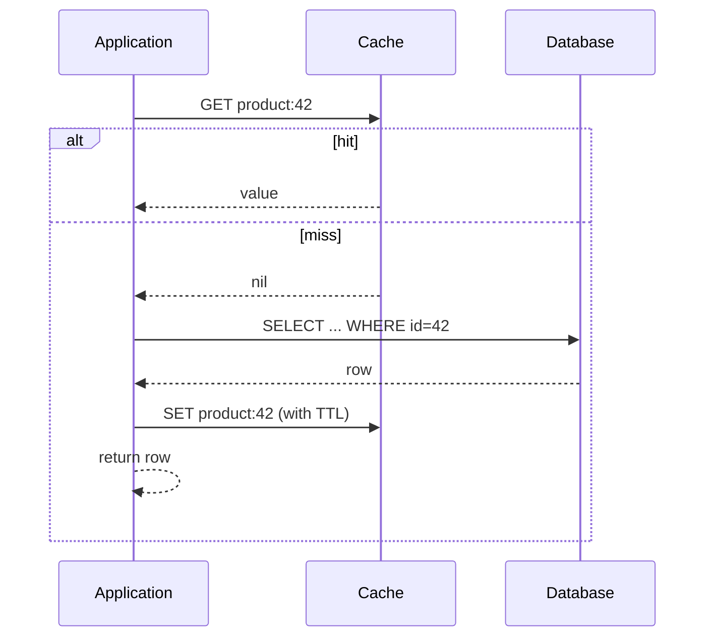

# Cache-Aside

> The application checks the cache, and on a miss it loads from the database and puts the result back.

**Group:** Caching
**Also called:** Lazy loading
**Interview framing:** [caching in grokking-system-design](https://github.com/design-gurus/grokking-system-design/blob/main/patterns/caching.md)

## What it is

The application owns the cache. On a read it looks in the cache first. If the value is there, it returns it. If not, it reads the database, writes the value into the cache, and returns it. The cache never talks to the database.

This is the most widely used caching strategy, and the one most often implemented with a subtle bug.

## The failure it prevents

Every read hitting the database. A product page read ten thousand times a minute becomes ten thousand queries, and the database becomes the limit on how many users you can serve. With a 95% hit ratio, the same traffic sends 500 queries instead.

## How it works

On writes, the standard approach is **write to the database, then delete the cache key**. Delete, not update. Updating writes a value computed from what this request knows, and concurrent writers can then leave a stale value behind that no TTL will fix until it expires. Deleting means the next reader repopulates from the source of truth.

Even delete-after-write has a race: a reader can load an old value, then a writer commits and deletes, then the reader writes its stale value into the cache. The window is small but real. A short TTL bounds the damage, and that is why every entry should have one even when you also invalidate explicitly.

## Knobs and typical numbers

| Knob | Typical starting value | Raise it when | Lower it when |
|---|---|---|---|
| TTL | 5 to 60 minutes for reference data | Data rarely changes and the load saving is large | Users notice stale values, or the data is money-related |
| Target hit ratio | 90% or above for a hot dataset | Not a knob you set, a result you measure | Under 80%, the cache is adding a hop and buying little |
| Cache size | Enough for the working set, not the whole dataset | Eviction rate is high and hit ratio is falling | Cost matters and the tail is genuinely cold |
| Eviction policy | LRU | Access patterns are recency-driven, which is usual | Scan-heavy workloads, where LRU gets flushed by a single big scan |
| Negative cache TTL | 30 seconds to 2 minutes | Missing keys are queried repeatedly | Records appear quickly after creation |

Cache a miss too. A key that does not exist, queried constantly, hits the database every time otherwise. This is how a "product not found" bug becomes a database outage.

## Trade-offs

| You gain | You pay |
|---|---|
| Only requested data is cached, so the cache stays small | Every miss pays cache latency plus database latency |
| A cache outage degrades performance but not correctness | The application holds the caching logic, so every call site can get it wrong |
| Works with any data store, with no special integration | Two systems to keep consistent, and the window is never zero |
| Simple to reason about, easy to add incrementally | Cold start after a cache restart hits the database hard |

## Failure modes

- **Updating the cache on write instead of deleting.** Two writers interleave and the cache keeps a value neither of them wrote last. Delete, and let the next read repopulate.
- **No TTL because "we invalidate explicitly".** Every explicit invalidation eventually has a bug or a missed path. A TTL is the backstop that turns a permanent wrong answer into a temporary one.
- **Cache stampede.** A hot key expires and a thousand concurrent requests all miss and all query the database at once. See [cache stampede prevention](cache-stampede-prevention.md).
- **Caching in a request path that already has the data.** A loop that fetches the same key ten times per request should use a per-request memo, not ten round trips to the cache.
- **Storing the whole object when callers need one field.** Serialization cost and memory both grow for nothing.
- **Cold start after a deploy or restart.** An empty cache sends full traffic to the database. Warm the hot keys, or roll the cache restart gradually.

## What to instrument

- **Hit ratio per key prefix**, not just globally. One badly behaved prefix hides inside a healthy overall number.
- **Latency of hits and misses separately.** A miss should cost database latency plus a little, and if it costs more the cache write is on the critical path.
- **Eviction rate.** Rising evictions with a falling hit ratio means the cache is too small for the working set.
- **Stale-read complaints as a product metric.** If support tickets track cache TTL changes, the TTL is too long.
- Alert on hit ratio dropping sharply, which usually means a deploy changed a key format.

## Real systems that use it

- **Facebook's memcached deployment** is the canonical large-scale cache-aside system, and their published work on it is where "lease" based stampede protection comes from.
- **Most Redis usage** in web applications is cache-aside, because it needs no integration between Redis and the database.
- **Django, Rails, and Laravel** ship cache-aside helpers as the default caching idiom.

## Pairs with

- [Cache stampede prevention](cache-stampede-prevention.md), which cache-aside needs at any real scale.
- [Read-through](read-through.md), the variant where the cache does the loading instead of the application.
- [Write-through](write-through.md) and [write-behind](write-behind.md), for the write side.
- [Change data capture](../data-intensive/change-data-capture.md), for invalidating from the database log rather than from application code.

## Go deeper

Covered lesson by lesson, with diagrams and honest trade-offs, in [System Design Patterns](https://www.designgurus.io/course/system-design-patterns?utm_source=github&utm_medium=repo&utm_campaign=design-patterns). For interview framing, see [grokking-system-design](https://github.com/design-gurus/grokking-system-design) and [Grokking the System Design Interview](https://www.designgurus.io/course/grokking-the-system-design-interview?utm_source=github&utm_medium=repo&utm_campaign=design-patterns).
