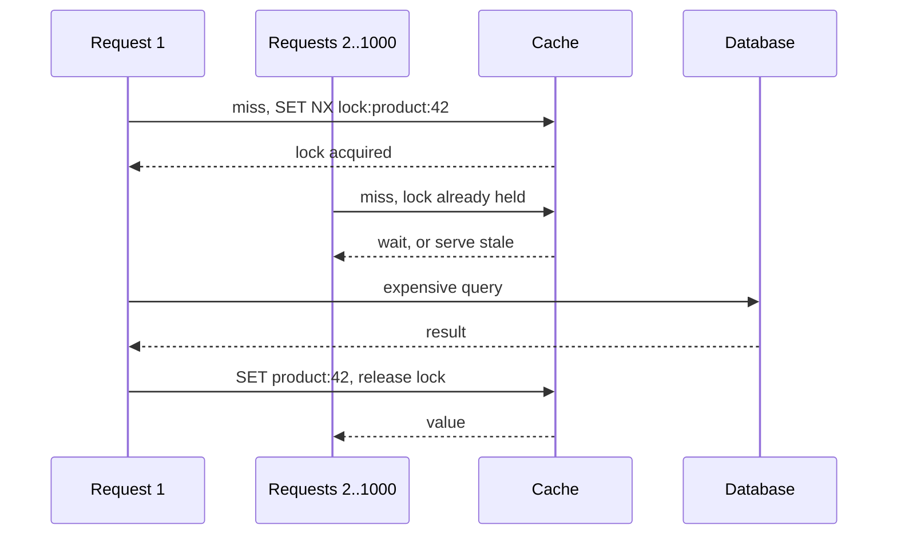

# Cache Stampede Prevention

> Stop a thousand requests from rebuilding the same expired key at the same moment.

**Group:** Caching
**Also called:** Thundering herd, dog-piling, cache miss storm
**Interview framing:** [caching in grokking-system-design](https://github.com/design-gurus/grokking-system-design/blob/main/patterns/caching.md)

## What it is

A popular cache key expires. Every request that arrives in the next few hundred milliseconds misses, and every one of them runs the expensive query to rebuild it. The database receives a thousand identical queries for a value that only needed computing once.

The cache was doing its job right up until the instant it stopped, and the collapse is sudden rather than gradual.

## The failure it prevents

An outage. This is worth stating plainly, because the failure mode is not "slightly more database load". A key protecting a five-second query, requested 2,000 times a second, produces 10,000 concurrent queries the moment it expires. The database saturates, every query slows, so the rebuild takes even longer, so more requests pile in. The system does not recover on its own.

It is worse after a cache restart, when every key is cold at once.

## How it works

Four techniques, and real systems combine them.

**1. Locking, or single flight.** The first request to miss takes a lock on the key and rebuilds. Everyone else either waits for the result or gets the stale value. This is the most common fix.

**2. Probabilistic early expiry.** Rather than expiring at a fixed instant, each read has a small chance of triggering a refresh as the TTL approaches. The chance rises as expiry nears, so one unlucky request refreshes early and the rest keep hitting a warm key. The known form of this is XFetch, and it costs a few lines.

**3. Stale-while-revalidate.** Keep serving the expired value while one request refreshes in the background. Latency never spikes, and the served value is briefly stale. This is what HTTP's `stale-while-revalidate` directive does, and it is the right default for content.

**4. TTL jitter.** Never set the same TTL for keys populated together. Add randomness, typically plus or minus 10 to 20 percent, so a batch warmed at the same second does not expire at the same second.

## Knobs and typical numbers

| Knob | Typical starting value | Raise it when | Lower it when |
|---|---|---|---|
| TTL jitter | 10 to 20% of the TTL | Many keys are warmed simultaneously | Almost never |
| Lock hold timeout | Slightly longer than the rebuild's p99, often 5 to 30 s | Rebuilds are genuinely slow | A stuck lock blocks readers too long |
| Waiter behavior | Serve stale if available, else wait | Stale is acceptable, which it usually is | Correctness demands fresh, so waiters block |
| Early-refresh window | Refresh in the last 10 to 20% of the TTL | Rebuilds are slow and you want more runway | Refresh traffic becomes significant |
| Stale-while-revalidate window | 30 s to 5 min past expiry | Availability beats freshness | Data goes stale fast |

The single most valuable line of code here is TTL jitter, because it costs nothing and prevents the synchronized-expiry case entirely.

## Trade-offs

| You gain | You pay |
|---|---|
| Database load stays flat when hot keys expire | Extra moving parts: locks, background refreshers, stale bookkeeping |
| Latency does not spike at expiry boundaries | Serving stale values, deliberately, for a bounded window |
| The system survives a cold cache | A lock is another thing that can be held forever by a dead process |
| Cheap: jitter and single flight cover most cases | Distributed locks need a timeout and are never perfectly safe |

## Failure modes

- **A lock with no expiry.** The rebuilding process dies holding it, and every reader waits forever. Always set a lock TTL.
- **A lock TTL shorter than the rebuild.** The lock expires mid-rebuild, a second request takes it, and you have the stampede again with extra steps.
- **Locking in the wrong place.** A per-process lock does nothing across twenty application servers. The lock must live in the shared cache.
- **Waiters that spin.** Retrying in a tight loop turns a database stampede into a cache stampede. Wait with backoff.
- **No stale value to serve.** Stale-while-revalidate needs the old value kept past expiry. Deleting on expiry removes the fallback, so store it with a longer physical TTL and a shorter logical one.
- **Solving it only for reads.** A cold cache after a deploy has no hot key to protect. Warm the top keys before shifting traffic.

## What to instrument

- **Concurrent misses per key.** More than one at a time on a hot key means single flight is not working.
- **Database query rate for cache-backed queries**, watched for spikes rather than averages. The stampede is a spike by definition.
- **Lock wait time and lock timeout count.**
- **Stale-serve rate**, so you know how often users get an old value.
- **Rebuild duration at p99**, which is what every timeout here must be derived from.
- Alert on a sudden fall in hit ratio combined with a rise in database latency. That combination is the stampede signature.

## Real systems that use it

- **Facebook's memcached leases**, described in their NSDI paper, give one client a token to rebuild while others wait or use stale data. This is the canonical published solution.
- **Caffeine and Guava** provide single flight by default in their loading caches, which is a strong reason to prefer [read-through](read-through.md).
- **Varnish and modern CDNs** implement request coalescing plus stale-while-revalidate, so one origin fetch serves many waiting clients.

## Pairs with

- [Cache-aside](cache-aside.md), which is where the stampede usually happens.
- [Read-through](read-through.md), which gives you single flight without writing it.
- [Circuit breaker](https://github.com/design-gurus/grokking-system-design/blob/main/patterns/circuit-breaker.md) and [graceful degradation](../reliability/graceful-degradation.md), for when the rebuild itself is failing.
- [Auto-scaling](../scaling/auto-scaling.md), which will not save you here: the spike is faster than any scaling reaction.

## Go deeper

Covered lesson by lesson, with diagrams and honest trade-offs, in [System Design Patterns](https://www.designgurus.io/course/system-design-patterns?utm_source=github&utm_medium=repo&utm_campaign=design-patterns). For interview framing, see [grokking-system-design](https://github.com/design-gurus/grokking-system-design) and [Grokking the System Design Interview](https://www.designgurus.io/course/grokking-the-system-design-interview?utm_source=github&utm_medium=repo&utm_campaign=design-patterns).
