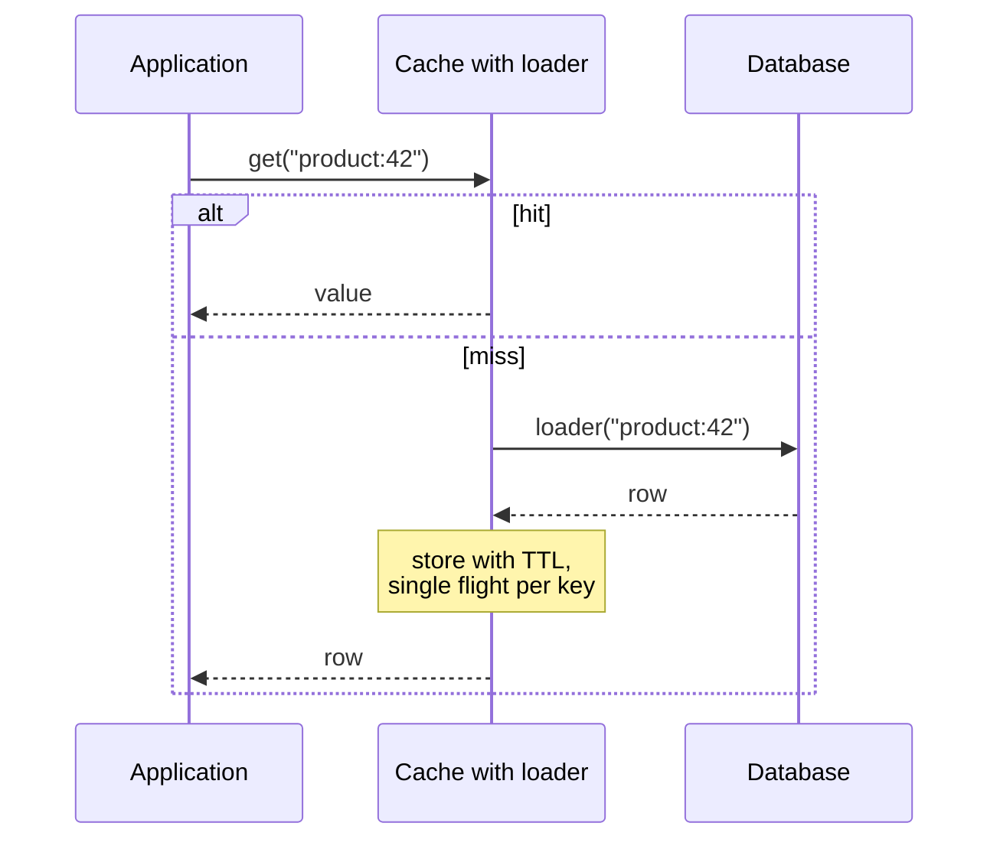

# Read-Through

> The cache loads from the database itself, so callers never see the data source.

**Group:** Caching
**Interview framing:** [caching in grokking-system-design](https://github.com/design-gurus/grokking-system-design/blob/main/patterns/caching.md)

## What it is

The application asks the cache for a key and always gets an answer. On a miss, the cache calls a loader function to fetch the value, stores it, and returns it. The caller never writes to the cache and never knows whether the value was already there.

Compared to [cache-aside](cache-aside.md), the same work happens. The difference is who owns it: the cache layer instead of every call site.

## The failure it prevents

Caching logic duplicated across the codebase, and inconsistently. In cache-aside, every place that reads a product must remember to check the cache, use the right key format, set the right TTL, and handle a miss. Fifteen call sites means fifteen chances to use a different key or forget the TTL.

Read-through puts that logic in one loader. The call site is one line, and it cannot get the key format wrong.

## How it works

Two properties usually come with the implementation, and they are the real reason to prefer it:

- **Single flight.** When twenty threads miss the same key at once, one calls the loader and the rest wait for its result. This removes the most common form of [cache stampede](cache-stampede-prevention.md) without any extra work.
- **One place for TTL, refresh, and metrics**, since every load goes through the same path.

## Knobs and typical numbers

| Knob | Typical starting value | Raise it when | Lower it when |
|---|---|---|---|
| TTL after write | 5 to 60 minutes | The source data is stable | Staleness is user-visible |
| Refresh-after-write | Half the TTL | You want values refreshed in the background before they expire | Background refresh load is heavy |
| Loader timeout | Same as a normal database call, 1 to 3 seconds | The loader does genuinely slow work | The caller has a tighter deadline |
| Max cache entries | Sized to the working set | Eviction rate is high | Memory pressure |
| Waiters per key | 1 loader, the rest wait | Never. Single flight is the point | Never |

**Refresh-ahead** is worth naming. Instead of expiring a value and making the next reader wait, the cache serves the slightly stale value and refreshes in the background. Latency stays flat, staleness grows a little. Caffeine and Guava both support this directly.

## Trade-offs

| You gain | You pay |
|---|---|
| Caching logic in one place, not at every call site | The cache now depends on the database, so a loader failure is a cache failure |
| Single flight for free, which kills most stampedes | Harder to bypass the cache deliberately for a fresh read |
| Consistent keys, TTLs, and metrics by construction | Needs a library or a cache product that supports loaders |
| Call sites read like plain data access | The loader can hide an expensive query behind an innocent-looking `get` |

## Failure modes

- **A loader that throws, caching the exception.** Some implementations cache failures, so a transient database blip becomes minutes of errors. Decide deliberately whether failures are cached, and for how long.
- **Loader latency in the caller's timeout budget.** A `get` that looks like a memory read can take two seconds. Callers must still set deadlines.
- **No negative caching.** A key that does not exist calls the loader on every request. Cache the miss with a short TTL.
- **Hidden N+1.** A loop calling `get` per id issues one query per id. Use a bulk loader that batches the keys into one query. This is the single biggest win most teams miss.
- **Cache and database disagreeing after a write.** Read-through says nothing about writes. Pair it with delete-on-write, [write-through](write-through.md), or an invalidation stream.
- **Warm-up after restart.** Every key must be loaded once, and a full cold cache means full database load. Stagger restarts.

## What to instrument

- **Loader call rate and loader latency**, separately from cache latency. This is the traffic actually reaching the database.
- **Hit ratio**, and **load failure rate** as its own metric.
- **Wait time for single-flight followers.** If followers wait a long time, the loader is slow and the cache is amplifying it.
- **Batch size on bulk loads.** A batch loader averaging 1.0 is not batching.
- **Eviction and refresh rates**, to tell whether entries expire or get pushed out.

## Real systems that use it

- **Caffeine** (Java) is the reference implementation, with `LoadingCache`, bulk loaders, refresh-after-write, and single flight built in.
- **Netflix EVCache** wraps memcached with read-through behavior across regions.
- **Hibernate and other ORMs** use read-through semantics for their second-level caches, which is why an unexpected query can appear from an innocuous property access.

## Pairs with

- [Cache-aside](cache-aside.md), the same work with the application in control.
- [Cache stampede prevention](cache-stampede-prevention.md), most of which read-through gives you by default.
- [Write-through](write-through.md), the natural write-side companion.
- [Connection pooling](../scaling/connection-pooling.md), because loaders are where a burst of database connections comes from.

## Go deeper

Covered lesson by lesson, with diagrams and honest trade-offs, in [System Design Patterns](https://www.designgurus.io/course/system-design-patterns?utm_source=github&utm_medium=repo&utm_campaign=design-patterns). For interview framing, see [grokking-system-design](https://github.com/design-gurus/grokking-system-design) and [Grokking the System Design Interview](https://www.designgurus.io/course/grokking-the-system-design-interview?utm_source=github&utm_medium=repo&utm_campaign=design-patterns).
