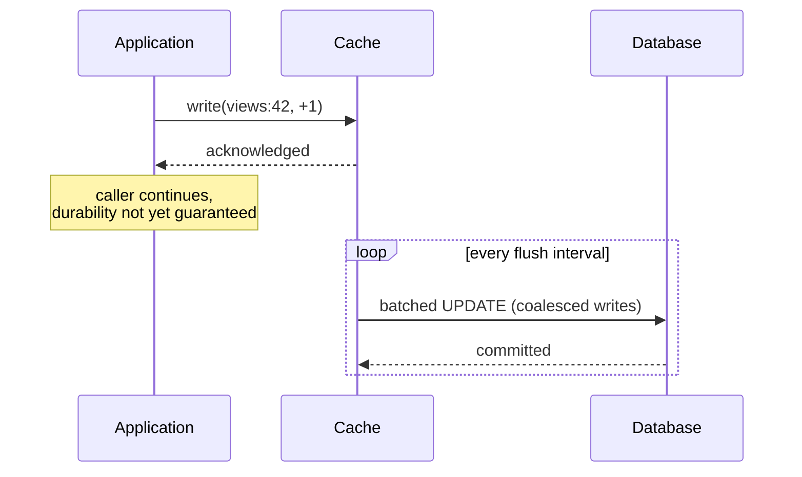

# Write-Behind

> Acknowledge the write immediately, persist it a moment later, and accept that the moment is a window where data can be lost.

**Group:** Caching
**Also called:** Write-back
**Interview framing:** [caching in grokking-system-design](https://github.com/design-gurus/grokking-system-design/blob/main/patterns/caching.md)

## What it is

The write goes into the cache and is acknowledged at once. A background process flushes to the database later, usually batching many writes together. The caller sees cache latency, not database latency.

This is the highest-throughput caching write strategy and the only one that can lose committed-looking data. Both facts come from the same design decision, so neither can be engineered away.

## The failure it prevents

The database becoming the write bottleneck for high-volume, low-value-per-item data. A counter incremented 50,000 times a second cannot be 50,000 database writes. Batched into one update per second per key, it is 50 writes, and the database stops being the limit.

## How it works

Two mechanics do the real work. **Batching** turns many writes into one round trip. **Coalescing** turns many writes to the same key into one write of the final value, which is where the biggest saving comes from for counters and last-write-wins fields.

The dangerous part is the flush window. Between acknowledgement and flush, the only copy of that data is in memory. If the cache node dies, those writes are gone, and the caller was told they succeeded.

## Knobs and typical numbers

| Knob | Typical starting value | Raise it when | Lower it when |
|---|---|---|---|
| Flush interval | 100 ms to 5 seconds | Throughput matters more than the loss window | The loss window is uncomfortable, which it usually is |
| Batch size | 100 to 1,000 writes | The database handles large batches efficiently | Large batches cause lock contention or long transactions |
| Max in-memory dirty entries | Bounded, and always bounded | Never unbounded | Memory pressure, or you want a smaller loss window |
| Behavior when the queue is full | Block the writer | Correctness matters more than availability | Never silently drop, which is the failure teams discover in production |
| Replication of the dirty buffer | At least one replica for anything you would miss | The data has real value | The data is genuinely disposable |

The number to write down and agree on with the business: **how many seconds of writes are you willing to lose?** That number is the flush interval. If the answer is zero, this is the wrong pattern.

## Trade-offs

| You gain | You pay |
|---|---|
| Write latency at cache speed, often sub-millisecond | A window where acknowledged data is not durable |
| Database write volume reduced by batching and coalescing | Complexity: a dirty buffer, a flusher, retry logic, backpressure |
| Absorbs write spikes that would overwhelm the database | The database is behind, so anything reading it directly sees stale data |
| Fewer, larger transactions, which many databases prefer | Recovery after a crash is genuinely hard to get right |

## Failure modes

- **Cache node dies with a full dirty buffer.** Everything unflushed is lost, and the users were told it worked. This is the defining risk. Mitigate with replication of the buffer, a durable log in front, or by accepting the loss explicitly for data where that is fine.
- **Unbounded buffer growth.** The database slows, the flusher falls behind, and memory fills until the process dies, taking every unflushed write with it. Always bound the buffer and apply [backpressure](https://github.com/design-gurus/grokking-system-design/blob/main/patterns/backpressure.md).
- **Flush failures that are dropped.** The batch fails, the entries are already gone from the buffer, and nothing retries. Retry, then dead letter, and alert.
- **Reports reading the database directly.** Analytics sees numbers lagging by the flush interval and someone files a data bug. Document the lag.
- **Ordering lost by coalescing.** Coalescing is correct for counters and last-write-wins fields, and wrong for anything where intermediate states matter.
- **Using it for money.** Payments, orders, and ledgers must not be acknowledged before they are durable. This pattern is for view counts, session state, telemetry, and last-seen timestamps.

## What to instrument

- **Dirty buffer size and age of the oldest unflushed write.** Age is the real loss-window metric, and it is the one to alert on.
- **Flush success rate and flush latency.**
- **Writes dropped or blocked due to a full buffer**, which should be zero and must never be silent.
- **Coalescing ratio**, writes accepted divided by writes flushed. A ratio near 1 means batching is buying you nothing.
- **Replication lag of the dirty buffer**, if it is replicated.

## Real systems that use it

- **Operating system page caches** are write-behind, which is exactly why `fsync` exists and why databases call it.
- **Redis with periodic persistence** is write-behind for anything relying on the snapshot rather than an append-only file with per-write sync.
- **Metrics and telemetry pipelines** almost always buffer and batch, accepting that a crashed agent loses a few seconds of samples.

## Pairs with

- [Write-through](write-through.md), the same shape with durability before acknowledgement.
- [Backpressure](https://github.com/design-gurus/grokking-system-design/blob/main/patterns/backpressure.md), which is required, not optional, once the buffer is bounded.
- [Dead letter queue](../reliability/dead-letter-queue.md), for flush batches that will never succeed.
- [Write-ahead log](https://github.com/design-gurus/grokking-system-design/blob/main/patterns/write-ahead-log.md), the technique that makes a fast acknowledgement durable, when losing writes is not acceptable.

## Go deeper

Covered lesson by lesson, with diagrams and honest trade-offs, in [System Design Patterns](https://www.designgurus.io/course/system-design-patterns?utm_source=github&utm_medium=repo&utm_campaign=design-patterns). For interview framing, see [grokking-system-design](https://github.com/design-gurus/grokking-system-design) and [Grokking the System Design Interview](https://www.designgurus.io/course/grokking-the-system-design-interview?utm_source=github&utm_medium=repo&utm_campaign=design-patterns).
