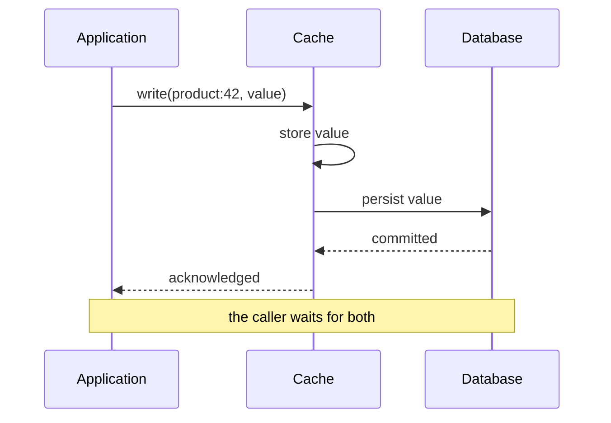

# Write-Through

> Write to the cache and the database together, before acknowledging.

**Group:** Caching
**Interview framing:** [caching in grokking-system-design](https://github.com/design-gurus/grokking-system-design/blob/main/patterns/caching.md)

## What it is

Every write goes through the cache. The cache updates its own copy and writes to the database, and only then does the caller get an acknowledgement. Reads that follow are guaranteed to find the current value in the cache.

You are buying read consistency with write latency. That is the entire trade.

## The failure it prevents

The stale-read window that [cache-aside](cache-aside.md) leaves open. In cache-aside, a write updates the database and deletes the key, and there is a period where a concurrent reader can put an old value back. With write-through, the cache is written as part of the write path, so a reader arriving immediately afterwards sees the new value.

It also prevents the cold-read penalty for freshly written data. Anything just written is already cached, which suits workloads where users read their own writes right away.

## How it works

The honest caveat: this is **not** atomic across two systems. The cache write can succeed and the database write fail, or the process can die between them. Ordering matters, and the safer order is database first, then cache, so a failure leaves a missing cache entry rather than a cache entry the database never accepted. A missing entry is a cache miss. A phantom entry is a wrong answer.

If you truly need atomicity, the cache must be part of the database, which is what a caching layer built into the storage engine gives you.

## Knobs and typical numbers

| Knob | Typical starting value | Raise it when | Lower it when |
|---|---|---|---|
| Added write latency | Expect 1 to 5 ms on top of the database write | Acceptable when writes are rare relative to reads | Write throughput is the bottleneck |
| TTL | Longer than cache-aside, hours is reasonable | The cache is authoritative for reads and kept current by writes | You do not trust every write path to go through the cache |
| Write ordering | Database first, then cache | Never invert without a reason you can defend | Never |
| Read-your-writes guarantee | Within one region | Cross-region needs replication, and the guarantee weakens | Never assume it across regions |

## Trade-offs

| You gain | You pay |
|---|---|
| Reads after a write are consistent, in the common case | Every write pays cache latency plus database latency |
| No stale-read race window in the normal path | Data written but never read still occupies cache space |
| Simple mental model: the cache mirrors the database | Not atomic across two systems, so partial failure is real |
| Warm cache for freshly written data | A cache outage now affects the write path, not just reads |

## Failure modes

- **Cache write succeeds, database write fails.** Now the cache serves a value that does not exist. This is why the database goes first.
- **Write-heavy workload.** Data written once and read rarely fills the cache with entries nobody wants, evicting entries that are read constantly. Measure the read-to-write ratio before choosing this. Below roughly 3:1 reads to writes, it is usually the wrong pattern.
- **A write path that bypasses the cache.** One batch job writes straight to the database, and the cache is now confidently wrong with a long TTL. Every write path must go through, or the long TTL becomes a liability.
- **Treating it as durable.** The cache is not the system of record. If the database write is what makes the data real, the acknowledgement must wait for it.
- **Multi-region.** Two regions with their own caches writing to a replicated database will disagree until replication catches up. Write-through does not fix that.

## What to instrument

- **Write latency split by stage**: time in the database, time in the cache. The split tells you which one to fix.
- **Write failure rate at each stage separately**, so a cache problem is not reported as a database problem.
- **Read-to-write ratio per key prefix.** This is the number that says whether this pattern belongs here at all.
- **Cache occupancy by write-only keys.** If most cached entries are never read, you are paying memory for nothing.
- **Divergence checks.** A background job sampling keys and comparing cache to database catches silent drift from bypassed write paths.

## Real systems that use it

- **Database buffer pools** are write-through in spirit: the page cache and the durable store are updated together under one transaction.
- **NCache, Hazelcast, and Apache Ignite** offer a write-through mode where the cache owns persistence to the backing store.
- **CDN origin push** is the same shape at the edge: publish content to the edge cache at deploy time rather than waiting for the first user to miss.

## Pairs with

- [Read-through](read-through.md), the natural read-side companion, giving one place that owns both directions.
- [Write-behind](write-behind.md), the same pattern with the durability wait removed.
- [Cache-aside](cache-aside.md), which is usually the better default unless read consistency is worth the write latency.
- [Idempotency](https://github.com/design-gurus/grokking-system-design/blob/main/patterns/idempotency.md), since a retried write must not double-apply in either system.

## Go deeper

Covered lesson by lesson, with diagrams and honest trade-offs, in [System Design Patterns](https://www.designgurus.io/course/system-design-patterns?utm_source=github&utm_medium=repo&utm_campaign=design-patterns). For interview framing, see [grokking-system-design](https://github.com/design-gurus/grokking-system-design) and [Grokking the System Design Interview](https://www.designgurus.io/course/grokking-the-system-design-interview?utm_source=github&utm_medium=repo&utm_campaign=design-patterns).
