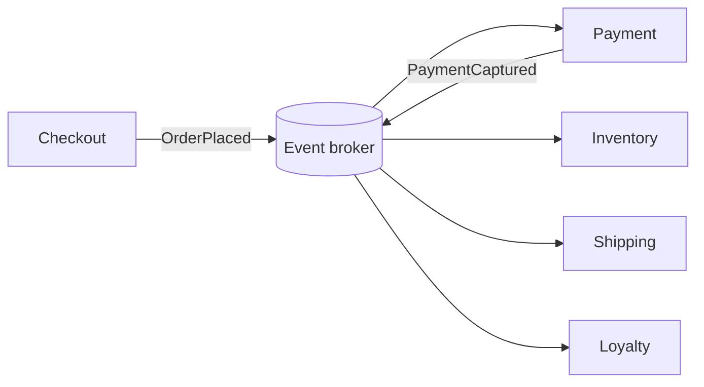

# Event-Driven Architecture

> Services coordinate through facts that already happened, instead of commands telling each other what to do.

**Group:** Communication

## What it is

Services publish events describing something that occurred: `OrderPlaced`, `PaymentCaptured`, `InventoryReserved`. Other services react. Nobody sends instructions, and nobody waits for a reply.

The distinction that carries the whole pattern is **event versus command**. A command names a receiver and an intention: "charge this card". An event names neither: "a payment was captured". A command can be refused. An event already happened, so it can only be reacted to. Systems get confusing when a message called an event is really a command with a polite name.

## The failure it prevents

Coupling that grows with every feature. In a request-driven system, checkout calls payment, then inventory, then shipping, then loyalty. Checkout is now aware of four systems, it fails when any of them fails, and its latency is the sum of theirs. The fifth feature makes it worse.

Event-driven flips the dependency. Checkout publishes `OrderPlaced` and finishes. Loyalty is added later by subscribing, and checkout never learns it exists.

## How it works

Each service owns its data and reacts to events by updating its own state. There is no central coordinator, so no single service knows the whole flow. That is the trade: the system gains independence and loses a place to read the story end to end.

Two shapes worth naming:

- **Event notification** carries an id and little else. Consumers call back for details. Small messages, more coupling, more traffic.
- **Event-carried state transfer** carries everything a consumer needs. No callback, more independence, larger messages, and stale copies to reason about.

Start with notification, move to state transfer when the callback traffic hurts.

## Knobs and typical numbers

| Knob | Typical starting value | Raise it when | Lower it when |
|---|---|---|---|
| Event payload size | Under 100 KB | Consumers make a callback per event anyway | Payloads carry data no consumer reads |
| Retention | 7 to 30 days | You rebuild consumer state by replaying | Nothing replays and storage costs bite |
| Schema compatibility mode | Backward compatible | Never. This is the floor | You control every consumer and can deploy in lockstep, which is rarer than teams think |
| Expected propagation delay | Under 1 second within a region | Batch consumers or cross-region replication | A user is watching for the result |
| Outbox flush interval | 100 to 500 ms | Volume is high and batching pays | Users notice the delay |

## Trade-offs

| You gain | You pay |
|---|---|
| Services deploy and fail independently | No single place shows the whole business flow |
| New consumers without touching producers | Debugging spans many services and needs tracing to be usable |
| Natural buffering against load spikes | Everything becomes eventually consistent, including things users watch |
| A log you can replay to rebuild state | Schema changes become a cross-team coordination problem |

## Failure modes

- **Dual writes.** The service writes to its database, then publishes an event, and crashes between the two. The state changed and nobody heard. This is the defining bug of the pattern, and the fix is the outbox pattern: write the event into the same database transaction, and a separate process publishes it. See [change data capture](../data-intensive/change-data-capture.md) and the [outbox pattern](https://github.com/design-gurus/grokking-system-design/blob/main/patterns/outbox-pattern.md).
- **The distributed monolith.** Services communicate through events but still cannot be deployed separately, because every schema change breaks three consumers. You paid the cost of distribution and kept the coupling.
- **Events that are really commands.** `SendEmailRequested` is a command wearing a costume. It creates the same coupling as a direct call, plus a broker.
- **Eventual consistency reaching the user.** The order confirmation page reads from a service that has not seen the event yet, so the user sees an empty order. Read from the service that owns the write, or make the wait visible.
- **No idempotency.** Redelivery is normal. Consumers that are not idempotent will double-charge, double-ship, and double-email.
- **Circular event chains.** A publishes, B reacts and publishes, C reacts and publishes something A consumes. The loop runs until something breaks.

## What to instrument

- **End-to-end business latency**, from `OrderPlaced` to `OrderShipped`, not just per-hop latency. This is the number that matches how the business thinks.
- **Distributed traces with the trace id carried in the event header.** Without this, debugging is reading five services' logs by hand. See [distributed tracing](../operations/distributed-tracing.md).
- **Consumer lag per subscription**, alerted in seconds.
- **Dead letter depth per consumer**, with the failing event retrievable.
- **Schema registry compatibility failures**, which should block a deploy rather than surface at runtime.

## Real systems that use it

- **Uber** runs its trip lifecycle on Kafka events, with the same event stream feeding real-time dispatch and the analytics platform.
- **Netflix** uses events for the pipeline between playback, personalization, and billing, with the log doubling as the source for offline processing.
- **Shopify** publishes storefront and order events that both internal services and third-party apps consume, which is what makes the app ecosystem possible.

## Pairs with

- [Publish-subscribe](publish-subscribe.md), the delivery mechanism underneath.
- [Saga](../consistency/saga.md), for multi-service workflows that need compensations rather than a distributed transaction.
- [Change data capture](../data-intensive/change-data-capture.md), which solves the dual-write problem by deriving events from the database log.
- [Distributed tracing](../operations/distributed-tracing.md), which is not optional here.

## Go deeper

Covered lesson by lesson, with diagrams and honest trade-offs, in [System Design Patterns](https://www.designgurus.io/course/system-design-patterns?utm_source=github&utm_medium=repo&utm_campaign=design-patterns). For interview framing, see [grokking-system-design](https://github.com/design-gurus/grokking-system-design) and [Grokking the System Design Interview](https://www.designgurus.io/course/grokking-the-system-design-interview?utm_source=github&utm_medium=repo&utm_campaign=design-patterns).
