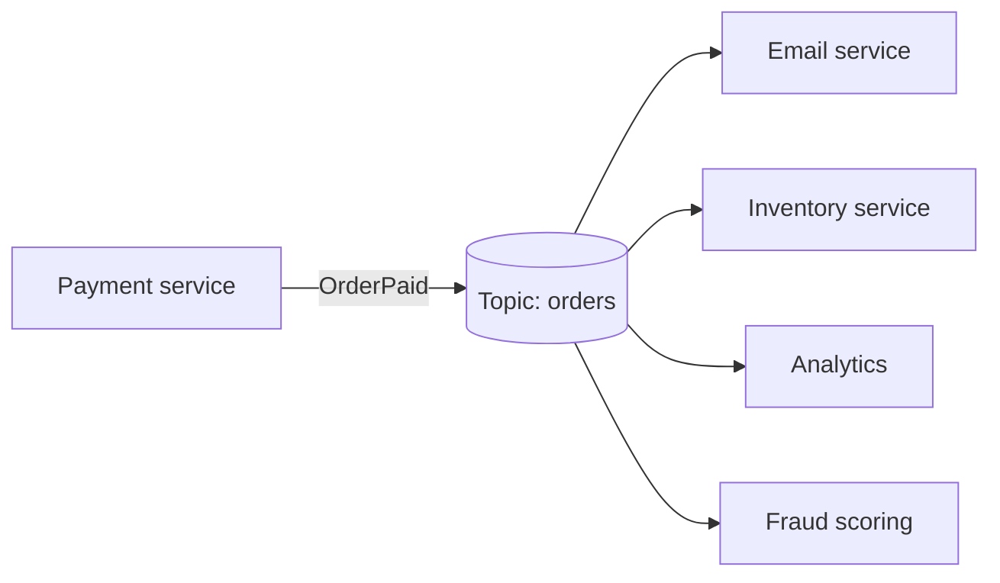

# Publish-Subscribe

> One event, many independent consumers, and a publisher that knows none of them.

**Group:** Communication
**Interview framing:** [message queues in grokking-system-design](https://github.com/design-gurus/grokking-system-design/blob/main/patterns/message-queues.md)

## What it is

A publisher sends a message to a topic. Every subscriber to that topic gets its own copy. The publisher does not know how many subscribers exist, what they do, or whether they are running.

The distinction that matters: in a **queue**, one message goes to one consumer, and consumers compete for work. In **pub-sub**, one message goes to every subscriber, and each gets a full copy. Same infrastructure in many products, opposite delivery semantics.

## The failure it prevents

The publisher having to know its consumers. Without it, "when an order is paid" means the payment service calls email, then inventory, then the warehouse, then analytics. Payment now depends on four systems, its latency is the sum of theirs, and adding a fifth reaction means changing payment.

With pub-sub, payment publishes `OrderPaid` and stops caring. A new consumer is a new subscription, and no existing code changes.

## How it works

The broker holds the topic. Subscribers register interest, and the broker tracks how far each one has read, independently. A slow analytics consumer does not slow the email consumer, because each has its own position.

Two broker styles behave differently under failure:

- **Log-based** (Kafka, Kinesis, Pulsar): messages stay for a retention period whether or not anyone read them. A new subscriber can read history. A broken consumer can be fixed and replayed.
- **Broadcast** (classic SNS, most MQTT setups): the broker fans out to whoever is connected. Nothing is retained for a subscriber that was not there.

Choose deliberately. "Can a new consumer replay last week?" is the question that decides it.

## Knobs and typical numbers

| Knob | Typical starting value | Raise it when | Lower it when |
|---|---|---|---|
| Retention | 7 days for a log-based topic | Consumers need to replay, or you rebuild state from the log | Storage cost matters and nothing replays |
| Partitions per topic | 6 to 12 to start | Consumer lag grows and consumers are already at max parallelism | You have far more partitions than consumers, adding overhead for nothing |
| Consumer batch size | 100 to 500 messages | Throughput matters more than per-message latency | Latency matters, or a batch failure is expensive to replay |
| Max delivery attempts | 3 to 5, then dead letter | Failures are usually transient | Poison messages are common and should be quarantined fast |
| Consumer lag alert | 1 to 5 minutes of lag | Bursty traffic makes short spikes normal | The consumer feeds something a user is waiting on |

Partition count is the one that hurts later. In Kafka, you can add partitions but not remove them, and adding them breaks key-to-partition mapping for existing keys.

## Trade-offs

| You gain | You pay |
|---|---|
| Publishers stop knowing their consumers | A broker to run, monitor, size, and pay for |
| New consumers without touching the producer | End-to-end flow is no longer visible in one codebase |
| Slow consumers do not slow the publisher | Ordering is only guaranteed within a partition, not across a topic |
| Replay and rebuild, on a log-based broker | At-least-once delivery, so every consumer must be idempotent |

## Failure modes

- **Assuming exactly-once delivery.** Nearly every broker is at-least-once. Consumers will see duplicates during rebalances and retries. Without [idempotency](https://github.com/design-gurus/grokking-system-design/blob/main/patterns/idempotency.md), duplicate emails and double charges follow. See [exactly-once semantics](../data-intensive/exactly-once-semantics.md) for what is actually achievable.
- **Assuming global ordering.** Order holds within a partition. If related events land on different partitions, they can be processed out of order. Partition by the entity key (order id, user id) when order matters.
- **A schema change that breaks consumers.** The publisher adds a required field and three consumers fail at once. Use a schema registry, and treat message schemas as a public API with the same compatibility rules.
- **Consumer lag that nobody watches.** The consumer has been dead for six hours, the publisher is fine, and every dashboard is green. Lag is the health metric for this pattern.
- **Fan-out amplification.** One event, twelve consumers, each making three database calls. A modest publish rate becomes a heavy read load somewhere else.

## What to instrument

- **Consumer lag per partition**, in both messages and seconds. Alert on seconds, since that is what users feel.
- **Publish rate and consume rate side by side.** A persistent gap means the consumer will never catch up.
- **Redelivery count and dead letter queue depth.** A rising dead letter queue is a bug, not a blip.
- **End-to-end latency**, stamped at publish and measured at the point the consumer finishes. Broker latency alone hides consumer slowness.
- **Rebalance frequency.** Frequent rebalances mean consumers are timing out and reprocessing.

## Real systems that use it

- **Apache Kafka** is the log-based default, used at LinkedIn, Uber, and most companies with a data platform. Consumer groups give you both queue and pub-sub semantics on one topic.
- **AWS SNS with SQS subscriptions** is the standard broadcast plus durable-per-consumer setup: SNS fans out, each SQS queue gives one consumer its own durable copy.
- **Google Cloud Pub/Sub** retains per subscription rather than per topic, which changes the replay story.

## Pairs with

- [Event-driven architecture](event-driven-architecture.md), which is what you get when pub-sub becomes the primary way services coordinate.
- [Dead letter queue](../reliability/dead-letter-queue.md), which every subscription needs.
- [Partitioned consumption](../data-intensive/partitioned-consumption.md), for parallelism with ordering inside a key.
- [Message queue](https://github.com/design-gurus/grokking-system-design/blob/main/patterns/message-queues.md), for the one-consumer-per-message case.

## Go deeper

Covered lesson by lesson, with diagrams and honest trade-offs, in [System Design Patterns](https://www.designgurus.io/course/system-design-patterns?utm_source=github&utm_medium=repo&utm_campaign=design-patterns). For interview framing, see [grokking-system-design](https://github.com/design-gurus/grokking-system-design) and [Grokking the System Design Interview](https://www.designgurus.io/course/grokking-the-system-design-interview?utm_source=github&utm_medium=repo&utm_campaign=design-patterns).
