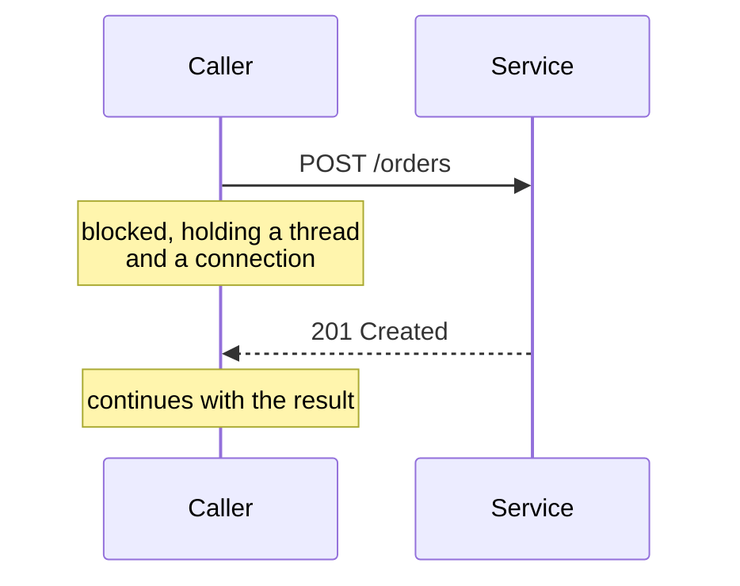

# Request-Response

> The caller sends a message and waits for the answer. The default, and the one worth understanding before you replace it.

**Group:** Communication

## What it is

One service sends a request to another and blocks until the reply arrives or the wait runs out. HTTP calls, gRPC calls, and SQL queries all work this way. The caller holds the result immediately, and it handles the error itself.

Everything else in this group exists because request-response has limits. Understanding those limits is the point of this page.

## The failure it prevents

Nothing. This is the baseline, not a fix. Its value is that the code is easy to read, easy to test, and easy to reason about: the answer arrives on the same line that asked for it.

The reason to name it as a pattern is the opposite of the usual reason. Teams reach for queues and events too early, and pay for coordination they did not need. If a caller genuinely needs the answer before it can continue, request-response is correct and a queue is not.

## How it works

The caller opens a connection, sends bytes, and waits. Three resources are held for the whole trip: a connection, a thread or task, and, in the worst case, a database transaction on the callee's side. Every one of them is finite.

Latency is additive along the chain. If A calls B and B calls C, A's response time is at least the sum of both hops, plus every network round trip in between.

## Knobs and typical numbers

| Knob | Typical starting value | Raise it when | Lower it when |
|---|---|---|---|
| Request timeout | 1 to 3 seconds for a user-facing call | The downstream work is genuinely slow and the user expects a wait | The caller has a tighter deadline of its own |
| Connection timeout | 100 to 500 ms | Cross-region calls, where the handshake is slower | Everything is in one availability zone |
| Connection pool size per host | 10 to 100 | You measure connection wait time under load | The downstream has a low connection limit |
| Keep-alive idle timeout | 60 to 90 seconds | Traffic is steady and reconnects cost more than idle sockets | Connections are expensive on the server side |
| Payload size | Under 1 MB per response | You genuinely cannot paginate | Anything above a few MB should be a link to object storage |

The rule worth memorizing: **a caller's timeout must be shorter than its own caller's timeout.** If the browser gives up after 5 seconds and your service waits 10 for the database, the work continues after nobody is listening.

## Trade-offs

| You gain | You pay |
|---|---|
| The result arrives inline, so the code is simple to read | The caller is only as available as the callee |
| Errors surface immediately, at the place that can handle them | Latency adds up along the chain, and the deepest hop sets the floor |
| No extra infrastructure, no broker to run | Load spikes hit the callee directly, with no buffer |
| Easy to trace, easy to test | Long work forces the caller to wait or the connection to be held open |

## Failure modes

- **Timeout longer than the caller's patience.** The user gave up, the connection is gone, and your service is still working. Every layer must have a shorter deadline than the layer above it.
- **Retry without a budget.** A slow downstream causes retries, retries multiply load, and the downstream gets slower. This is a retry storm, and it is how one slow service takes down four. Pair with [retry with exponential backoff](../reliability/retry-exponential-backoff.md) and [circuit breaker](https://github.com/design-gurus/grokking-system-design/blob/main/patterns/circuit-breaker.md).
- **Thread pool exhaustion.** Every in-flight call holds a thread. When the downstream slows from 50 ms to 2 seconds, the same traffic needs forty times the threads. Unrelated endpoints on the same service start failing. See [bulkhead](../reliability/bulkhead.md).
- **Chatty call patterns.** A loop that makes one call per item turns a page render into 200 round trips. Batch the call or denormalize the data.
- **No idempotency on writes.** A timeout does not tell you whether the work happened. Without [idempotency](https://github.com/design-gurus/grokking-system-design/blob/main/patterns/idempotency.md), the safe retry does not exist.

## What to instrument

- **Latency at p50, p95, and p99**, per endpoint and per downstream. Averages hide the failure.
- **Timeout rate** as its own metric, separate from error rate. A rising timeout rate is the earliest signal of downstream trouble.
- **In-flight request count** and **thread pool saturation**. These predict exhaustion before it happens.
- **Connection pool wait time**. If callers queue for a connection, the pool is the bottleneck, not the network.
- Alert on p99 latency and on saturation. Do not page on a single failed request.

## Real systems that use it

- **gRPC** is request-response with a schema and multiplexing over HTTP/2, used for most internal service-to-service traffic at Google and widely outside it.
- **REST over HTTP** is the default for public APIs, chosen for cacheability and for tooling rather than speed.
- **Database drivers** are request-response, and their connection pools are the most common place a service runs out of capacity.

## Pairs with

- [Timeout](../reliability/timeout.md) and [retry with exponential backoff](../reliability/retry-exponential-backoff.md), which every request-response call needs.
- [Circuit breaker](https://github.com/design-gurus/grokking-system-design/blob/main/patterns/circuit-breaker.md), for when the callee is already down.
- [Message queue](https://github.com/design-gurus/grokking-system-design/blob/main/patterns/message-queues.md), the alternative when the caller does not need the answer now.
- [Webhooks](webhooks.md), for the reverse direction when the answer takes minutes or hours.

## Go deeper

Covered lesson by lesson, with diagrams and honest trade-offs, in [System Design Patterns](https://www.designgurus.io/course/system-design-patterns?utm_source=github&utm_medium=repo&utm_campaign=design-patterns). For interview framing, see [grokking-system-design](https://github.com/design-gurus/grokking-system-design) and [Grokking the System Design Interview](https://www.designgurus.io/course/grokking-the-system-design-interview?utm_source=github&utm_medium=repo&utm_campaign=design-patterns).
