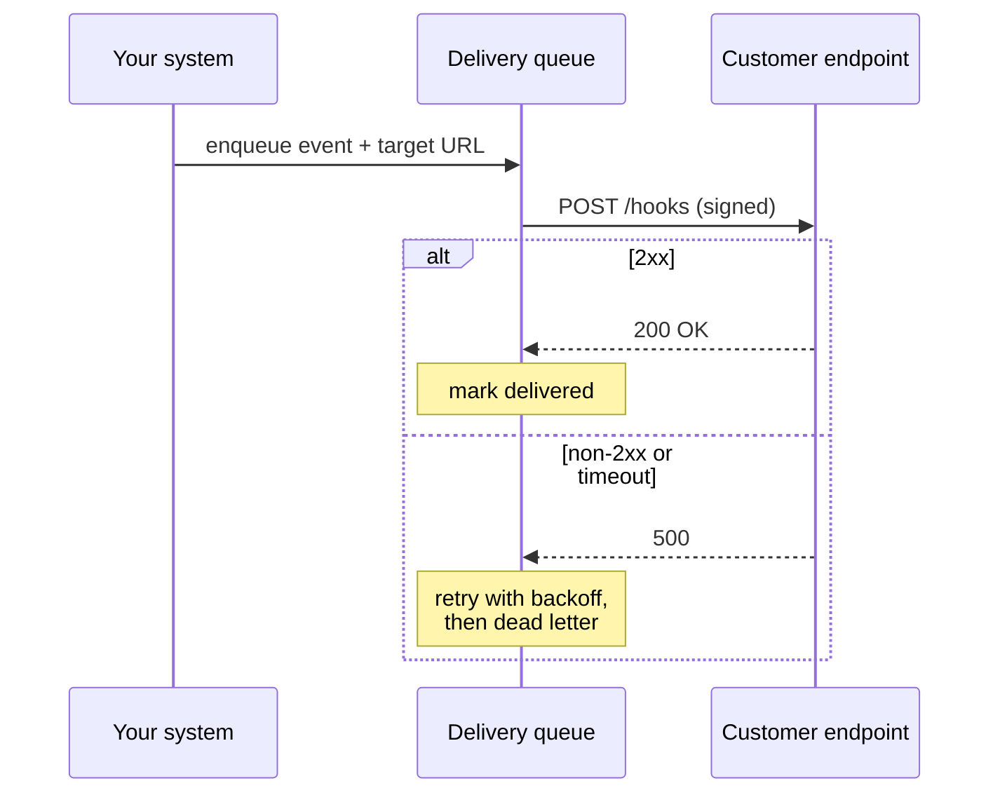

# Webhooks

> You call them when something happens, so they stop polling you.

**Group:** Communication

## What it is

A consumer registers a URL. When an event occurs, you make an HTTP request to that URL with the event in the body. It is the reverse of the normal direction: your server becomes the client, and theirs becomes the server.

This is how nearly every software-as-a-service product delivers events to customers. Stripe, GitHub, Shopify, Slack, and Twilio all work this way, because it is the only push mechanism that needs nothing from the receiver except an HTTPS endpoint.

## The failure it prevents

Polling. Without webhooks, every integrator asks "anything new?" every thirty seconds. Ten thousand customers polling a quiet API means 20,000 requests per minute where 99.9% of the answers are "no". The cost falls on you, and the customer still sees up to thirty seconds of delay.

Webhooks invert it: one request per actual event, delivered in about a second.

## How it works

The part people underestimate: **delivery must be asynchronous and durable**. Calling the customer's URL inline from the code that created the event means your write path now depends on someone else's uptime. Put the delivery on a queue.

Security is not optional here, because you are making requests to URLs that strangers supplied. Sign every payload with an HMAC over the raw body plus a timestamp, and publish how to verify it. Without a timestamp in the signed material, a captured request can be replayed forever.

## Knobs and typical numbers

| Knob | Typical starting value | Raise it when | Lower it when |
|---|---|---|---|
| Delivery timeout | 5 to 10 seconds | Never, really. Receivers should acknowledge fast and work later | Receivers are doing work inline and holding your workers |
| Retry schedule | Exponential, roughly 1 min, 5 min, 30 min, 2 h, 6 h, over about 24 hours | Customers have long outages and want eventual delivery | Events go stale quickly and late delivery is worse than none |
| Max attempts before disabling | 10 to 20 failures, or 24 hours | Customers complain about being disabled too eagerly | Dead endpoints are wasting a lot of delivery capacity |
| Signature tolerance window | 5 minutes | Clients have bad clocks | You control the clients |
| Concurrent deliveries per endpoint | 5 to 20 | The receiver is fast and asks for more | You are overwhelming a small customer |

Publish the retry schedule. Integrators build against it, and changing it silently breaks their assumptions.

## Trade-offs

| You gain | You pay |
|---|---|
| Events arrive in about a second, with no polling | You now depend on endpoints you do not control |
| Load proportional to real events, not to consumer count | A whole delivery subsystem: queue, retries, dead letters, signing, dashboards |
| The simplest possible integration for the receiver | At-least-once delivery, so receivers must handle duplicates |
| Works through corporate networks, because it is plain HTTPS | The receiver must expose a public endpoint, which some cannot |

## Failure modes

- **Sending inline with the business transaction.** A slow customer endpoint now slows your checkout. Always enqueue.
- **No signature, or a signature over the parsed body.** Verification must use the exact raw bytes. Frameworks that reparse and re-serialize JSON break signatures in ways that are painful to debug.
- **No replay protection.** Sign a timestamp and reject anything older than a few minutes, or a captured delivery can be replayed indefinitely.
- **Server-side request forgery.** Customers register `http://169.254.169.254/` or an internal address, and your delivery worker fetches your own cloud metadata. Validate the URL: HTTPS only, public IP ranges only, resolve and check the address, and re-check after redirects.
- **Retrying non-retryable failures.** A 400 means the payload is wrong and will always be wrong. Retry 429, 5xx, and timeouts. Do not retry 4xx other than 429 and 408.
- **No ordering guarantee, treated as ordered.** Retries mean an older event can arrive after a newer one. Include a sequence number or a timestamp and let receivers discard stale updates.
- **Thundering herd on recovery.** A customer comes back after an outage, and you deliver 50,000 queued events at once, knocking them over again. Rate limit per endpoint on replay.

## What to instrument

- **Delivery success rate per endpoint**, not just overall. One broken customer should be visible without hunting.
- **Time from event creation to successful delivery**, at p50 and p99.
- **Queue depth and retry backlog.** A growing backlog means one or many endpoints are down.
- **Endpoints auto-disabled**, as an event customers get notified about.
- Give customers a dashboard with recent deliveries, response codes, and a manual redeliver button. It removes most support tickets.

## Real systems that use it

- **Stripe** signs with HMAC-SHA256 over the timestamp and raw body, retries with exponential backoff for up to three days, and exposes a delivery log with manual replay.
- **GitHub** delivers repository events with a signature header and a delivery id, and lets you redeliver any past event from the settings page.
- **Shopify** documents that delivery is at-least-once and requires apps to be idempotent, and removes endpoints that fail for too long.

## Pairs with

- [Publish-subscribe](publish-subscribe.md), which usually sits behind the delivery queue internally.
- [Retry with exponential backoff](../reliability/retry-exponential-backoff.md) and [dead letter queue](../reliability/dead-letter-queue.md), both required rather than optional.
- [Idempotency](https://github.com/design-gurus/grokking-system-design/blob/main/patterns/idempotency.md), which the receiver must implement and you must document.
- [Server-sent events](https://github.com/design-gurus/grokking-system-design/blob/main/patterns/long-polling-websockets-sse.md), when the receiver is a browser rather than a server.

## Go deeper

Covered lesson by lesson, with diagrams and honest trade-offs, in [System Design Patterns](https://www.designgurus.io/course/system-design-patterns?utm_source=github&utm_medium=repo&utm_campaign=design-patterns). For interview framing, see [grokking-system-design](https://github.com/design-gurus/grokking-system-design) and [Grokking the System Design Interview](https://www.designgurus.io/course/grokking-the-system-design-interview?utm_source=github&utm_medium=repo&utm_campaign=design-patterns).
