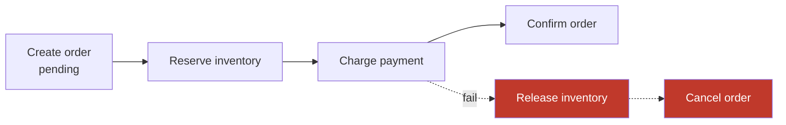

# Saga

> A long transaction split into local steps, each with a compensating action, and no global lock anywhere.

**Group:** Distributed consistency
**Interview framing:** [distributed transactions in grokking-system-design](https://github.com/design-gurus/grokking-system-design/blob/main/patterns/distributed-transactions.md)

## What it is

A business transaction spanning several services, executed as a sequence of local transactions. Each step commits in its own database immediately. If a later step fails, the saga runs **compensating transactions** to undo the earlier ones.

There is no rollback, because everything was already committed. There is only compensation: a new transaction that reverses the business effect of an earlier one. Reserving inventory is compensated by releasing it. Charging a card is compensated by refunding it, and a refund is a different event from a charge that never happened.

## The failure it prevents

The blocking coordinator of [two-phase commit](https://github.com/design-gurus/grokking-system-design/blob/main/patterns/distributed-transactions.md). Two-phase commit holds locks across services for the duration of the transaction, and if the coordinator dies after prepare, participants are stuck holding locks until it returns. Across services owned by different teams, with their own databases, that coupling is unacceptable.

A saga never holds a lock across a service boundary. Each step is a short local transaction, and availability of one service does not block another.

## How it works

Two coordination styles, and the choice matters more than it first appears:

- **Choreography.** Each service listens for events and reacts. No coordinator. Simple for three steps, and by six steps nobody can say what the flow is without reading every service.
- **Orchestration.** A coordinator holds the state machine and tells each service what to do next. One place to read the flow, one place to see where a saga is stuck, and one more component to run.

Start with choreography for two or three steps. Move to orchestration past that, and do it before the flow becomes unreadable rather than after.

Order the steps so the most likely failures happen first, and put the hardest-to-compensate step last. Charging a card before checking inventory means refunding customers for items you never had.

## Knobs and typical numbers

| Knob | Typical starting value | Raise it when | Lower it when |
|---|---|---|---|
| Steps per saga | 3 to 6 | Rarely worth more, and past 8 reconsider the boundaries | Complexity is causing incidents |
| Step timeout | Seconds to minutes, by step | A step involves a human or a slow partner | Users are waiting |
| Saga overall timeout | Minutes to hours | Human approval is in the loop | The user expects a fast answer |
| Compensation retry attempts | Many, with backoff, effectively until success | Compensation must not be abandoned | Never abandon silently |
| Reservation expiry | Slightly longer than the saga timeout | Steps are slow | Inventory is scarce and holds are costly |

Compensation is not optional and not best-effort. A saga that gives up mid-compensation leaves money or inventory in a wrong state, so failed compensations must page a human rather than land quietly in a log.

## Trade-offs

| You gain | You pay |
|---|---|
| No locks held across services, so no blocking coordinator | No isolation: other transactions see intermediate states |
| Each service keeps its own database and deploys independently | A compensating action must be written for every step |
| Scales across teams and across data stores | Failures during compensation need their own handling |
| Long-running flows, including ones with human steps, are natural | The flow is harder to see and to debug than a single transaction |

## Failure modes

- **Missing isolation, and not designing for it.** Between "reserve inventory" and "confirm order", another customer sees inventory that may be released a second later. Sagas give atomicity of a kind and give up isolation entirely. Use reservations with expiry, or a pending status, and make the intermediate state explicit in the model.
- **Compensations that cannot actually compensate.** The email is sent. The physical package shipped. Put irreversible steps last, or add a delay before them so cancellation can still win.
- **Non-idempotent steps or compensations.** Retries are certain, so a compensation applied twice must not double-refund.
- **Compensation that fails and is dropped.** The worst outcome, because the system is now silently inconsistent. Retry hard, then alert a human, and track it as an incident class.
- **Choreography that outgrew itself.** Nine services reacting to each other's events, with the flow existing only in people's heads. Move to orchestration.
- **No saga state persisted.** If the coordinator restarts mid-flow and has not stored which steps completed, it cannot resume or compensate correctly. Saga state must be durable.
- **Dual writes inside a step.** A service commits locally and then publishes an event, and crashes between them. Use the outbox pattern or [change data capture](../data-intensive/change-data-capture.md).

## What to instrument

- **Sagas by state**: running, completed, compensating, compensation-failed. The last one is the alert.
- **Saga duration at p50 and p99**, and count of sagas stuck past the overall timeout.
- **Compensation rate per step**, which shows which step fails most and where to invest.
- **Failed compensations**, which should be zero and must page.
- **Business-level reconciliation**, comparing inventory reserved to inventory confirmed, and charges to orders. This catches inconsistency the application never noticed.
- **Trace id carried through every step**, since debugging without it means reading six services' logs. See [distributed tracing](../operations/distributed-tracing.md).

## Real systems that use it

- **Travel and e-commerce booking flows** are the classic case: reserve seat, reserve hotel, charge card, and release both if the charge fails.
- **Temporal and AWS Step Functions** are orchestration engines that persist workflow state and handle retries and compensation, which removes most of the hand-rolled machinery.
- **Uber's Cadence**, Temporal's predecessor, was built for exactly this shape of long-running multi-service workflow.

## Pairs with

- [Event-driven architecture](../communication/event-driven-architecture.md), the usual substrate for choreography.
- [Idempotency](https://github.com/design-gurus/grokking-system-design/blob/main/patterns/idempotency.md), required by every step and every compensation.
- [Change data capture](../data-intensive/change-data-capture.md), which closes the dual-write hole inside each step.
- [Two-phase commit](https://github.com/design-gurus/grokking-system-design/blob/main/patterns/distributed-transactions.md), the alternative when the participants share a coordinator and locking is acceptable.
- [Dead letter queue](../reliability/dead-letter-queue.md), for steps that will never succeed.

## Go deeper

Covered lesson by lesson, with diagrams and honest trade-offs, in [System Design Patterns](https://www.designgurus.io/course/system-design-patterns?utm_source=github&utm_medium=repo&utm_campaign=design-patterns). For interview framing, see [grokking-system-design](https://github.com/design-gurus/grokking-system-design) and [Grokking the System Design Interview](https://www.designgurus.io/course/grokking-the-system-design-interview?utm_source=github&utm_medium=repo&utm_campaign=design-patterns).
