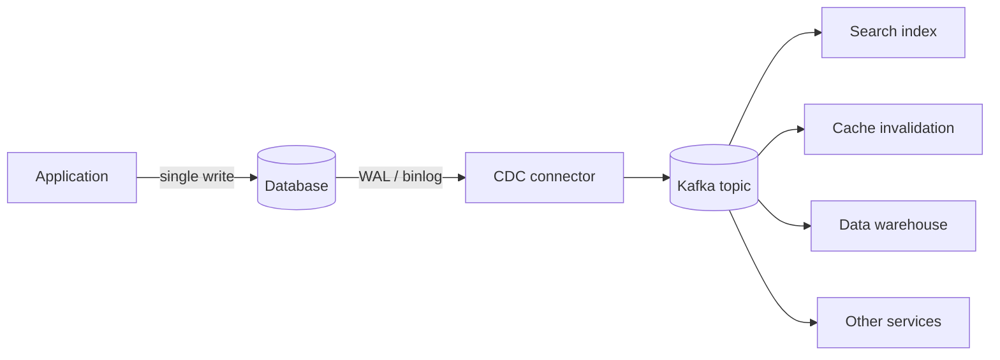

# Change Data Capture

> Turn database writes into a stream, without asking the application to publish anything.

**Group:** Data-intensive
**Also called:** CDC

## What it is

Read the database's own replication log and publish each committed change as an event. Every insert, update, and delete becomes a message, in commit order, with the before and after values.

The database's log is the source of truth for what actually happened. Deriving events from it means the event stream cannot disagree with the data, which is a guarantee no application-level publishing can offer.

## The failure it prevents

The dual write. An application updates its database and then publishes an event. Between those two operations it can crash, the broker can be unreachable, or the transaction can roll back after the event was sent. Any of those leaves the database and the event stream disagreeing, permanently and silently.

There is no way to make two writes to two systems atomic without a distributed transaction. Change data capture sidesteps the problem: there is one write, to the database, and the event is derived from it afterwards.

## How it works

The connector acts as a replica: it reads the write-ahead log or binary log, tracks its position, and publishes. Because it reads the same log replication uses, it sees every change in commit order and misses nothing.

Two phases matter operationally. A **snapshot** reads the existing table contents when the connector first starts, because the log only holds recent history. Then **streaming** picks up from the log position where the snapshot ended. The snapshot of a large table is the slow, load-heavy part, and it needs planning.

The alternative approaches are worth naming so the choice is deliberate:

- **Polling a `updated_at` column.** Simple, misses deletes, misses intermediate states, and needs an index. Fine for low-volume, non-critical sync.
- **Triggers writing to an outbox table.** Reliable and transactional, at the cost of write overhead on every statement.
- **The outbox pattern**, where the application writes an event row in the same transaction and a connector publishes it. This is CDC applied to a table you control, and it gives cleaner event shapes than raw table changes.

That last option is usually the best of both. Raw CDC publishes your internal schema, which then becomes a contract with every consumer.

## Knobs and typical numbers

| Knob | Typical starting value | Raise it when | Lower it when |
|---|---|---|---|
| Replication slot retention | Enough for hours of downtime | Consumers can be down for a long time | Disk fills, which is the danger |
| Snapshot chunk size | Thousands of rows per chunk | The database has headroom | The snapshot is affecting production |
| End-to-end lag target | Under 1 to 5 seconds | Batch consumers | A user is waiting on the derived data |
| Topic partitions | Partition by primary key | Ordering per row must hold | Never partition randomly |
| Tombstone retention for deletes | Long enough for all consumers | Compacted topics need care | Never drop deletes silently |

The replication slot is the operational hazard specific to this pattern. In Postgres, a slot holds write-ahead log segments until the consumer confirms. A stopped connector means the database retains log forever, and the disk fills. Monitor slot lag and alert on it, because the failure is a database outage, not a pipeline outage.

## Trade-offs

| You gain | You pay |
|---|---|
| Events that cannot disagree with the database | The connector is infrastructure to run, monitor, and upgrade |
| No dual write, and no application changes needed | Raw CDC leaks your internal schema to every consumer |
| Full ordering, including deletes and intermediate states | Replication slots can fill the database's disk if the consumer stops |
| A single stream feeding search, cache, warehouse, and services | Initial snapshots put real load on the source database |

## Failure modes

- **A stopped connector filling the disk.** The most damaging failure, because it takes down the source database rather than just the pipeline. Alert on replication lag in bytes, well before the disk is at risk.
- **Schema changes breaking consumers.** A column rename in the database becomes a breaking change in the event stream. This is why the outbox pattern, with an event shape you design, is often better than raw table capture.
- **Snapshot load on production.** Reading a 500 GB table at full speed will affect live queries. Chunk it, throttle it, or snapshot from a replica.
- **Duplicates after a restart.** Delivery is at-least-once. Consumers must be idempotent, keyed by primary key plus log position.
- **Deletes handled as updates.** A consumer that only applies inserts and updates leaves deleted rows in the search index forever. Handle tombstones explicitly.
- **Assuming CDC gives you business events.** A row change is not a business event. Three updates to an order row may represent one business action, and consumers must not infer intent from raw column changes.
- **Capturing sensitive columns.** The stream now carries personal data to every consumer, with different retention and access controls than the database. Filter at the connector.

## What to instrument

- **Replication slot lag in bytes and in time.** This is the alert that prevents a database outage.
- **End-to-end lag**, from commit timestamp to consumer processing, which is the number that matters to downstream users.
- **Connector restarts and snapshot progress**, since a connector that silently restarts and re-snapshots is a load event.
- **Events by operation type**, so a sudden absence of deletes reveals a broken configuration.
- **Schema change events**, which should be reviewed rather than discovered by a failing consumer.

## Real systems that use it

- **Debezium** is the dominant open-source implementation, with connectors for Postgres, MySQL, MongoDB, and others, usually deployed on Kafka Connect.
- **Netflix, Airbnb, and Shopify** all use log-based capture to keep search indexes and derived stores in sync, rather than having services publish those updates themselves.
- **Cloud managed services**, including AWS DMS and Google Datastream, provide the same capability without running the connector infrastructure.

## Pairs with

- [Event-driven architecture](../communication/event-driven-architecture.md), where CDC solves the dual-write problem the architecture creates.
- [Cache-aside](../caching/cache-aside.md), where the change stream drives invalidation instead of application code.
- [Exactly-once semantics](exactly-once-semantics.md), for what the delivery guarantee actually is.
- [Saga](../consistency/saga.md), whose steps use the same technique to publish reliably.
- [Write-ahead log](https://github.com/design-gurus/grokking-system-design/blob/main/patterns/write-ahead-log.md), the mechanism this reads from.

## Go deeper

Covered lesson by lesson, with diagrams and honest trade-offs, in [System Design Patterns](https://www.designgurus.io/course/system-design-patterns?utm_source=github&utm_medium=repo&utm_campaign=design-patterns). For interview framing, see [grokking-system-design](https://github.com/design-gurus/grokking-system-design) and [Grokking the System Design Interview](https://www.designgurus.io/course/grokking-the-system-design-interview?utm_source=github&utm_medium=repo&utm_campaign=design-patterns).
