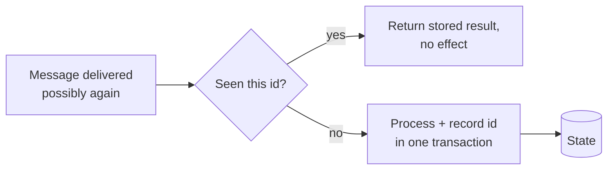

# Exactly-Once Semantics

> What it actually means, why the naive version is impossible, and how real systems get the effect anyway.

**Group:** Data-intensive

## What it is

The guarantee that each message affects the system's state once, no matter how many times it is delivered or reprocessed.

The claim needs care. **Exactly-once delivery over a network is impossible.** The sender cannot distinguish "the message was lost" from "the acknowledgement was lost", so it must either resend (risking a duplicate) or not (risking a loss). This is the Two Generals Problem, and no protocol solves it.

What is achievable is **exactly-once processing**, sometimes called effectively-once: messages may be delivered many times, and the observable effect happens once. That is a property of the consumer and the state store, not of the network.

## The failure it prevents

Duplicate effects that cost real money. A payment message redelivered after a consumer restart charges the card twice. An inventory decrement applied twice oversells stock. An email sent twice is embarrassing, and a refund issued twice is a loss.

At-least-once delivery is the default in nearly every queue and broker, so duplicates are not an edge case. They are guaranteed to happen during any rebalance, restart, or network blip.

## How it works

Three techniques, in order of how widely they apply.

**1. Idempotent consumers.** Make reprocessing harmless. This is the general answer and it works with any broker.

```sql
-- The write and the dedup record commit together, or neither does.
BEGIN;
  INSERT INTO processed_messages (message_id) VALUES ($1);  -- unique constraint
  UPDATE accounts SET balance = balance - $2 WHERE id = $3;
COMMIT;
-- A duplicate violates the unique constraint and the whole transaction aborts.
```

The dedup record and the effect must be in **one transaction**. If they are separate, the consumer can apply the effect and crash before recording it, and the retry applies it again.

**2. Transactional read-process-write, within one system.** Kafka's transactions let a consumer read, process, and write output plus consumer offsets atomically. If the transaction aborts, none of it is visible. This gives exactly-once **within Kafka**, and the boundary is the important part: as soon as output goes to an external database or an email provider, the guarantee ends.

**3. Idempotency keys at the API boundary.** The caller supplies a key. The server stores the key with the result, and a repeat of the same key returns the stored result rather than performing the work again. This is how payment APIs make retries safe.



## Knobs and typical numbers

| Knob | Typical starting value | Raise it when | Lower it when |
|---|---|---|---|
| Dedup key retention | Longer than the maximum possible redelivery window, often 7 days | Replays reach back further | Storage cost, but never below the retry window |
| Dedup store | The same database as the effect | Always, if possible | Only if a separate store can share a transaction |
| Kafka `transactional.id` | Stable per producer instance | Required for fencing zombies | Never random per restart |
| `isolation.level` for consumers | `read_committed` when producers use transactions | Always in that case | Never mix carelessly |
| Idempotency key TTL on an API | 24 hours is common | Clients retry over long periods | Rarely shorter |

The dedup table grows forever without a cleanup job. Partition it by day and drop old partitions, rather than deleting rows, which is slow and creates bloat.

## Trade-offs

| You gain | You pay |
|---|---|
| Duplicates stop producing duplicate effects | Every consumer needs dedup state, stored and cleaned up |
| Retries become safe, which enables everything else | Throughput drops, since transactions and unique checks cost |
| Correctness that survives restarts and rebalances | The guarantee ends at the boundary of the transactional system |
| A clear contract for API clients through idempotency keys | Complexity that is easy to implement subtly wrong |

## Failure modes

- **Believing the broker gives it to you.** Kafka's exactly-once applies to Kafka-to-Kafka flows. The moment you write to Postgres or call Stripe, you are back to at-least-once and need your own idempotency.
- **Dedup record and effect in separate transactions.** The consumer applies the effect, crashes, and the retry applies it again because the dedup record was never committed. This is the classic implementation bug.
- **Non-unique message ids.** A dedup key derived from a timestamp, or from a field that is not actually unique, silently fails to deduplicate.
- **Dedup state expiring too early.** A message redelivered after a week is treated as new because the key was cleaned up after a day.
- **Side effects that cannot be deduplicated.** Sending an email, calling a partner API, or writing to a system with no idempotency support. Wrap those with an idempotency key at the boundary, or accept at-least-once and design for it.
- **Unbounded dedup table.** Works for six months, then the table is the largest in the database and everything slows.
- **Assuming ordering as well.** Exactly-once processing says nothing about order. Those are separate guarantees requiring separate work.

## What to instrument

- **Duplicate detection rate**, counting how often a message was already seen. A sudden rise means something upstream is redelivering.
- **Dedup table size and growth**, plus whether cleanup is running.
- **Transaction abort rate** for transactional producers, which signals fencing or timeouts.
- **Consumer restart and rebalance frequency**, since that is when duplicates arrive.
- **Business-level reconciliation**: total charges versus total orders, run daily. This catches the duplicates that slipped through, which is the only way to know your dedup is actually working.

## Real systems that use it

- **Kafka transactions with `enable.idempotence`** give exactly-once for stream processing within Kafka, and Kafka Streams uses this for its state stores.
- **Stripe's idempotency keys** are the reference design for the API boundary version, storing the response against the key for 24 hours.
- **Flink's checkpointing with two-phase commit sinks** achieves end-to-end exactly-once with sinks that support transactions, and the documentation is explicit that the sink must cooperate.

## Pairs with

- [Idempotency](https://github.com/design-gurus/grokking-system-design/blob/main/patterns/idempotency.md), which is the same idea stated at the API level.
- [Retry with exponential backoff](../reliability/retry-exponential-backoff.md), which is only safe once this exists.
- [Change data capture](change-data-capture.md), which delivers at-least-once and therefore needs it.
- [Partitioned consumption](partitioned-consumption.md), where rebalances are the main source of duplicates.
- [Saga](../consistency/saga.md), whose steps and compensations must both be idempotent.

## Go deeper

Covered lesson by lesson, with diagrams and honest trade-offs, in [System Design Patterns](https://www.designgurus.io/course/system-design-patterns?utm_source=github&utm_medium=repo&utm_campaign=design-patterns). For interview framing, see [grokking-system-design](https://github.com/design-gurus/grokking-system-design) and [Grokking the System Design Interview](https://www.designgurus.io/course/grokking-the-system-design-interview?utm_source=github&utm_medium=repo&utm_campaign=design-patterns).
