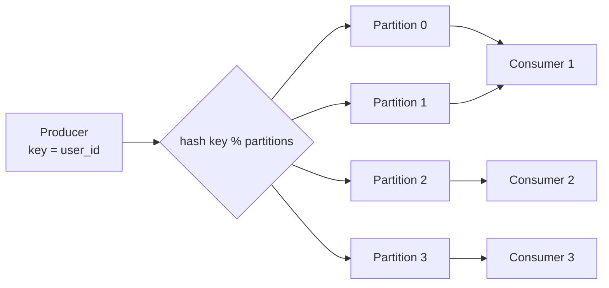

# Partitioned Consumption

> Parallel consumers, with ordering preserved inside each key.

**Group:** Data-intensive

## What it is

Split a stream into partitions by a key. Each partition is consumed by exactly one consumer at a time, so messages sharing a key are processed in order, while different keys are processed in parallel.

This is the compromise between the two things you cannot have together at scale: **strict global ordering** and **parallel processing**. You get ordering where it matters (per user, per order, per account) and parallelism everywhere else.

## The failure it prevents

Two failures, one on each side.

Without partitioning, ordering forces a single consumer. One thread processing every message means throughput is capped by one machine, and a backlog can never be cleared faster than it accumulates.

Without ordering, parallel consumers process a user's `AddressChanged` and `OrderShipped` in whichever order they happen to run, and the package goes to the old address. The bug appears under load and disappears when you try to reproduce it.

## How it works

The producer hashes the key to choose a partition, so all messages for one user always land on the same partition. The broker assigns partitions to consumers in a group, one consumer per partition. Adding a consumer triggers a **rebalance**, which reassigns partitions.

Two numbers follow from this and both matter:

- **Maximum parallelism equals partition count.** Twelve partitions means at most twelve useful consumers. The thirteenth sits idle.
- **Partition count is hard to change.** Adding partitions changes the hash mapping, so a key that used to go to partition 3 now goes to partition 7, and its ordering guarantee is broken across the change. Most systems do not allow removing partitions at all.

Choose the key by asking what must stay ordered. Order id keeps one order's events in sequence. User id keeps one user's events in sequence and is usually the better choice, since events across a user's orders often interact.

## Knobs and typical numbers

| Knob | Typical starting value | Raise it when | Lower it when |
|---|---|---|---|
| Partition count | 2 to 3 times the expected maximum consumer count | Consumer lag persists at full parallelism | Rarely possible, so start generously |
| Consumers per group | At most one per partition | Never more, they idle | Fewer if each handles multiple partitions well |
| Max poll interval | Longer than the slowest batch processing time | Processing is slow, or the consumer is evicted mid-work | Faster failure detection needed |
| Session timeout | 10 to 45 seconds | Network is unreliable | Faster rebalance on genuine failure |
| Batch size | 100 to 500 messages | Throughput matters | Long batches risk exceeding the poll interval |

Over-provision partitions at creation. Doubling them later means either accepting broken ordering across the boundary or replaying into a new topic, and both are painful.

## Trade-offs

| You gain | You pay |
|---|---|
| Parallel throughput with per-key ordering intact | Ordering only within a partition, never across the topic |
| Consumers scale by adding instances up to the partition count | Partition count caps parallelism and is hard to change |
| Failure of one consumer only stalls its partitions | Rebalances pause consumption and can cause duplicates |
| A natural sharding model for consumer state | Hot keys create hot partitions that no amount of scaling fixes |

## Failure modes

- **Hot partitions.** One key, such as a very large tenant or a celebrity account, generates a large share of traffic. That partition's consumer is saturated while the others idle, and adding consumers does nothing. Fix by adding a suffix to the key for high-volume entities, accepting that ordering is lost for those keys, or routing them to a dedicated topic.
- **Rebalance storms.** A consumer takes too long between polls, the group evicts it, that triggers a rebalance, which pauses everyone, which makes another consumer slow. Set the poll interval above the p99 batch processing time, and use cooperative rebalancing where available.
- **Null or missing keys.** Messages with no key are distributed round-robin, so they have no ordering guarantee at all. This is easy to do by accident.
- **Assuming order across partitions.** Two events for different users are unordered relative to each other, and consumers sometimes assume otherwise.
- **A poison message blocking a partition.** One message that always fails blocks everything behind it on that partition, while other partitions run normally. The symptom is confusing: partial throughput. Route failures to a [dead letter queue](../reliability/dead-letter-queue.md).
- **More consumers than partitions.** Extra instances consume nothing while consuming budget.
- **Duplicates after rebalance.** Offsets committed after processing means a rebalance can replay recent messages. Consumers must be idempotent.

## What to instrument

- **Lag per partition, not just per topic.** The average hides the hot partition entirely, and the hot partition is the problem.
- **Message rate per partition**, which shows key skew directly.
- **Rebalance count and rebalance duration**, since frequent rebalances mean consumption is repeatedly paused.
- **Processing time per batch at p99**, which is what the poll interval must exceed.
- **Assigned partitions per consumer**, to catch idle consumers and uneven assignment.
- Alert on per-partition lag in seconds, and on any partition whose rate is far above the median.

## Real systems that use it

- **Apache Kafka** is the reference: consumer groups, partitions, and key-based routing are the whole model, and cooperative rebalancing was added specifically to reduce rebalance pauses.
- **AWS Kinesis** uses shards with the same properties, including the same difficulty around resharding.
- **Azure Event Hubs** and **Google Pub/Sub with ordering keys** implement equivalent semantics with different resharding behavior.

## Pairs with

- [Publish-subscribe](../communication/publish-subscribe.md), which this is the consumption side of.
- [Consistent hashing](https://github.com/design-gurus/grokking-system-design/blob/main/patterns/consistent-hashing.md), the technique that makes repartitioning less disruptive.
- [Exactly-once semantics](exactly-once-semantics.md), because rebalances are the main source of duplicates.
- [Dead letter queue](../reliability/dead-letter-queue.md), for the poison message that would otherwise block a partition.
- [Backpressure](https://github.com/design-gurus/grokking-system-design/blob/main/patterns/backpressure.md), for when consumers cannot keep up at all.

## Go deeper

Covered lesson by lesson, with diagrams and honest trade-offs, in [System Design Patterns](https://www.designgurus.io/course/system-design-patterns?utm_source=github&utm_medium=repo&utm_campaign=design-patterns). For interview framing, see [grokking-system-design](https://github.com/design-gurus/grokking-system-design) and [Grokking the System Design Interview](https://www.designgurus.io/course/grokking-the-system-design-interview?utm_source=github&utm_medium=repo&utm_campaign=design-patterns).
