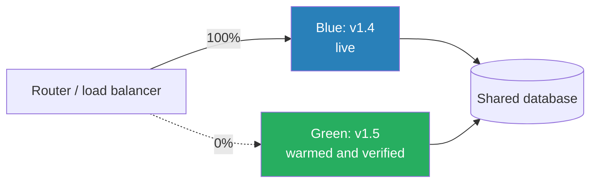

# Blue-Green Deployment

> Two complete environments and one switch. The rollback is as fast as the release.

**Group:** Operations

## What it is

Run two identical production environments. Blue serves live traffic. Green sits idle, running the new version. When green is verified, the router switches all traffic to it in one step. Blue stays running, untouched, as the rollback target.

The value is asymmetric and worth stating plainly: this pattern is not primarily about deploying. It is about **undoing**. Rollback becomes flipping the switch back, which takes seconds, rather than redeploying the old version, which takes as long as a deploy plus the time to decide.

## The failure it prevents

A bad release that takes twenty minutes to undo. Without blue-green, rolling back means starting a new deployment pipeline with the previous artifact, waiting for the build, the rollout, and the health checks, all while the incident continues. Blue-green makes that decision reversible in seconds, which changes how willing a team is to ship.

## How it works

The steps: deploy to green, run smoke tests against green directly, warm its caches and connection pools, switch the router, watch, and keep blue running for a defined window before releasing it.

**The database is the hard part, and it is the reason this pattern is often misapplied.** Both environments share one database, so the schema must work with both versions at once. That forces expand-and-contract migrations:

1. **Expand.** Add the new column, nullable, with a default. Both versions work.
2. **Deploy** the version that writes both old and new.
3. **Backfill** existing rows.
4. **Deploy** the version that reads the new column.
5. **Contract.** Drop the old column, in a later release.

Steps 1 and 5 are separate deployments, often days apart. A migration that drops a column in the same release as the code change makes rollback impossible, and that removes the entire benefit.

## Knobs and typical numbers

| Knob | Typical starting value | Raise it when | Lower it when |
|---|---|---|---|
| Time to keep the old environment | 1 to 24 hours after switch | Problems surface slowly | Infrastructure cost is high |
| Warm-up before switch | Until caches and pools are ready, often 2 to 10 minutes | Cold start is expensive | Startup is genuinely fast |
| Connection drain on the old environment | 30 to 300 seconds | Long-lived connections or slow requests | Requests are short |
| Verification window before releasing blue | 15 to 60 minutes of live traffic | Slow-burning issues are a concern | High confidence and cost pressure |
| Cost during deploy | 2x for the overlap period | Unavoidable for this pattern | Consider canary instead |

## Trade-offs

| You gain | You pay |
|---|---|
| Rollback in seconds, by switching back | Double the infrastructure during the overlap |
| The new version is tested in the real environment before traffic | The database is shared, so schema changes need expand-and-contract |
| A clean cutover with no mixed-version window for stateless traffic | Long-lived connections and sessions need handling at the switch |
| Simple to reason about: one switch, one thing to undo | All users move at once, so a bad release affects everyone briefly |

## Failure modes

- **A migration that breaks the old version.** Dropping or renaming a column with the deploy means blue no longer works, so there is nothing to roll back to. This is the single most common way teams lose the benefit while paying the cost.
- **Data written by green that blue cannot read.** Rolling back leaves rows the old version chokes on. New columns must be additive and optional until the old version is retired.
- **Cold green.** Traffic switches to an environment with empty caches and unopened connections, and latency spikes for several minutes. Warm before switching.
- **Stateful connections dropped at the switch.** WebSockets, server-sent event streams, and long polls all break. Drain them, or accept and plan the reconnect.
- **Releasing blue too early.** The problem appears forty minutes after the switch, and the rollback target is gone.
- **In-flight background jobs.** A job started on blue and finishing after the switch may write with the old logic. Drain workers as deliberately as web traffic.
- **Configuration drift between environments.** Green differs from blue in an environment variable nobody tracked, so the test on green proved nothing. Both environments must come from the same definition.

## What to instrument

- **Error rate and p99 latency, split by environment**, before and after the switch. Without the split, you cannot tell whether the new version is the cause.
- **Time to switch and time to roll back**, measured in real releases, not in theory. Rollback that has never been exercised does not work.
- **Warm-up completeness**: cache hit ratio and connection pool state on green before the switch.
- **Requests dropped during cutover**, which should be zero.
- **Age of the standby environment**, so nobody releases it early by accident.
- **Schema compatibility checks in CI**, verifying that the previous application version still passes against the new schema. This is the automation that prevents the top failure mode.

## Real systems that use it

- **AWS CodeDeploy and Elastic Beanstalk** offer blue-green as a built-in deployment mode with automated traffic shifting and rollback.
- **Kubernetes** implements it with two Deployments and a Service selector change, which is a one-field edit and is genuinely instant.
- **Database teams** use expand-and-contract independently of blue-green, and tools such as gh-ost and pt-online-schema-change exist because the schema half of this problem is the hard half.

## Pairs with

- [Canary deployment](canary-deployment.md), the alternative that shifts traffic gradually rather than all at once.
- [Feature flags](feature-flags.md), which separate releasing a feature from deploying the code and reduce how often a full rollback is needed.
- [Health check endpoint](https://github.com/design-gurus/grokking-system-design/blob/main/patterns/heartbeats.md), which gates whether green is ready to receive traffic.
- [Change data capture](../data-intensive/change-data-capture.md), for keeping data in sync when environments genuinely cannot share a database.

## Go deeper

Covered lesson by lesson, with diagrams and honest trade-offs, in [System Design Patterns](https://www.designgurus.io/course/system-design-patterns?utm_source=github&utm_medium=repo&utm_campaign=design-patterns). For interview framing, see [grokking-system-design](https://github.com/design-gurus/grokking-system-design) and [Grokking the System Design Interview](https://www.designgurus.io/course/grokking-the-system-design-interview?utm_source=github&utm_medium=repo&utm_campaign=design-patterns).
